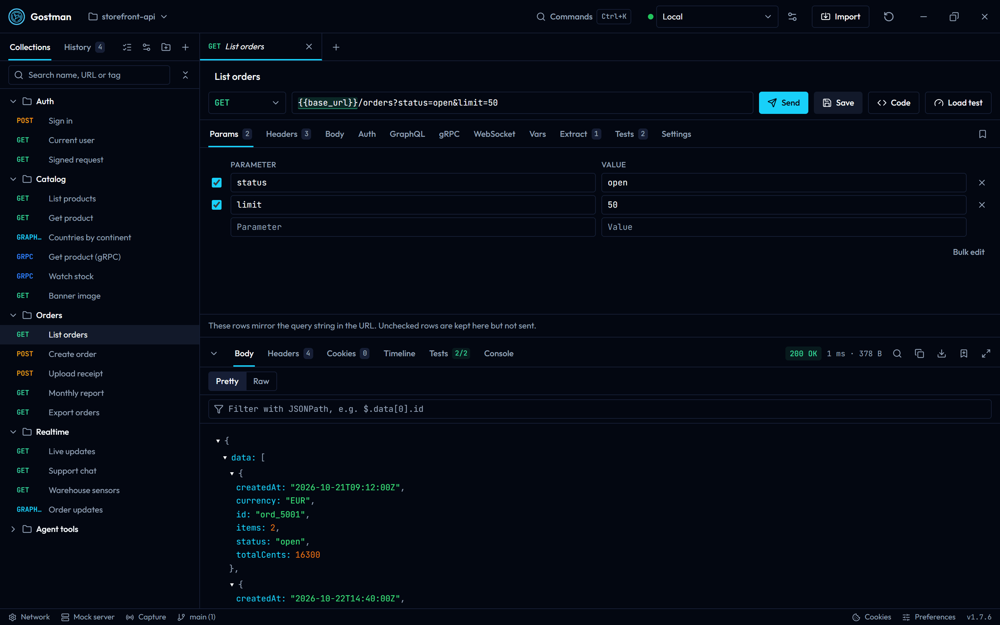
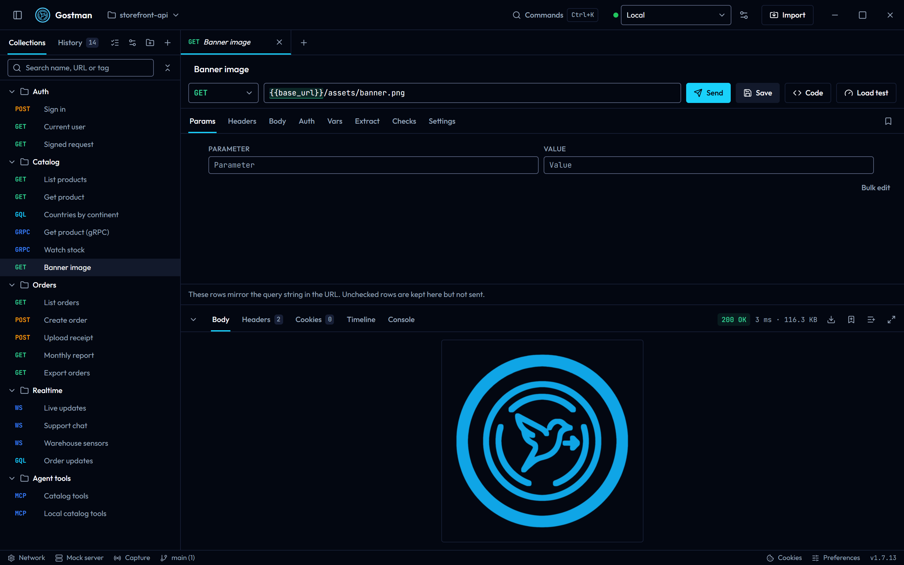
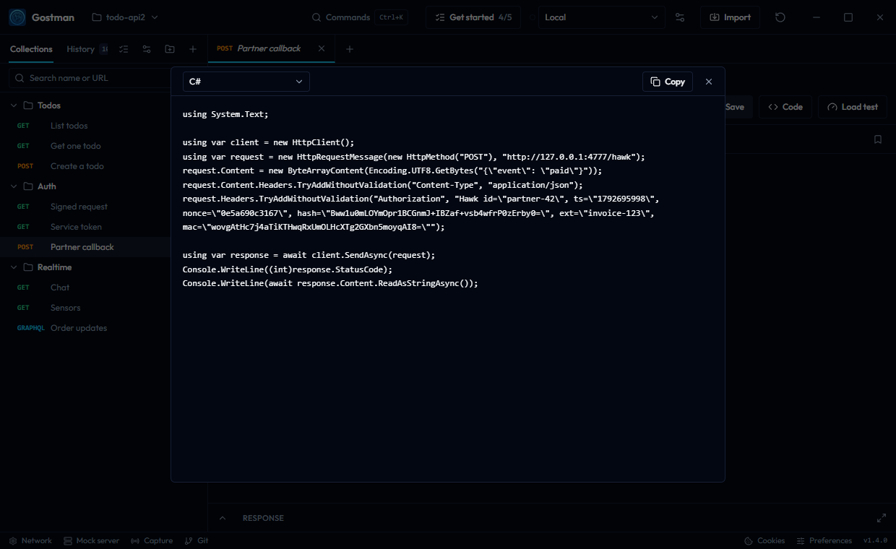

<div align="center">
  
  <h1>Gostman</h1>
  <p>An API client for REST, GraphQL, gRPC and WebSocket that you, your CI pipeline and your coding agent share. Desktop app, web app and command line, no account.</p>

  [](https://github.com/kunalgoesbyken/gostman/actions/workflows/ci.yml)
  [](https://github.com/kunalgoesbyken/gostman/releases/latest)
  [](LICENSE)

  <p>
    <a href="https://gostman.vercel.app/web"><strong>Open the web app</strong></a> ·
    <a href="https://github.com/kunalgoesbyken/gostman/releases/latest">Download for Windows, macOS and Linux</a> ·
    <a href="#features">Features</a>
  </p>
  <p>No account. Your requests stay on your device. The web app installs as an app and works offline.</p>
</div>



| | |
| --- | --- |
|  |  |
|  |  |
|  |  |

Gostman is a native desktop application built with Go and [Wails](https://wails.io), with the same interface available in the browser at [gostman.vercel.app](https://gostman.vercel.app). Requests, collections and environments are stored on your machine. There is nothing to sign in to.

## Features

**Requests**

- REST with any method, GraphQL, gRPC, WebSocket and MCP servers
- MCP servers over Streamable HTTP: load the tools, call one with JSON arguments, assert on the result
- gRPC services loaded through server reflection or from `.proto` files, for unary and streaming methods
- Query parameters and headers as rows you can switch on and off
- Bodies: JSON, text, XML, form URL-encoded, multipart with file uploads, or a single file
- Auth helpers: Basic, Bearer token, API key (header or query) and OAuth 2.0 (client credentials, password, authorization code with PKCE) with automatic token renewal
- A cookie jar that stores response cookies and sends them back, with a manager to inspect and delete them
- Per-request timeout, redirect and TLS verification settings
- Paste a `curl` command into the URL bar to turn it into a request

**Responses**

- JSON tree and raw views, HTML preview, inline images and PDFs
- Headers, cookies, status, size and timing
- Download any response body, including binary ones
- Cancel a request in flight

**Workflow**

- Collections with nested folders, tabs, history and search
- Environments with `{{variable}}` substitution in URLs, headers, bodies and auth
- Extraction rules that copy values from a response (JSON path, header, cookie or status code) into variables after every send, for chaining requests
- Assertions, and pre-request and post-response scripts with `test()` and `expect()`, run in a sandbox
- A runner that sends every request in a folder in order and reports each failed check
- Collections as plain YAML files in a folder, ready for Git (desktop)
- Saved response examples and a local mock server that serves them (desktop)
- A `gostman` command line for CI, and an MCP server so coding agents can use the same collection
- Traffic capture through a local forwarding address, saved as requests and examples (desktop and CLI)
- Encrypted share links and files that are never uploaded, and a generated HTML documentation page
- GraphQL schema introspection, query formatting and validation
- Code generation for curl, JavaScript, Python, Go, PHP and Java
- Server-Sent Events and SOAP requests, with WSDL import
- Auth also covers OAuth 1, Digest, AWS SigV4, NTLM and Akamai EdgeGrid
- A Git panel (desktop): diff, commit, push, branches, stash and conflict resolution
- Secret managers: HashiCorp Vault, AWS, Azure and Google Cloud
- Import from Postman, OpenAPI, Insomnia, HAR, WSDL, Bruno and curl; export to Postman, OpenAPI, HAR, Bruno, Markdown or a Gostman backup

## Install

Download the latest build from the [releases page](https://github.com/kunalgoesbyken/gostman/releases/latest).

| Platform | File | Notes |
| --- | --- | --- |
| Windows | [`Gostman-windows-amd64.exe`](https://github.com/kunalgoesbyken/gostman/releases/latest/download/Gostman-windows-amd64.exe) | Installer. Adds Start menu and desktop shortcuts and an uninstaller. |
| Windows | [`Gostman-windows-amd64-portable.exe`](https://github.com/kunalgoesbyken/gostman/releases/latest/download/Gostman-windows-amd64-portable.exe) | Single executable, no installation. |
| macOS | [`Gostman-darwin-universal.dmg`](https://github.com/kunalgoesbyken/gostman/releases/latest/download/Gostman-darwin-universal.dmg) | Intel and Apple Silicon. Drag Gostman to Applications. |
| Linux | [`Gostman-linux-amd64.deb`](https://github.com/kunalgoesbyken/gostman/releases/latest/download/Gostman-linux-amd64.deb) | Debian and Ubuntu. `sudo apt install ./Gostman-linux-amd64.deb` |
| Linux | [`Gostman-linux-amd64.tar.gz`](https://github.com/kunalgoesbyken/gostman/releases/latest/download/Gostman-linux-amd64.tar.gz) | Other distributions. `sudo tar -xzf Gostman-linux-amd64.tar.gz -C /` Requires GTK 3 and WebKitGTK 4.1. |

The builds are not code-signed yet, so the operating system asks for confirmation the first time:

- **Windows**: SmartScreen shows "Windows protected your PC". Choose **More info**, then **Run anyway**.
- **macOS**: right-click Gostman in Applications and choose **Open**, then confirm.

Windows needs the WebView2 runtime, which ships with Windows 10 and 11; the installer fetches it when it is missing.

## Web version

[gostman.vercel.app](https://gostman.vercel.app) runs the same interface in the browser. Browsers cannot call arbitrary APIs directly, so requests are relayed through a small proxy. Two consequences:

- The hosted proxy cannot reach `localhost` or private network addresses. Use the desktop app for local APIs.
- Proxy, CA certificate and client certificate settings exist only in the desktop app.
- A gRPC stream is collected and shown when it ends; messages for a client stream are written up front as a JSON array.
- Responses larger than 3 MB are truncated. The desktop app reads up to 50 MB.

Data in the web version is kept in the browser's local storage.

## Command line

Each release includes `gostman-cli-<os>-<arch>` archives with a single `gostman` binary. It can also be built with `go build ./cmd/gostman`.

```bash
gostman run orders-api --env CI --var-from-env API_TOKEN --reporter junit --output report.xml
gostman send --workspace orders-api "Create user" --select '$.id'
gostman mock orders-api --port 4010
gostman capture --upstream https://api.example.com --workspace orders-api
gostman docs orders-api --output docs.html
```

- `run` takes a workspace folder or a Gostman export and sends every request in order with its scripts, extraction rules, cookies, OAuth 2.0 tokens and checks. It exits 0 when everything passed, 1 when a request or a check failed and 2 when the command or input is wrong. A 4xx or 5xx status alone is not a failure; add a check such as `res.status equals 200`.
- `send` sends one saved request, or an ad hoc one (`gostman send GET https://example.com -H 'Accept: application/json'`), and prints a short JSON summary followed by the body.
- `mock` serves the saved examples of a workspace on `127.0.0.1`; `--openapi spec.yaml|url` serves a spec's operations instead or as well, `--delay`, `--delay-max`, `--error-rate` and `--error-status` add latency and failures, and `--log` prints each request's headers and body with credentials masked.
- `capture` forwards everything sent to `127.0.0.1:4020` on to one API, prints each call, and with `--workspace` saves each new method and path as a request with its response as an example.
- `docs` writes the collection as one self-contained HTML page.
- `--var name=value` sets a variable and `--var-from-env NAME` reads it from the environment, so secrets stay out of the files. `--redact` replaces variable values and credentials in a report with `{{name}}`.
- Secret managers: an environment variable can read its value from HashiCorp Vault (KV 1 and 2), AWS Secrets Manager, Azure Key Vault or Google Cloud Secret Manager. The collection stores only a reference (connection name, path, field, version); the connection is yours. Connections named `vault`, `aws`, `azure` or `gcp` read the standard variables: `VAULT_ADDR`, `VAULT_TOKEN` (or `VAULT_ROLE_ID` with `VAULT_SECRET_ID`), `VAULT_NAMESPACE`; `AWS_REGION`, `AWS_ACCESS_KEY_ID`, `AWS_SECRET_ACCESS_KEY`, `AWS_SESSION_TOKEN`; `AZURE_KEYVAULT_URL` with `AZURE_ACCESS_TOKEN` or `AZURE_TENANT_ID`, `AZURE_CLIENT_ID`, `AZURE_CLIENT_SECRET`; `GOOGLE_OAUTH_ACCESS_TOKEN` (for example from `gcloud auth print-access-token`) and `GOOGLE_CLOUD_PROJECT`. Another name such as `prod-vault` is set up with `GOSTMAN_SECRETS_PROD_VAULT_KIND=vault` plus `GOSTMAN_SECRETS_PROD_VAULT_ADDRESS`, `..._TOKEN` and so on. Secret references are only read when the run opts in with `--secrets` (credentials from the process environment) or `--secrets-env-file secrets.env` (the same variables from a KEY=value file; the process environment wins), so a collection you did not write cannot use the credentials of your shell or CI job. A reference that cannot be read stops the run before anything is sent. Values are replaced in `--redact` reports and in `send` and `mcp` output. Even with the flag, a collection chooses which paths are read, so only pass it for collections you trust. The apps resolve references in the desktop app only, from connections set up under Secret managers; the web version cannot reach them.
- Data-driven runs: `--data users.csv` (header row, UTF-8, quoted fields may hold commas and line breaks) or `--data users.json` (an array of objects) runs the whole collection once per row. A row's columns become variables and override the environment and `--var`; every value from a CSV is text. `iteration` (from 1) and `iterationCount` are set for scripts and `{{iteration}}` in requests. `--iterations n` repeats a run n times, or uses only the first n rows. Each iteration starts from the environment's variables again.
- Parallel runs: `--parallel n` sends up to n at once. With several iterations, whole iterations run side by side and each keeps its own order and extraction chaining. With one iteration, single requests run side by side and do not see each other's extracted variables, so use it for independent requests. Cookies and OAuth 2 tokens are shared between workers, and a token is fetched once.
- Other run flags: `--only "Folder/Name"` (name, id or path, repeatable), `--bail`, `--delay ms`, `--timeout ms`, `--env-file .env` (KEY=value lines, `--var` wins) and `--insecure`, which is off unless you pass it.
- Reports: `--reporter text|json|junit|html`. `--reporter html --output report.html` writes one self-contained page with a summary, every request's timing, checks, request and response, and a filter for failures; response bodies are included, so add `--redact` before sharing it. The desktop and web runner dialogs take a data file and a parallel count the same way and can download the same report; there, iterations run one after another and the parallel count applies inside each. Colour is off when `NO_COLOR` is set or the output is not a terminal.
- On macOS the binary is not notarized: run `xattr -d com.apple.quarantine gostman` once.

`gostman help` lists every flag.

With Go installed: `go install github.com/kunalgoesbyken/gostman/cmd/gostman@latest`.

### Docker and CI

```bash
docker build -t gostman .
docker run --rm -v "$PWD:/workspace" -e API_TOKEN gostman run api --var-from-env API_TOKEN
```

The image is distroless, static and runs as a non-root user. In GitHub Actions:

```yaml
- uses: kunalgoesbyken/gostman@main
  with:
    collection: api
    reporter: junit
    output: report.xml
```

[docs/ci.md](docs/ci.md) has exit codes, reports, secrets, and GitLab CI, Jenkins and plain GitHub Actions recipes.

## Use from a coding agent

`gostman mcp` serves a workspace over the Model Context Protocol, so Claude Code, Codex, Cursor and other MCP clients can call your APIs through Gostman in place of `curl`.

```bash
gostman init api
claude mcp add gostman -- gostman mcp --workspace api --var-from-env API_TOKEN
```

For other clients, register the command `gostman` with the arguments `mcp --workspace api`.

The agent gets these tools: `list_requests`, `get_request`, `send_request`, `run_folder`, `save_request`, `list_environments`, `set_environment`, `start_mock`, `stop_mock` and `mock_status`.

What this gives you over a shell command:

- **Secrets stay out of the conversation.** Requests reference `{{name}}`; values are filled in inside Gostman and replaced with their names in everything returned, including URL-encoded, base64 and JSON-escaped echoes. Variable values shorter than six characters are not treated as secrets; passwords, tokens and keys in a request's auth settings are, from three characters. This guards against accidental exposure; it is not a barrier against a value the server returns in a transformed form.
- **The agent can only call hosts your collection already uses**, plus localhost. Add more with `--allow-host api.example.com`, or `--allow-host '*'` for any. Requests an agent saves never widen this list.
- **State carries across calls.** Cookies, OAuth 2.0 tokens and variables last for the session.
- **Small answers.** Bodies are capped at 8 KB by default and can be narrowed with a JSONPath.
- **Shared work.** Requests the agent saves are YAML files in the workspace, visible in the app and in Git. An agent cannot save a literal credential.

The OAuth 2.0 authorization code grant and WebSocket requests are not available to agents.

## Folders and Git (desktop)

The control next to the logo shows where the collection lives. **Open folder** keeps it as files: `gostman.yaml`, one YAML file per request, one directory per folder and `environments/<name>.yaml`.

- OAuth tokens, cookies, history, network settings and open tabs are never written to the folder.
- Values typed into environments and auth fields are written as typed. Keep secrets in an environment file that Git ignores, or pass them at run time.
- After a `git pull`, choose **Reload from disk**. Files that cannot be read are listed and left untouched.
- A folder you did not create opens with its scripts and OAuth 2.0 settings switched off until you choose **Trust this folder**.

## Examples and the mock server (desktop)

Save any response as a named example from the response panel (up to 20 per request, 2 MB each; cookie and authorization headers are not kept). The mock server, opened from the header, serves each request's method and path with one of its examples on `127.0.0.1`.

- `{{base_url}}/users/42` is served at `/users/42`; a literal base path such as `/v1` is kept. Segments written `:id`, or holding an unresolved variable, match anything.
- GraphQL, gRPC and WebSocket requests, and requests without an example, are not served.
- Examples travel with exports and workspace folders, so they can contain whatever the response body held.
- **From OpenAPI spec**: load a spec from an address or a file and every operation becomes a route (base path from `servers`, `{id}` segments typed by the spec, status codes, headers and example bodies from the spec). Operations without an example answer with an empty body.
- **Rules** run before the routes, in the order listed; the first match wins. A rule can match the method, a path template, query parameters, headers and JSON body values (`$.user.name`) and then override the status, headers and body, or only answer its Nth match.
- **Templating**: response bodies and headers can use `{{request.params.id}}`, `{{request.query.x}}`, `{{request.header.x}}`, `{{request.body.json.path}}` and the dynamic variables `{{$guid}}`, `{{$timestamp}}`, `{{$randomInt}}`. Missing values render empty, and values are escaped inside JSON responses.
- **Behavior**, for the whole server or one route or rule: a fixed or ranged delay, a slow body, and failures (an error status, a connection reset or an empty reply) at a chosen rate. CORS is off by default; when on, only localhost origins (any port, `127.0.0.1`, `[::1]`) are answered, and the CLI's repeatable `--cors-origin https://app.example.com` adds exact extra origins. Other origins get no CORS headers.
- **Log**: the last 500 requests with headers and body (up to 4 KB). Credential-like header names and query parameters show as `***`.
- Rules, per-route options and an imported spec are saved in `.gostman/mock.yaml` of a workspace folder, or in the app data folder otherwise. The server binds to `127.0.0.1` only, refuses other `Host` headers, never reads files, and caps request bodies at 10 MB, responses at 10 MB, routes at 10,000 and rules at 200.

## Capture (desktop and CLI)

Start a capture with the address of your API, then point your app at `http://127.0.0.1:4020`. Gostman forwards each call, lists it, and lets you save any of them as a request with its response as an example.

- It is a forwarding address for one API, not an intercepting proxy: there is no certificate to install, and an app whose base URL cannot be changed is not captured.
- `Authorization`, `Cookie` and `Proxy-Authorization` request headers are never saved. Bodies are saved as captured, so check them for tokens before sharing.
- Only requests from localhost pages are forwarded. On an Android emulator use `adb reverse tcp:4020 tcp:4020`.

## Sharing and documentation

The **Share** tab of the import dialog encrypts a folder or the whole collection in your window (AES-256-GCM) and gives you a link, or an encrypted file plus a key. Nothing is uploaded: the key sits after the `#` in the link, which browsers do not send to servers.

- Anyone holding the whole link can open it. Use a passphrase, or the file with the key sent separately, for anything sensitive.
- Variable values and saved responses are left out unless you tick them. OAuth tokens, cookies and history are never included.
- The recipient sees what is inside before importing, and their own variable values are kept.
- A link carries up to 32 KB; larger selections go as a file.

**Export → HTML docs** (or `gostman docs`) writes one self-contained documentation page: every request with its description, parameters, headers, body, a curl example and saved examples. Values in auth settings, credential headers and parameters with names such as `token` or `key` are shown as `<redacted>`; other literal secrets in bodies are not detected, so review the page before publishing.

## Variables

Define variables per environment as a JSON object and reference them anywhere with `{{name}}`.

## Tests and scripts

The Tests tab of a request holds assertions (`res.status equals 200`, `res.body.user.id is a number`) and pre-request and post-response scripts. Scripts are JavaScript with `req`, `res`, `env.get()` / `env.set()`, `test(name, fn)` and Chai's `expect()`. They run in an isolated worker with no network access and are stopped after 10 seconds. Results appear in the Tests tab of the response, and the runner applies the same checks to every request in a folder.

### Network settings (desktop)

The gear icon in the header opens the proxy and certificate settings: use the system proxy, none, or a custom HTTP, HTTPS or SOCKS5 proxy with a bypass list; add a CA certificate; and attach client certificates to hosts. Certificates and keys are PEM files, and keys must not be passphrase-protected.

### OAuth 2.0 callback

For the authorization code grant, register the callback URL shown in the Auth tab with your provider. The desktop app listens on `http://localhost:9876/callback` by default and the address can be changed; the web version uses `/oauth-callback` on its own origin.

## Development

Requirements: Go 1.24.5 or newer, Node.js 20 or newer, and the [Wails CLI](https://wails.io/docs/gettingstarted/installation) v2.11.

```bash
git clone https://github.com/kunalgoesbyken/gostman.git
cd gostman
```

Desktop app with hot reload:

```bash
cd gostman-gui
wails dev
```

Web app (two terminals):

```bash
go run ./cmd/local            # request proxy on :8787, from the repository root
```

```bash
cd gostman-gui/frontend
npm install
npm run dev:web               # http://localhost:3000
```

Production builds:

```bash
cd gostman-gui && wails build                 # desktop binary in build/bin
cd gostman-gui/frontend && npm run build:web  # static site in dist-web
```

Checks run by CI:

```bash
go build ./... && go vet ./...                           # repository root
cd gostman-gui && go build ./... && go vet ./...
cd gostman-gui/frontend && npm run build && npm run build:web
```

### Layout

| Path | Contents |
| --- | --- |
| `engine/` | Go package that prepares and sends requests. Shared by the desktop app and the web proxy, so both behave the same. |
| `rpc/` | Go package for gRPC: reflection, `.proto` compilation and calls. |
| `workspace/` | A collection as YAML files in a folder. |
| `runner/` | The send pipeline in Go for the command line, running the app's script code in an embedded JavaScript engine. |
| `mock/` | The mock server. |
| `agent/`, `mcp/`, `redact/` | The MCP server, its tools and the redaction of secrets. |
| `mcpclient/` | The MCP client used to test MCP servers. |
| `capture/`, `loopback/` | The forwarding capture and the localhost-only listener it shares with the mock server. |
| `cmd/gostman/` | The `gostman` command line. |
| `gostman-gui/` | Wails desktop application: `app.go` (bindings and storage), `websocket.go`, packaging assets in `build/`. |
| `gostman-gui/frontend/` | React interface used by both targets. `src/App.jsx` is the desktop entry, `src/WebApp.jsx` the web entry. |
| `api/` | Vercel serverless functions. `proxy.go` exposes the engine to the web app. |
| `cmd/local/` | The same proxy as a local server for development. |

### Releasing

Releases are automatic. Change `info.productVersion` in `gostman-gui/wails.json` and push to `main`. If no release exists for that version, the workflow builds the installers on Windows, macOS and Linux and publishes them as `v<version>`.

## Contributing

Issues and pull requests are welcome. For anything larger than a small fix, please open an issue first to agree on the approach.

## License

[MIT](LICENSE)
