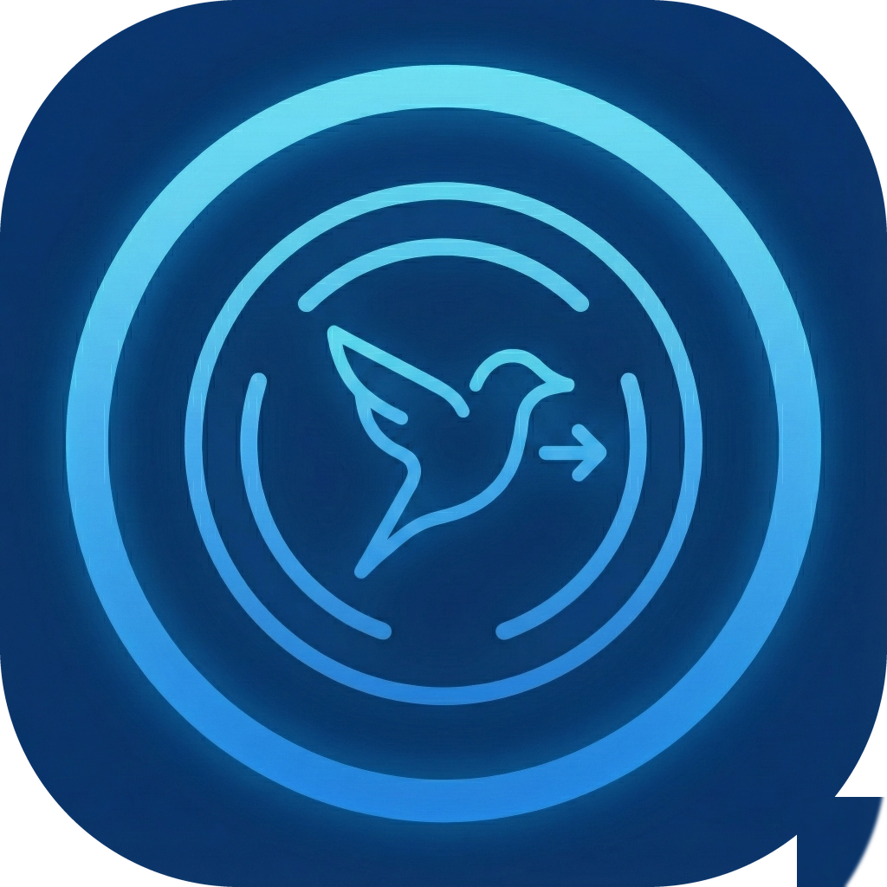
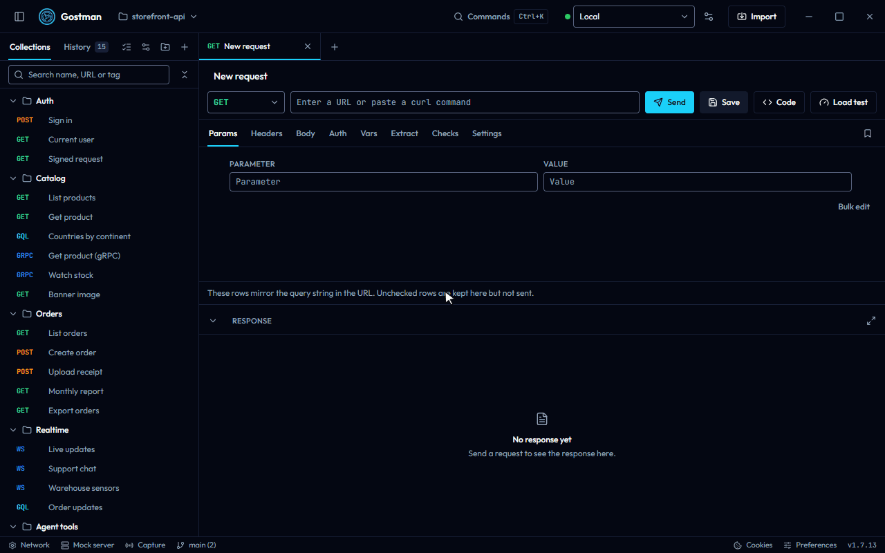
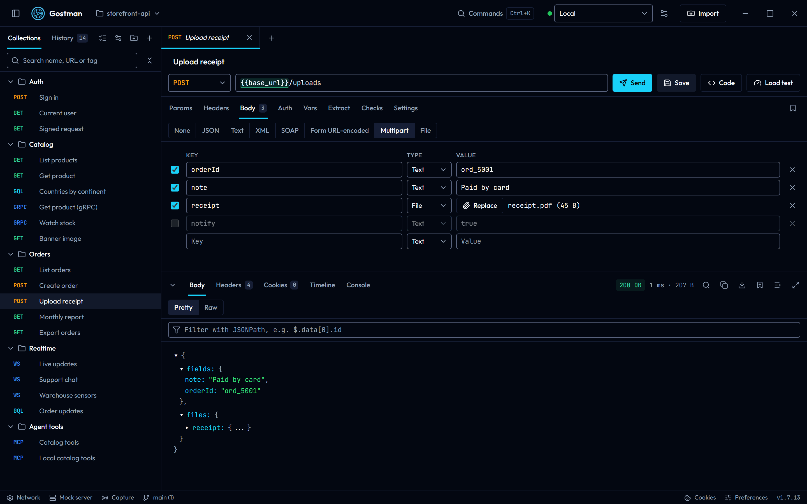
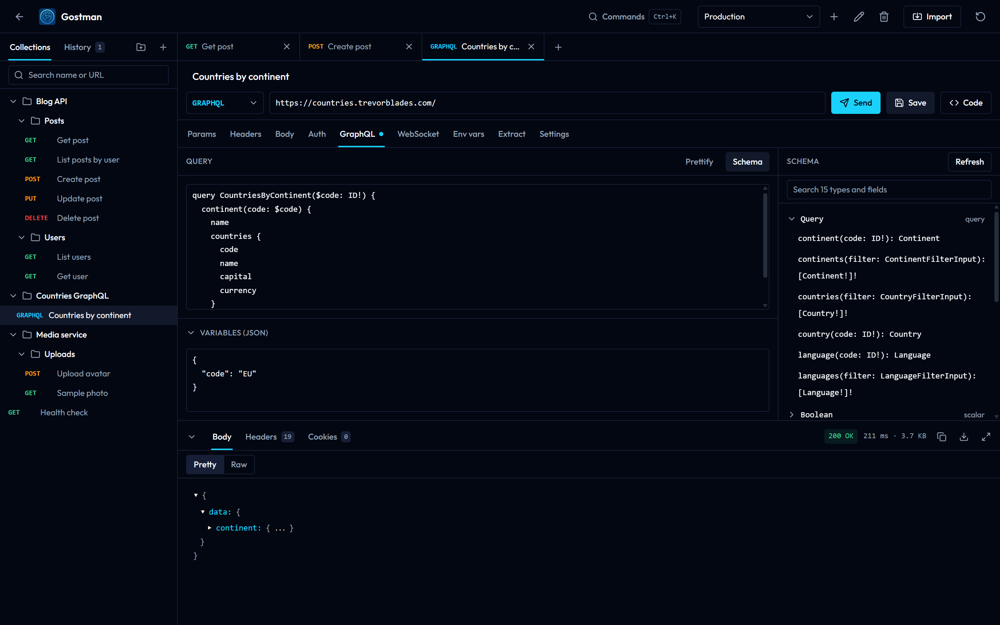
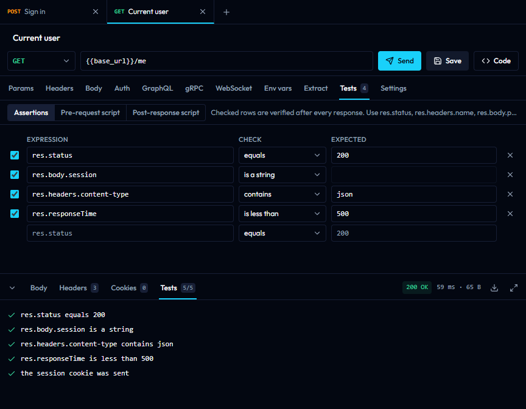
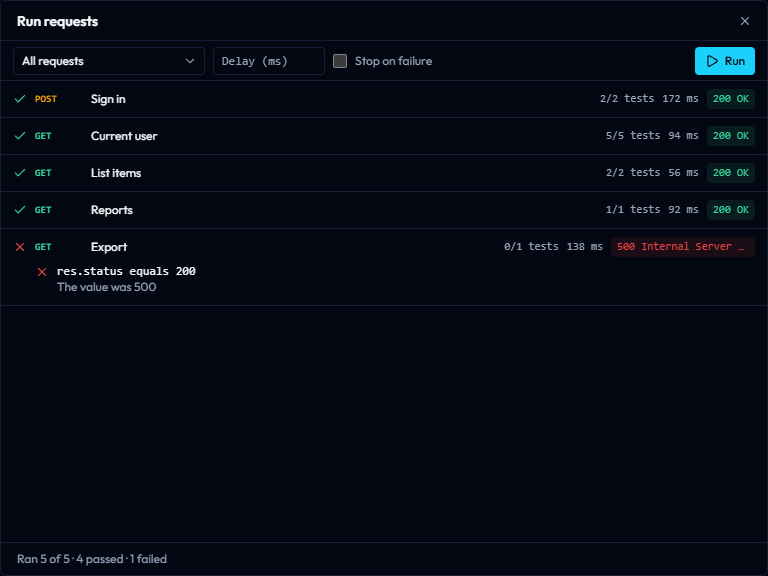

<div align="center">
  
  <h1>Gostman</h1>
  <p>An API client for REST, GraphQL, gRPC and WebSocket that you, your CI pipeline and your coding agent share. Desktop app, web app and command line, no account.</p>

  [](https://github.com/kunalgoesbyken/gostman/actions/workflows/ci.yml)
  [](https://github.com/kunalgoesbyken/gostman/releases/latest)

  <p>
    <a href="https://gostman.com/web"><strong>Open the web app</strong></a> ·
    <a href="https://github.com/kunalgoesbyken/gostman/releases/latest">Download for Windows, macOS and Linux</a> ·
    <a href="#features">Features</a>
  </p>
  <p>No account. Your requests stay on your device. The web app installs as an app and works offline.</p>
</div>



| | |
| --- | --- |
|  |  |
|  |  |

Gostman is a native desktop application built with Go and [Wails](https://wails.io), with the same interface available in the browser at [gostman.com](https://gostman.com). Requests, collections and environments are stored on your machine. There is nothing to sign in to.

## Why not Bruno or Postman?

Both are good tools. Gostman is for people who want the paid-tier workflow without a paid tier or an account.

- **Nothing to sign in to.** Collections are plain YAML files in a folder you can commit. The desktop app and the browser version both work without an account.
- **No tiers.** Data-driven runs, parallel runs, HTML reports, secret managers (Vault, AWS, Azure, Google Cloud) and the Git panel are all in the download. Bruno documents several of these under its [Pro and Ultimate plans](https://www.usebruno.com/pricing), and Postman lists custom data files in the Collection Runner on its [paid plans](https://www.postman.com/pricing/).
- **Small.** The Windows installer is about 10 MB and the app takes about 20 MB on disk. The [benchmark script](benchmarks/README.md) lets you measure it on your own machine.
- **One collection for you, CI and your coding agent.** The same files run in the app, with `gostman run` in CI, and through the built-in MCP server.

Prices and plans change, so check their pages before you decide. Gostman has no accounts, so it has no hosted collaboration, SSO or cloud monitors. A side-by-side table is on [gostman.com](https://gostman.com).

## Quick start

- **Browser:** open [gostman.com/web](https://gostman.com/web), paste a URL and press Send.
- **Desktop:** download the installer from [Install](#install) and open it.
- **Command line:** send a request, or run a collection you saved to a folder in the app.

```bash
go install github.com/kunalgoesbyken/gostman/cmd/gostman@latest
gostman send GET https://example.com -H 'Accept: text/html'
gostman run path/to/collection
```

### Try a working collection

The [`examples`](examples) folder holds collections that call public test APIs, so they run as soon as you clone the repository:

```bash
git clone https://github.com/kunalgoesbyken/gostman && cd gostman
gostman run examples/todo-api --env Public
```

```
PASS  GET      Todos/List todos  200 OK  99 ms  3/3 tests
PASS  GET      Todos/Get one todo  200 OK  13 ms  3/3 tests
PASS  POST     Todos/Create a todo  201 Created  286 ms  3/3 tests

Requests  3 passed
Tests     9 passed
```

Open the same folder in the desktop app with **Open folder** to see the requests, the checks and the variable passed from one request to the next.

## Learn

- [Tutorial: test an API](docs/tutorial-first-collection.md) builds that collection step by step: variables, folders, assertions, chaining, scripts and a data-driven run.
- [Tutorial: run your API tests in CI](docs/tutorial-ci.md) runs it on every pull request with secrets kept out of the files.
- [Guides by task](docs/guides.md): migrate from Postman, mock a backend before it exists, record real traffic, load test, publish docs, let a coding agent call your API.
- [Script reference and examples](docs/scripting-and-settings.md#tests-and-scripts): JSON Schema checks, request signing, fetching a token, polling.
- [Troubleshooting](docs/troubleshooting.md)

## Features

- **Protocols:** REST, GraphQL (schema browser), gRPC (reflection or `.proto`), WebSocket, Server-Sent Events, SOAP and MCP servers.
- **Auth:** Basic, Bearer, API key, OAuth 2.0 (with PKCE and automatic renewal), OAuth 1, Digest, AWS SigV4, NTLM, Akamai EdgeGrid, JWT Bearer, Atlassian ASAP and Hawk.
- **Workflow:** collections with nested folders, environments and variables, extraction rules to chain requests, a cookie jar, history and a command palette.
- **Tests:** assertions plus pre-request and post-response scripts with `test()` and `expect()` in a sandbox, and a collection runner with CSV or JSON data files, parallel runs and HTML, JUnit and JSON reports.
- **Local load testing** with `gostman load`: latency percentiles and pass or fail thresholds.
- **Secret scanner:** `gostman scan` and an in-app check find credentials typed into a collection before you commit or share it.
- **Collections as files:** plain YAML in a folder with a Git panel (diff, commit, push, branches, stash, conflicts) on the desktop.
- **Mock server and capture:** serve saved examples or an OpenAPI spec locally, and record traffic from your own app.
- **OpenAPI:** import, sync with a remote spec, and a spec viewer with a linter (`gostman lint`).
- **Docs:** generate one HTML page with Markdown descriptions and an optional Try it panel.
- **Secret managers:** HashiCorp Vault, AWS, Azure and Google Cloud, and your OS keychain for stored values.
- **Sharing:** encrypted share links that never upload anything, and Open in Gostman links.
- **For coding agents:** `gostman mcp` lets Claude Code, Codex and Cursor call your API through the collection without seeing your secrets.
- **AI assistant** (optional, bring your own key): generate requests, tests and scripts, and explain errors.
- **Import and export:** Postman, OpenAPI, Insomnia, HAR, WSDL, Bruno and curl in; Postman, OpenAPI, HAR, Bruno, Markdown and a Gostman backup out.
- **Code generation** for curl, JavaScript, Python, Go, PHP and Java.

## Install

Download the latest build from the [releases page](https://github.com/kunalgoesbyken/gostman/releases/latest).

| Platform | File | Notes |
| --- | --- | --- |
| Windows | [`Gostman-windows-amd64.exe`](https://github.com/kunalgoesbyken/gostman/releases/latest/download/Gostman-windows-amd64.exe) | Installer. Adds Start menu and desktop shortcuts and an uninstaller. |
| Windows | [`Gostman-windows-amd64-portable.exe`](https://github.com/kunalgoesbyken/gostman/releases/latest/download/Gostman-windows-amd64-portable.exe) | Single executable, no installation. |
| macOS | [`Gostman-darwin-universal.dmg`](https://github.com/kunalgoesbyken/gostman/releases/latest/download/Gostman-darwin-universal.dmg) | Intel and Apple Silicon. Drag Gostman to Applications. |
| Linux | [`Gostman-linux-amd64.deb`](https://github.com/kunalgoesbyken/gostman/releases/latest/download/Gostman-linux-amd64.deb) | Debian and Ubuntu. `sudo apt install ./Gostman-linux-amd64.deb` |
| Linux | [`Gostman-linux-amd64.tar.gz`](https://github.com/kunalgoesbyken/gostman/releases/latest/download/Gostman-linux-amd64.tar.gz) | Other distributions. `sudo tar -xzf Gostman-linux-amd64.tar.gz -C /` Requires GTK 3 and WebKitGTK 4.1. |

The builds are not code-signed yet, so the operating system asks for confirmation the first time:

- **Windows**: SmartScreen shows "Windows protected your PC". Choose **More info**, then **Run anyway**.
- **macOS**: right-click Gostman in Applications and choose **Open**, then confirm.

Windows needs the WebView2 runtime, which ships with Windows 10 and 11; the installer fetches it when it is missing.

## Web version

[gostman.com](https://gostman.com) runs the same interface in the browser. Browsers cannot call arbitrary APIs directly, so requests are relayed through a small proxy. Two consequences:

- The hosted proxy cannot reach `localhost` or private network addresses. Use the desktop app for local APIs.
- Proxy, CA certificate and client certificate settings exist only in the desktop app.
- A gRPC stream is collected and shown when it ends; messages for a client stream are written up front as a JSON array.
- Responses larger than 3 MB are truncated. The desktop app reads up to 50 MB.

Data in the web version is kept in the browser's local storage.

## Documentation

The same pages are published at [gostman.com/docs](https://gostman.com/docs). The tutorials and guides are listed under [Learn](#learn); the reference pages are:

- [Getting started](docs/getting-started.md) and [what is free in Gostman](docs/free-features.md)
- [Requests and responses](docs/requests-and-responses.md) and [protocols](docs/protocols.md)
- [Command line](docs/cli.md): `run`, `send`, `load`, `scan`, `lint`, `docs`, `mock`, `capture`, secret managers, data files, reports
- [CI recipes](docs/ci.md): GitHub Actions, GitLab CI, Jenkins, Docker
- [Use from a coding agent](docs/agents.md)
- [Folders, Git, mock server and capture](docs/workspaces-and-mock.md)
- [Sharing, generated docs and Open in Gostman links](docs/sharing-and-docs.md)
- [Variables, scripts and settings](docs/scripting-and-settings.md)
- [AI assistant](docs/ai.md)

## Contributing

Issues and pull requests are welcome. For anything larger than a small fix, please open an issue first to agree on the approach. See [CONTRIBUTING.md](CONTRIBUTING.md) for how to build, test and release.
