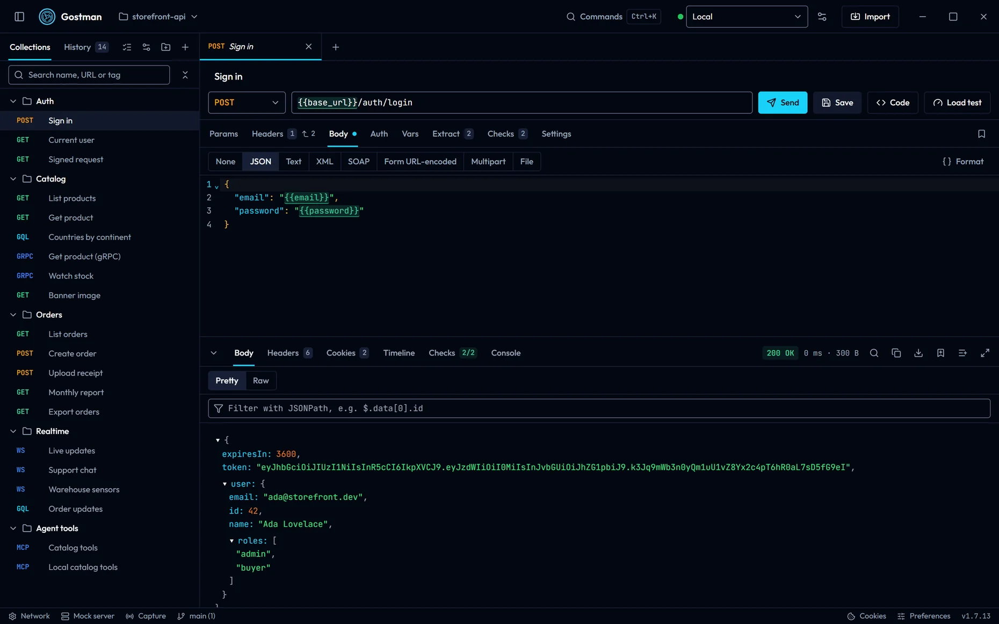

# Gostman documentation

Gostman is an API client for REST, GraphQL, gRPC and WebSocket that you, your CI pipeline and your coding agent share. These pages cover the desktop app, the web app and the command line, and every feature in them is included in the free download.

## Where to start

- [Getting started](getting-started.md): open Gostman in the browser, install the desktop app or the command line, and send a first request.
- [What is free in Gostman](free-features.md): the features Postman and Bruno list under paid plans, and where Gostman covers each one.
- [Coming from Bruno](coming-from-bruno.md): import a Bruno collection, what happens to its scripts, and the `gostman run` flags that match `bru run`.

## Learn

- [Tutorial: test an API](tutorial-first-collection.md): build a collection with variables, chained requests and checks, then run it from the app and the command line.
- [Tutorial: run your API tests in CI](tutorial-ci.md): run the collection on every pull request with secrets kept out of the files.
- [Guides by task](guides.md): migrate from Postman, mock a backend, record traffic, load test, publish docs and more.
- [Troubleshooting](troubleshooting.md): common problems and their fixes.
- [Example collections](../examples/README.md): ready-to-run workspaces you can open or run.

## Send requests

- [Requests and responses](requests-and-responses.md): the request editor, every body and auth type, and the response viewer.
- [Protocols](protocols.md): REST, GraphQL, gRPC, WebSocket, Server-Sent Events, SOAP and MCP servers.
- [Variables](variables.md): scopes, secrets and dynamic values.
- [Folder and collection settings](folder-settings.md): headers, auth, variables and scripts shared by a folder.
- [Variables, scripts and settings](scripting-and-settings.md): tests, scripts, network settings and the OAuth 2.0 callback.

## Test and automate

- [Runner, load testing and secret scanning](runner-load-and-scan.md): the in-app runner and the dialogs for load tests and scans.
- [Command line](cli.md): `run`, `send`, `mock`, `capture`, `docs`, `load`, `scan`, `lint`, `import` and `export`.
- [Gostman in CI](ci.md): exit codes, reports, recipes for GitHub Actions, GitLab CI and Jenkins, and a run against the mock server.
- [Use from a coding agent](agents.md): the MCP server for Claude Code, Codex and Cursor.

## Your data

- [Collections and Git](collections-and-git.md): the sidebar, tabs, storage and the Git panel.
- [Folders, mock server and capture](workspaces-and-mock.md): collections as files, saved examples and recorded traffic.
- [Import, export and specs](import-export-and-specs.md): supported formats, OpenAPI tools and Open in Gostman links.
- [Sharing and documentation](sharing-and-docs.md): encrypted share links and generated HTML documentation.

## Settings and security

- [Secrets and network](secrets-and-network.md): secret variables, secret managers, proxy and certificates.
- [Preferences and shortcuts](preferences-and-shortcuts.md): the command palette, preferences and keyboard shortcuts.
- [AI features](ai.md): the optional assistant, which uses your own key.
