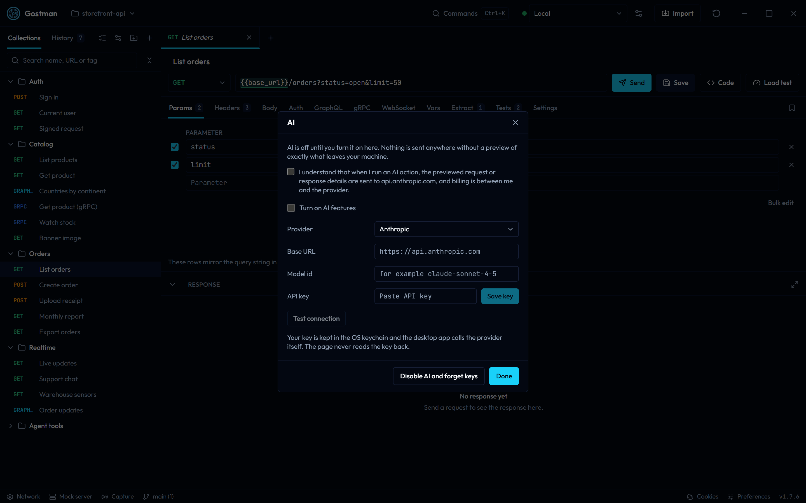

# AI features (bring your own key)

AI is off by default. While it is off, Gostman shows no AI buttons, AI commands or AI shortcuts, and nothing is sent to any AI provider. The only places that mention AI are the **AI** section of Preferences and the "AI settings" command in the command palette, which opens that section.

To turn it on, open Preferences and choose **AI** (or run "AI settings" from the command palette), tick the consent line, turn AI on, pick a provider, paste a key if the provider needs one, and choose a model. The note at the top says whether AI is off, on, or on but still missing a model or key. Use "Test connection" to check it. If you start an AI action before a model or key is set, Preferences opens on this section. "Turn off AI and forget keys" switches everything off again and deletes the saved keys; while AI is off it reads "Forget AI keys and settings" and appears only when there is something to forget.

Providers: Anthropic, OpenAI, Google Gemini, OpenRouter, Ollama, LM Studio and any OpenAI-compatible base URL. Plain `http` base URLs are refused unless the host is loopback or you allow it for that address.

## Choosing a model

"List models" asks the provider which models your key can use and offers them as suggestions in the model field; you can still type any model id. For Ollama (`http://localhost:11434`) and LM Studio (`http://localhost:1234`) the list of installed models is loaded as soon as you pick the provider or open the settings. If the server is running but has no models, download one first.

The placeholders in the model field are examples only, for instance `claude-sonnet-5-5`, `gpt-6.1-sol` or `gemini-3.8-flash`.

## Where the key lives

- Desktop: the OS keychain through the existing secret store. The page never reads it back; the Go side calls the provider.
- Web: the key stays in this browser (local storage, or session storage when "Remember on this device" is off). The page calls the provider directly. Keys and prompts never pass through Gostman servers or `/api/proxy`.

On both, a key is saved for the base URL it was entered with. If you change the base URL, the key is not sent to the new address; save it again for that address.

## Browser limits (CORS)

A web page can only call a provider that allows cross-origin requests. From the provider documentation, not tried against the real services here:

- Anthropic: allowed only when the request carries `anthropic-dangerous-direct-browser-access: true`, which Gostman sends.
- OpenAI, OpenRouter and Google Gemini: answer the browser preflight and allow calls from any origin.
- Ollama: allows only local origins by default. Start it with `OLLAMA_ORIGINS` set to the site, for example `OLLAMA_ORIGINS=https://gostman.com`, and restart it.
- LM Studio: turn on CORS in the server settings of its Developer view, or start the server with `lms server start --cors`.
- Other OpenAI-compatible servers: must answer the `OPTIONS` preflight and allow the `Authorization` and `Content-Type` headers from the site.

Some browsers ask for permission before a website may reach a server on your own machine; allow it for local models. A blocked call looks like a network failure, so the error names the likely cause and the fix for the chosen provider. The desktop app calls the provider from Go and has no such limit.

## What is sent

Every action shows a preview of the exact text before it is sent, with a byte and token estimate, plus the reply format Gostman asks for. Secret variable values, auth fields, sensitive header values and sensitive JSON keys are masked, also when they appear URL-encoded, JSON-escaped or base64-encoded. Variables are sent by name only.

Response bodies:

- "Explain a failed response" includes the response body values by default (up to 4 KB, sensitive keys masked), because the error message in the body is usually what explains the failure. Untick "Include the body values" to send only the structure. The preview says which one is sent.
- "Checks for a response" sends only the structure of the body (key names and types) unless you tick "Include real response values".

"Don't ask again for this action" skips the preview for that action only: from then on it is sent as soon as you start it. The AI section of Preferences shows how many actions skip the preview, and "Show the preview again" brings it back for all of them.

## Replies

Gostman asks for a JSON reply in a fixed shape. Where the provider supports it, the shape is sent as a JSON schema: Anthropic structured outputs, OpenAI and OpenAI-compatible `response_format`, Gemini `responseJsonSchema`. If a provider or model rejects the schema, the request is sent once more without it and the shape is given in the instructions only.

If an answer reaches the length limit, Gostman shows "The answer was cut off" instead of a partial result. Try again with less content, or pick a model that writes shorter answers.

## What AI can do

Draft a request, assertions and tests, pre and post scripts, a failure explanation, request docs, a collection search, and requests from an API description. Results are proposals shown as a preview; nothing is sent, saved or run until you accept, and scripts run only when you press Send. In a restricted folder, script generation is disabled and accepted scripts stay inert until the folder is trusted.

Besides the **AI:** commands in the command palette, three buttons appear in place once AI is on:

- **Generate with AI** in the **Checks** tab of a request: on the Assertions view it proposes checks for the last response, and on the Pre-request script or Post-response script view it writes that script.
- **Write with AI** next to the description in the request's **Settings** tab proposes a description.
- **Explain with AI** appears in the response toolbar when a response has an error status, and under the message when a request could not be sent. It explains the response or the error and suggests a fix.

- Collection search sends the first 300 requests of the collection. If it has more, the dialog says so before anything is sent.
- Requests from an API description: when the pasted text is an OpenAPI or Swagger document, the built-in importer reads all of it, the same way Import data does, and nothing is sent to AI. Other descriptions, such as a GraphQL schema or API documentation text, go to AI, up to 64 KB of text. AI makes up to 15 requests per answer; when the API has more, "Make the next requests" sends the same text again with the list of requests already made, up to 200 requests in all. To add assertions to imported requests, send one and use "Checks for a response", which works from the real response.
