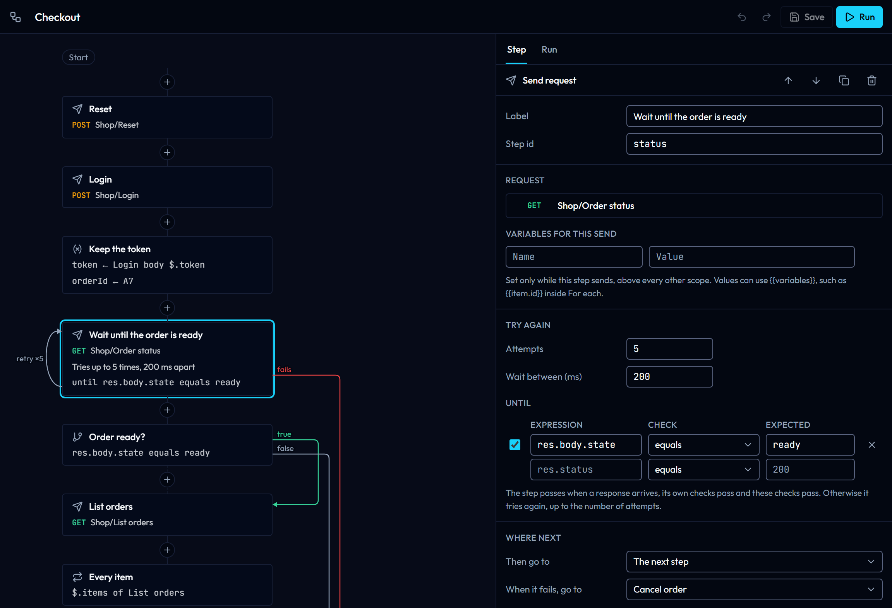

# Flows

A flow chains saved requests into a scenario: send one request after another, try a request again until it passes, go to another step when one fails, branch on a response, repeat steps for every item of a list or until a condition passes, run another flow as one step and pass values from one response to the next. You draw it in the app and run it there, from `gostman flow run` or in CI. The definition is a YAML file in the workspace, so it is reviewed and versioned with the requests it uses.

Use the [runner](runner-load-and-scan.md#run-requests) to check every request of a folder, in order. Use a flow when the order matters and depends on the answers: a login whose token the next calls need, an order you poll until it is ready, a clean-up that only runs when something failed, or a bug that needs five calls in a precise sequence to show up.


## Draw a flow

1. Open the **Flows** tab of the sidebar and choose **New flow**, or **Start from an example** for a small flow that logs in, waits until an order is ready and cancels it when it never is.
2. Choose **+** between two steps, or at the end of the list, and pick the kind of step. **Send request** opens a search over your saved requests.
3. Select a step to edit it in the panel on the right (below the canvas on a phone). **Float the panel** turns it into a window over the canvas that you can move and resize; it opens when you select a step and closes with Esc. Every step has a **Note**, written in Markdown, for the reason it is there; the canvas shows it when you hover over the step. Choose **Save** or press Ctrl+S (⌘S on macOS) to keep the flow; a dot on its tab marks unsaved changes, and **Undo** and **Redo** (Ctrl+Z, Ctrl+Y) step back through your edits.

Steps run from top to bottom. A line between two cards means the first one continues with the next; a dashed line means it never does, for example after an **End** step. Jumps to other steps are drawn on the right with their reason: **fails** in red, **true** and the cases of a **Switch** in green, **false**, **otherwise** and **go to** in grey. A **Send request** that tries again shows a loop on its left with the number of attempts, and the steps a **For each** or a **Repeat** runs are framed under it.

Drag the background to move around, and zoom with the buttons in the corner, Ctrl and the mouse wheel, or + and −; 0 goes back to 100%. A flow opens fitted when it is readable that way; when steps are out of view, the corner shows **Show N hidden steps**, which fits the whole flow. On the canvas, the arrow keys move between steps, Enter opens the selected step in the panel, Alt+↑ and Alt+↓ move it, and Delete removes it after asking. Removing a step makes the steps that went to it continue with the next step instead. A step that needs attention, such as a **Send request** without a request, shows a warning sign, and the flow settings (shown when no step is selected) list every problem.

## Kinds of steps

| Step | What it does |
| --- | --- |
| **Send request** | Sends a saved request with its scripts, checks, extraction rules, cookies and OAuth 2.0 token, the same way the Send button does. It passes when a response arrives and its own checks pass. **Values for this send** put headers, query parameters, body fields and variables into the request for this step only (see [Pass values into a request](#pass-values-into-a-request)). **Attempts** and **Wait between** try it again when it fails, and **Until** adds checks that must also pass, such as `res.body.status equals ready`. **When it fails, go to** takes another path after the last attempt; without it, a failure stops the flow as failed. |
| **Set variables** | Sets session values for the next steps: text with `{{variables}}`, or a value from the response of an earlier **Send request** step (a JSONPath into the body, a header or the status code). A path that finds nothing fails the flow, so a missing token is reported where it went missing. |
| **If** | Checks the latest response, the response of a chosen step, or variables, with the same checks as a request's **Checks** tab. **Match** says whether all or any must pass. **When true** and **When false** choose where to go; empty means the next step. |
| **Switch** | Checks a list of cases from top to bottom, each with its own label, conditions and step to go to, and goes where the first one that matches says. **When no case matches** chooses where to go otherwise. Like **If**, it reads the latest response, the response of a chosen step, or variables; empty means the next step. |
| **For each** | Repeats the steps inside it for every item of a list found by a JSONPath in an earlier response. Inside, `{{item}}` is the item as text, `{{item.id}}` one of its fields and `{{index}}` its position from 0; both names can be changed. An empty list skips the steps. |
| **Repeat** | Runs the steps inside it several times: exactly **Passes** times (1 to 1000), or, with an **Until** condition, until the condition passes after a pass. **Wait between passes** pauses between two passes, and `{{index}}` (the **Pass variable**) holds the number of the pass from 0; it is removed when the loop ends, and a value it hid is set back. When the condition never passes, **When the condition never passes, go to** takes another path; without it the flow fails. |
| **Run flow** | Runs another saved flow as one step, with the same environment and session, and passes when that flow passes. **Variables for this run** set values for the steps of that flow only. **When it fails, go to** takes another path when it fails. **Open flow** opens it in its own tab. |
| **Wait** | Pauses for a number of milliseconds. |
| **End** | Stops the flow as passed or failed, with a message for the summary. |

Every step except **End** has **Then go to**, which can jump to any step, back to an earlier one to make a loop, or to the end of the flow. A step inside a **For each** or a **Repeat** can only be reached from inside it; go to the **For each** or **Repeat** itself to start the loop again.

A **Run flow** step uses the saved version of the other flow. Its requests count against the request limit of the flow that runs it, values its **Set variables** steps write stay in the session, and its own variables are removed when it ends. Inside that flow, a value it writes itself, with **Set variables**, **For each** or **Repeat**, replaces the one it was given. A request limit reached inside it, its own or the one of the flow that runs it, stops the whole run as failed, even when the step has **When it fails, go to**. A flow cannot run itself, directly or through other flows, and flows can run inside each other at most 8 levels deep; both are reported as problems before the run starts.

Conditions use only the declarative checks, never JavaScript, so a flow by itself runs no code. The requests it sends keep their own scripts, and a folder you have not trusted keeps them switched off as usual.

A run stops after 1,000 requests, so a loop with no way out ends with a message instead of running forever. Change the limit in the flow settings, up to 10,000. A loop that sends no request at all stops after 10,000 steps.



## Pass values into a request

**Values for this send**, in the panel of a **Send request** step, put values into the request just before it is sent, without changing the saved request. Each row has a target, a name and a value:

| Target | Name | What happens |
| --- | --- | --- |
| **Header** | The header name | Replaces the header, whatever its case, or adds it. |
| **Query parameter** | The parameter name | Replaces the parameter in the URL, or adds it. |
| **JSON body** | A JSONPath such as `$.customer.id`, `$.items[0].sku` or `$['first name']` | Sets that field of the JSON body and creates the objects on the way. |
| **Form field** | The field name | Replaces or adds a text field of a form or multipart body; file parts are left alone. |
| **Variable** | The variable name | Sets a variable for this send only, above every other scope, and removes it after the send. |

The value is text with `{{variables}}`, or it comes from the response of a **Send request** step that runs before this one: a JSONPath into its body, one of its headers or its status code, the same choices as in **Set variables**. A value read from a JSON body keeps its type in a JSON body, so a number stays a number and an object stays an object; text is sent as written, with its `{{variables}}` filled in when the request is sent. The canvas shows how many values a step sets.

When a value cannot be read or put into the request, for example because the path finds nothing or the body is not valid JSON, the step fails with the reason and goes to **When it fails, go to** if it has one. Nothing is sent, so it is not tried again and does not count against the request limit. A JSON body target needs a body that is valid JSON before variables are filled in: write `"{{id}}"` with quotes in the body, or set the field here instead. The flow will not start while a target does not fit the request, such as a JSON body target on a text body, or a value comes from a step that does not run first.

## Run a flow

Choose **Run** (or press the Send shortcut, Ctrl+Enter) to run the flow with the active environment. The cards light up as the steps run: a spinner on the step being sent, a green tick when it passed, a red cross when it failed, and an orange arrow when it failed but the flow handled it, by trying again or by going to another step. A step that is tried again shows its attempt, such as `3/5`.

The **Run** tab lists every step that ran, in order. Requests use the same rows as the runner: status, time, checks and, when expanded, the URL that was sent and the response body. Failed **Until** checks are listed with the request, so you see why a step was tried again. **Set variables** rows show the values they set; values of variables whose names look secret, such as `token`, are hidden. The steps of a flow run by a **Run flow** step are listed indented under it, and its card shows a spinner until that flow ends. **Stop** cancels the request in flight and ends the run, and **Report** saves the run as the same HTML report the runner writes, with the outcome of the flow at the top.

### Run metrics

**Metrics**, at the top of the **Run** tab, shows the total time of the run, the number of requests and the bytes of request bodies sent and of responses received, with the slowest steps: how many times each ran and its total, shortest, longest and average time. A request step counts each attempt; a **Wait** counts its pause; a **For each** counts each item and a **Repeat** each pass, timed by the steps inside it (the wait between passes is not a pass); a **Run flow** step counts each run of its flow, from start to end, and the requests of that flow count in the totals. The HTML report has the same numbers under **Flow metrics**, the JSON report has them as `flow.metrics`, and `gostman flow run` prints them in one line, such as `Metrics   12 requests, 3.4 s, 18.0 KB sent, 240.5 KB received`.

Values set by **Set variables** and **For each** stay in the session after the run, like values from Extract rules, so you can send a request by hand with them; they are never saved. The variables of a **Send request** step are removed again after it is sent.


## Run from the command line

```bash
gostman flow list --workspace orders-api
gostman flow run Checkout --workspace orders-api --env CI
gostman flow run orders-api/flows/checkout.yaml --env CI --reporter junit:flow.xml
gostman run orders-api --flow Checkout --env CI
```

`flow run` takes the flow's name or id, or the path of a flow file, and runs it through the same pipeline as `gostman run`, so `--env`, `--var`, `--var-from-env`, `--env-file`, `--secrets`, `--timeout`, `--insecure`, `--allow-files`, `--redact`, `--contract`, the certificate and proxy flags and every reporter work the same way (see [Command line](cli.md#flows)). The workspace is `--workspace`, or the current folder, or the workspace that holds the flow file. A Gostman export works too: `gostman flow run Checkout --workspace export.json`.

The text report prints each request as `gostman run` does, a `FLOW` line for every other step, and the outcome of the flow at the end. A failure the flow handled is printed in yellow with the reason, and counted apart. The steps of a flow run by a **Run flow** step are printed indented between a line that starts it and the line with its outcome.


The exit status follows the flow: 0 when it reaches its end or an **End** step marked passed, 1 when it fails (an unhandled failure, a failed **End** step, the request limit or an interrupt), 2 when the command or the flow is wrong, for example a step that points to a missing request, and 3 when the request that failed it got no response. The JSON report adds a `flow` object with the outcome, the message and every step in the order it ran; the steps of a **Run flow** step are in its own `steps`, and the requests they sent carry `inFlow` (the name of that flow) and `depth`. An **If** or **Switch** step has `branch`, the way it went: `then` or `else`, or `case:0`, `case:1` and so on for the case of a **Switch** that matched (`else` when none did). JUnit adds one test case for the flow and one for every **Run flow** step, and reports handled failures as skipped.

## The flow file

In a workspace folder each flow is a file in `flows/` at the root, named after the flow, such as `flows/checkout.yaml`. The app writes it when you save and reads changes made by an editor or a `git pull` within a few seconds. Keys the app does not know are kept at the top of the file. In app storage and in the browser, flows are kept with the rest of your data, and a Gostman export carries them; an import adds them as new flows linked to the imported requests and to each other, and lists any step whose request was not in the export.

```yaml
name: Checkout
description: Log in, wait until the order is ready, then check every item.
maxSends: 200
steps:
  - id: login
    kind: request
    request: Shop/Login
    note: Signs in as the **CI user**; its password comes from `--var-from-env`.
  - id: keep-token
    kind: set
    label: Keep the token
    values:
      - name: token
        step: login
        source: body
        path: $.token
      - name: orderId
        value: A7
  - id: status
    kind: request
    label: Wait until the order is ready
    request: Shop/Order status
    retry:
      times: 5
      delayMs: 1000
      until:
        - expression: res.body.state
          operator: eq
          value: ready
    onFailure: cancel
  - id: list
    kind: request
    request: Shop/List orders
  - id: has-items
    kind: if
    step: list
    conditions:
      - expression: res.body.items
        operator: isNotEmpty
    else: cancel
  - id: each-item
    kind: forEach
    step: list
    path: $.items
    steps:
      - id: item
        kind: request
        request: Shop/Get order
        variables:
          itemId: "{{item.id}}"
  - id: done
    kind: end
    outcome: passed
    message: Order checked
  - id: cancel
    kind: request
    request: Shop/Cancel order
  - id: cancelled
    kind: end
    outcome: failed
    message: The order never got ready, so it was cancelled
```

| Key | Where | Meaning |
| --- | --- | --- |
| `name`, `description` | flow | Shown in the app and in reports. Without `name`, the file name is used. |
| `maxSends` | flow | Request limit of a run, 1 to 10000 (default 1000). |
| `id` | step | Short name other steps use to point at it, unique in the flow. `end` is reserved. |
| `kind` | step | `request`, `set`, `if`, `switch`, `forEach`, `repeat`, `flow`, `delay` or `end`. |
| `label` | step | Title on the canvas and in reports. Without it, the request's name, the flow's name or the kind of step is shown. |
| `note` | step | Markdown shown when you hover over the step on the canvas. |
| `next` | step | Step to go to next; empty means the step below it, `end` ends the flow as passed. |
| `request`, `requestId` | request | The saved request, by its `Folder/Name` path and its id. The id is tried first, so renaming a request keeps the flow working; the app fills in both when it saves. |
| `variables` | request | Values for this send only, as `name: template`. |
| `inputs` | request | Values put into the request before it is sent: a list of `target` (`header`, `query`, `body`, `form` or `variable`), `name` (the header, parameter or field name, a JSONPath for `body`, or the variable name) and either `value` or `step`, `source` and `path`, as in `values`. |
| `retry.times`, `retry.delayMs`, `retry.until` | request | Attempts (1 to 50), the wait between them in milliseconds, and extra checks. |
| `onFailure` | request | Step to go to when the last attempt fails. |
| `values` | set | A list of `name` with either `value` (text with `{{variables}}`) or `step`, `source` (`body`, `header` or `status`) and `path` (a JSONPath, or the header name). |
| `source`, `step`, `match`, `conditions`, `then`, `else` | if | `response` (the latest one, or the one of `step`) or `variables` (the expression is a variable name); `all` or `any`; checks written as `expression`, `operator`, `value`, as in a request's assertions. |
| `source`, `step`, `cases`, `else` | switch | As for `if`; `cases` is a list of `label`, `match`, `conditions` and `target` (a step id, `end`, or empty for the next step), checked in order; `else` is where to go when none matches. |
| `step`, `path`, `as`, `indexAs`, `steps` | forEach | The step whose response holds the list, its JSONPath, the names of the item and index variables (`item` and `index`) and the steps to repeat. |
| `times`, `delayMs`, `indexAs`, `source`, `step`, `match`, `until`, `onFailure`, `steps` | repeat | Passes (1 to 1000, default 3), the wait between them in milliseconds, the name of the pass variable (`index`), the condition checked after each pass (read like the conditions of `if`), the step to go to when it never passes, and the steps to repeat. |
| `flow`, `flowId`, `variables`, `onFailure` | flow | The flow to run, by its name and its id (the id is tried first; the app fills in both when it saves), values for that run as `name: template`, and the step to go to when it fails. |
| `ms` | delay | Milliseconds to wait, up to 600000. |
| `outcome`, `message` | end | `passed` or `failed`, and the message of the summary. |

The other kinds of steps look like this:

```yaml
steps:
  - id: sign-in
    kind: flow
    flow: Log in
    variables:
      user: "{{ciUser}}"
    onFailure: cancelled
  - id: wait-ready
    kind: repeat
    label: Wait until the order is ready
    times: 10
    delayMs: 500
    until:
      - expression: res.body.state
        operator: eq
        value: ready
    onFailure: cancel
    steps:
      - id: status
        kind: request
        request: Shop/Order status
  - id: by-state
    kind: switch
    step: status
    cases:
      - label: Paid
        conditions:
          - expression: res.body.payment
            operator: eq
            value: paid
        target: ship
      - label: Refused
        match: any
        conditions:
          - expression: res.body.payment
            operator: eq
            value: refused
          - expression: res.status
            operator: eq
            value: "402"
        target: cancel
    else: cancel
```

The decisions of a flow, where to go next, whether a step passed and what a value is, are made by the same code in the app and on the command line, so a flow takes the same path in both. The [todo-api example](../examples/todo-api) has a flow you can run with `gostman flow run "Check todos" --workspace examples/todo-api --env Public`.
