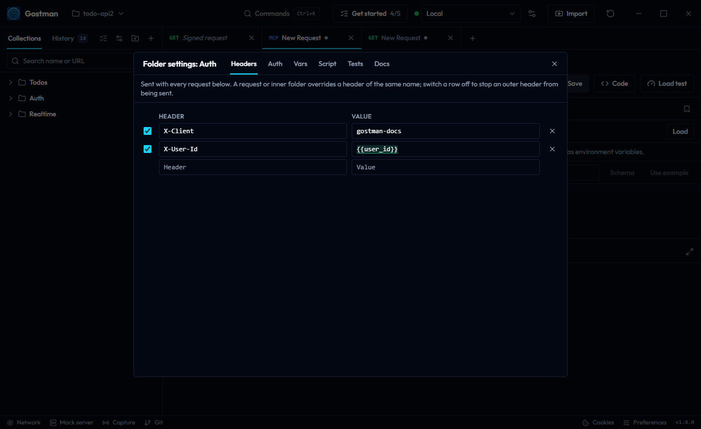

# Folder and collection settings

Every folder and every collection can carry settings that the requests below them share. Where you open them depends on where the collection lives:

- **In the app's own storage** (the web app, and the desktop app without a folder open) each top-level folder is a collection. Open its settings from its menu with **Collection settings**; deeper folders have **Settings**. The settings button above the collection tree opens **Settings for all collections**: settings that apply to every request in every collection, and the shared collection variables.
- **In a folder workspace** the folder is one collection. The settings button opens **Collection settings**, kept in `gostman.yaml`, and every folder's menu has **Settings**. For collection variables only, a top-level folder still counts as a collection: it can keep its own list, as in the app's own storage, so a collection saved to a folder or imported with `gostman import` resolves the same values.

The command palette has **Collection settings**, which opens the settings of the active request's collection (in the app's own storage, a request outside any folder gets **Settings for all collections**), and, in the app's own storage, **Settings for all collections**.



| Tab | What it holds |
| --- | --- |
| Headers | Rows sent with every request below |
| Auth | An auth scheme used by requests set to **Inherit** |
| Vars | Folder variables for the requests below. In the settings of a top-level folder (**Collection settings** in the app's own storage, **Settings** in a folder workspace), **Collection variables** switches to the collection's own collection variables, which an environment overrides, and **Folder variables** back. **Settings for all collections**, and **Collection settings** in a folder workspace, edit the shared collection variables here. Collection variables have a secret lock; folder variables have no on/off checkbox or secret lock, so keep secrets in an environment or a collection variable marked secret |
| Script | A script under **Before the request** and one under **After the response**; at the outermost level, also **Time limit (s)** for every script |
| Checks | Assertions checked after every response |
| Docs | A description shown in generated documentation |

The outermost level is **Settings for all collections**, or **Collection settings** in a folder workspace. A request belongs to its folder, which may sit inside other folders; in the app's own storage the top-level one is its collection.

## How levels combine

**Headers** merge from the outside in: the outermost level, then each folder down to the request's own folder, then the request. A header with the same name (case-insensitive) replaces the outer one. A row that is switched off removes the outer header of that name instead of sending anything, so a request can drop a header a folder adds.

**Auth** is chosen by the nearest level that sets one. A request whose Auth type is **Inherit** uses the auth of its folder, else its parent folder, and so on up to the outermost level. A folder whose type is left on **Inherit**, the default for folders, passes the question outward. **No auth** on a folder stops the search: requests that inherit from it are sent without authentication. The outermost level has no **Inherit** choice; when it is left on **No auth**, a request that inherits and finds no auth on the way is sent without authentication. A request that sets its own type, including **No auth**, never inherits. New requests keep **No auth** until you choose Inherit.

**Variables** follow [Variables](variables.md): globals, then collection variables, then the environment, then each folder from the outermost to the request's folder, then the request's own Vars, with session values above them all. A folder variable overrides an environment variable of the same name.

**Scripts** run outside in before the request is sent: the outermost level's, each folder's, then the request's. After the response they run inside out: the request's, each folder's from the innermost, then the outermost level's. Each one sees the variables as they stand when it starts. A script that fails stops the request.

**Checks** accumulate: the request's assertions, every folder's and the outermost level's are all checked.

**Docs** are shown above the requests of that folder in the generated HTML page; the outermost level's description appears at the top. The text is rendered as Markdown; HTML in it is escaped, never rendered.

## What is sent

The Go engine merges headers and resolves auth when it prepares a request, so what is sent, the code snippets, the CLI and the agent tools all agree. Inherited headers and auth appear in generated code. gRPC metadata, MCP requests and WebSocket connections use the same merged headers and auth.

OAuth 2.0 set on a folder or the outermost level works like OAuth 2.0 on a request: **Get token** in the settings dialog stores the token there, and it is renewed when it expires. In a folder workspace the token is not written to the YAML files.

## Files

In a folder workspace a folder's settings live in its `folder.yaml` and the collection's in `gostman.yaml`, next to `variables`:

```yaml
name: Payments
variables:
  region: eu
collectionVariables:
  apiVersion: v2
collectionVariablesMeta:
  apiKey:
    secret: true
headers:
  - key: X-Team
    value: payments
auth:
  type: bearer
  token: "{{token}}"
preScript: console.log("entering payments")
assertions:
  - expression: res.status
    operator: lt
    value: "500"
description: Endpoints owned by the payments team.
```

`collectionVariables` is the collection's own list, kept by a top-level folder. `collectionVariablesMeta` holds its secret marks (`secret: true`) and switched-off rows (`enabled: false`). A secret variable such as `apiKey` above is written by name only: the desktop app keeps its value in the keychain, and `gostman run` takes it with `--var`.

Keys Gostman does not know are kept when it rewrites the file. Gostman exports and share links carry folder settings with each folder, and the outermost settings with a full export. Importing never overwrites existing settings, and never changes the settings that apply to your other collections. In the app's own storage, the outermost settings of an import go to the imported collection's own **Collection settings**, or to a new **Imported collection** that holds the import when they cannot be copied without changing what a request inherits, see [Import, export and specs](import-export-and-specs.md). In a folder workspace they are adopted only when the collection has none.

## Trust

Imports are untrusted. Scripts, OAuth 2.0 settings and [file reads](variables.md#reading-files) on folders and at the outermost level are counted in the import prompt and dropped if you decline them. In a folder you have not trusted, a request is not sent when one of its folders or the outermost level carries a script, OAuth 2.0 settings or a file read, exactly as for a request that carries them.

## The CLI

`gostman run` and `gostman send` read the same files and exports and apply the same rules. Nesting deeper than 64 folders is cut at the 64 nearest folders. A folder whose parent is missing or that sits in a cycle is treated as having no parent.
