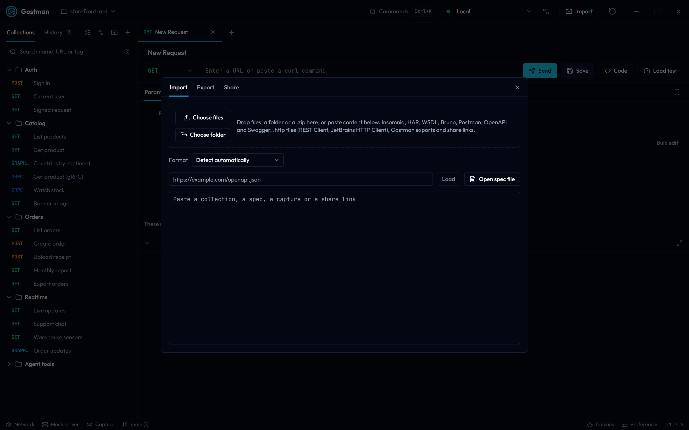
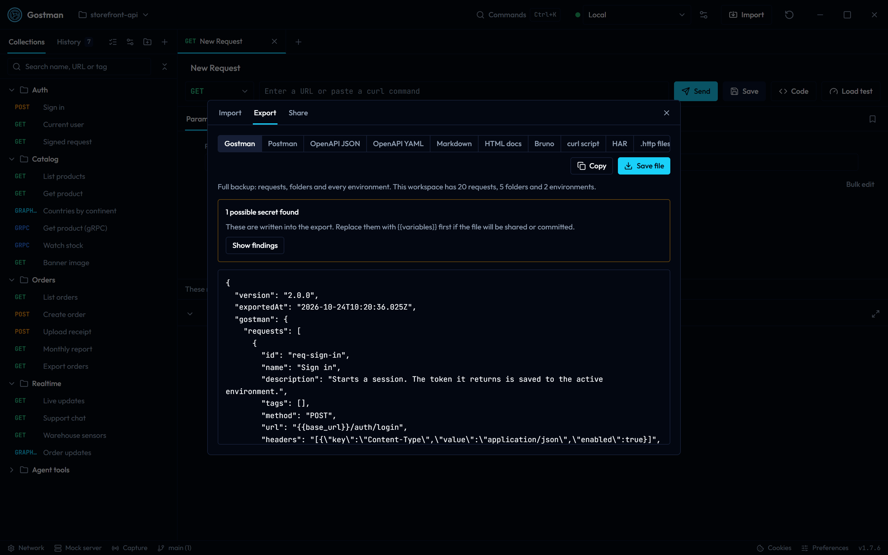
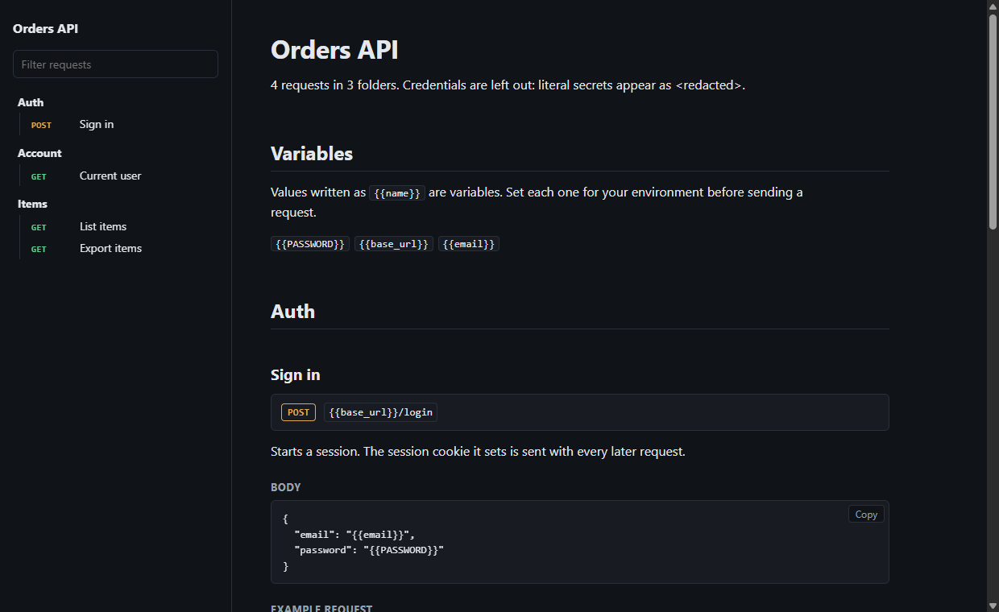

# Import, export and OpenAPI specs

This page covers the Import and Export dialog, what an import does and does not change, the OpenAPI spec viewer, spec sync and linter, and the Open in Gostman link builder. Encrypted share links and generated documentation are described in [Sharing and documentation](sharing-and-docs.md).

## The Import and Export dialog

Open the dialog with the **Import** button in the header or the **Import data** and **Export data** commands in the command palette. It has three tabs: **Import**, **Export** and **Share**. The Share tab is covered in [Sharing and documentation](sharing-and-docs.md).

## Importing

You can bring data in four ways:

- **Choose files** or **Choose folder**.
- Drop files, a folder or a `.zip` on the drop area.
- Paste content into the text box (**Content to import**).
- Enter the address of an OpenAPI spec and choose **Load**, or choose **Open spec file** to pick a spec on disk. **Open spec file** is available in the desktop app only.

Gostman reads the content after a short pause and shows a summary before anything is added. Nothing changes until you choose **Import**.

### Supported formats

| Format | Notes |
| --- | --- |
| Postman | Postman files. Collection variables are imported once as variables, not copied into every request |
| OpenAPI | OpenAPI and Swagger specs |
| Insomnia | Insomnia exports |
| HAR | HAR captures |
| WSDL | WSDL services |
| Bruno | Bruno collections in `.bru` or YAML (OpenCollection), as a folder, a `.zip` or one exported file |
| .http files | VS Code REST Client and JetBrains HTTP Client `.http` and `.rest` files, with their environments. See [.http files](#http-files) |
| Gostman | Gostman exports and share links |

Request tags are carried over from Bruno (`tags` in a `.bru` file's `meta` block, or `info.tags` in OpenCollection YAML) and from the `tags` of an OpenAPI operation, which also still pick the folder. Postman, Insomnia, HAR and WSDL files have no request tags.

The **Format** list defaults to **Detect automatically**. Choose a format yourself when detection picks the wrong one. A curl command pasted into the address bar of a request fills that request, see [Collections, tabs and Git](collections-and-git.md).

When you pick HAR, or the files you read include a HAR capture, a **Leave out images, fonts, styles and scripts** checkbox appears. Chosen entries are listed under **Left out** in the summary.

### Files and folders

- The file picker accepts `.zip`, `.json`, `.yaml`, `.yml`, `.xml`, `.wsdl`, `.xsd`, `.har`, `.bru`, `.http`, `.rest` and Gostman share files.
- A folder or archive is searched for importable files with those extensions. Hidden paths (any segment starting with a dot) and `node_modules` are ignored.
- Up to 5,000 files are read. Each file and the files together are limited to 10 MB, and the dialog reports the limit when you go over it.
- Files must be text. A binary file is refused with a message naming it.
- With several files, the summary lists each file with its detected format and a total line.

### .http files

Files ending in `.http` or `.rest` are always read as request files. Pasted text, or a file with another extension, is read as one only when its first request starts with a method and an address, such as `GET https://api.example.com/users`.

- Each file becomes a folder named after the file. Files in subfolders keep that layout, so `users/admin.http` becomes the folder `admin` inside `users`.
- Requests are separated by `###`. The name is the text after `###` or a `# @name` (or `// @name`) line; a request without one is named after its method and address. Other `#` and `//` lines before the request line become its description.
- A line with only an address is a `GET`. `HTTP/1.1` at the end of the request line is ignored, and the lines after it that start with `?` or `&`, or are indented and start with `/`, continue the address.
- Headers run until the first blank line and the body runs to the next `###`. The body type comes from `Content-Type`: JSON, XML, text, form fields and multipart parts are read into their own body types. A `Content-Type` that matches what Gostman sends for that body type is dropped.
- `Authorization: Basic user password` (or `user:password`), `Digest user password` and `Bearer token` become the request's authentication.
- `X-Request-Type: GraphQL`, or the JetBrains `GRAPHQL` method, makes a GraphQL request: the query, then a blank line and the variables as JSON.
- `# @no-redirect` and `# @timeout` (seconds, or with `ms`, `s` or `m`) set the request options. `# @prompt name` turns `{{name}}` in that request into the prompt `{{?name}}`.
- File variables (`@name = value`) become variables of the file's folder.
- A REST Client request variable such as `{{login.response.body.$.token}}` or `{{login.response.headers.Location}}` adds an extract rule to the `login` request and is replaced with the variable it fills, here `{{login_token}}`. References to `.request.` values or XPath queries are kept as written and listed in the summary.

System variables are rewritten to Gostman's dynamic variables where one exists:

| In the file | In Gostman |
| --- | --- |
| `{{$guid}}`, `{{$uuid}}`, `{{$random.uuid}}` | `{{$guid}}`, `{{$uuid}}` |
| `{{$timestamp}}`, `{{$isoTimestamp}}`, `{{$datetime iso8601}}` | `{{$timestamp}}`, `{{$isoTimestamp}}` |
| `{{$randomInt}}`, `{{$random.integer}}` | `{{$randomInt}}` |
| `{{$randomInt 1 10}}`, `{{$random.integer(1, 10)}}` (upper bound not included) | `{{$randomInt(1,9)}}` |
| `{{$random.email}}` | `{{$randomEmail}}` |
| `{{$processEnv NAME}}`, `{{$dotenv NAME}}`, `{{$env.NAME}}` | `{{process.env.NAME}}`, read from the workspace's `.env` file |

Others, such as `{{$datetime rfc1123}}`, offsets like `{{$timestamp -1 d}}`, `{{$aadToken}}` and the JetBrains `{{$random.*}}` generators, are kept as written and listed in the summary.

Environments come from:

- `http-client.env.json` and `http-client.private.env.json` (JetBrains). Each top-level name becomes an environment, and values from the private file are added to it and marked secret. Values that are objects, such as JetBrains auth settings, are left out with a note.
- A `settings.json` with `rest-client.environmentVariables` (REST Client). Each environment gets the `$shared` values, and `{{$shared name}}` is replaced with the shared value. Comments and trailing commas are allowed. Folders that start with a dot are not searched, so add `.vscode/settings.json` to the import yourself.

JetBrains response handlers (`> `) become post-response scripts and pre-request handlers (`< `) become pre-request scripts. Common calls are rewritten: `client.test` to `test`, `client.assert(value, message)` to `expect(value, message).to.be.ok`, `client.global.set` and `get` and `request.variables.set` and `get` to `env.set` and `env.get`, `client.log` to `console.log`, `response.body` and `response.status` to `res.body` and `res.status`, and `response.headers.valueOf(name)` to `res.getHeader(name)`. Anything else is kept as written and listed in the summary.

Not imported, and listed in the summary: bodies read from files with `< path` (the request keeps the file name, attach the file again), response handlers in separate `.js` files, `>>` response redirects and `WEBSOCKET` and `GRPC` requests.

### The import summary

The summary reads, for example, `name: Postman file, 12 requests, 3 folders and 2 environments`. It counts requests and folders, and environments, variables and folder settings when there are any. Below the counts it can show:

- Warnings, in the warning color.
- A **Left out** list of what was skipped.
- For an OpenAPI spec loaded from pasted text, a note that sync is available only for specs loaded from an address or an opened file.

For an OpenAPI spec the summary also has a **Browse** button that opens the spec viewer before you import.

When you confirm, an **Import complete** message states how many requests, folders and other items were added, with any notes.

### What imports never do

Imports are untrusted input, as described in the project notes:

- They only add data. An imported item never overwrites an existing one by id; items that clash get new ids.
- They never disable TLS verification. If a request in the file turned verification off, it is kept on and a warning names up to five such requests.
- They never carry OAuth tokens.
- Folders in a loop or nested deeper than 32 levels are moved to the top level, with a warning.
- Variables from the file are merged into the active environment. If the active environment is not valid JSON, the variables are skipped with a note. An environment whose variables are not valid JSON is skipped by name.
- Collection settings are adopted only when the open collection has none, see [Folder and collection settings](folder-settings.md).

### Scripts and OAuth 2.0

Scripts, OAuth 2.0 settings, local MCP commands and file reads are kept when you import them, but you decide first. If the import contains any request, folder or collection setting that carries them, Gostman asks **Import scripts and sign-in settings?** with the number of items. Choose **Import them** to keep them. Cancel to import everything else without them.

In a folder workspace, imported items that carry scripts, OAuth 2.0 settings, local MCP commands or file reads stay restricted until you trust the folder, see [Collections, tabs and Git](collections-and-git.md).

### Share links

Pasting a share link, or choosing a share file, shows a preview with the requests, folders and environments. A share protected with a passphrase asks for it, and a file sent without its key asks for the key. Variables you already have keep your values. Shared imports go through the same prompt for scripts, OAuth 2.0 settings, local MCP commands and file reads. Creating shares is covered in [Sharing and documentation](sharing-and-docs.md).

## Exporting

The **Export** tab previews the content, shows how many requests, folders and environments the workspace has, and offers a copy button and **Save file**. A secret scan runs on the workspace and warns before you save when it finds credentials, see [Command line](cli.md#secret-scanner). The preview shows the first 20,000 characters; the saved file is complete.

| Format | What you get |
| --- | --- |
| Gostman | Full backup: requests, folders and every environment. OAuth tokens are removed |
| Postman | Collection v2.1 with the active environment as collection variables |
| OpenAPI JSON | OpenAPI 3.0 description of the HTTP requests |
| OpenAPI YAML | OpenAPI 3.0 description of the HTTP requests |
| Markdown | Readable API documentation |
| HTML docs | One self-contained page to publish or print. Credentials are left out and variables stay as `{{name}}` |
| Bruno | A folder of `.bru` files with environments, saved as a `.zip` |
| curl script | One curl command per request. Credentials become environment variable placeholders |
| HAR | HTTP Archive 1.2 with the requests and no responses |
| .http files | Requests for VS Code REST Client and JetBrains HTTP Client, one file per folder, with environments in `http-client.env.json` |

Gostman, OpenAPI and Bruno exports keep request tags. Bruno only reads tags made of letters, digits, `_` and `-`, so other tags, such as ones with spaces, are left out of a Bruno export.

For Bruno, curl script, HAR and .http exports, an **Include credentials** checkbox is off by default. Off, passwords, tokens and secret-named headers or variables are replaced with `{{NAME}}` placeholders. On, credentials are written into the file in plain text.

### .http export

Each folder with requests becomes a `.http` file named after it, inside a folder for each parent folder; requests outside any folder go to `requests.http`. One file is saved as it is, several as a `.zip`.

- Each file starts with `@name = value` lines for the collection and folder variables that apply to it. Variables with secret-looking names or several lines are left out.
- Each request has a `###` line with its name, its description as `#` lines, `# @name` when the name has no spaces, and `# @no-redirect`, `# @timeout` and `# @prompt` when they apply.
- Basic, Digest and Bearer authentication and API keys are written as headers or query parameters. Other authentication types are noted in a comment.
- Bodies are written with a matching `Content-Type`. Form fields are URL-encoded and multipart file fields read their file with `< ./name`. GraphQL requests are `POST` requests with `X-Request-Type: GraphQL`.
- Dynamic variables are written in REST Client form, for example `{{$randomInt 1 10}}` and `{{$dotenv NAME}}`. A variable filled by an extract rule of a named request in the same file is written as a request variable such as `{{login.response.body.$.token}}`.
- Environments are written to `http-client.env.json`, and secret or secret-named values to `http-client.private.env.json`, empty unless you include credentials.
- Scripts, assertions, the Vars tab of a request, examples, folder settings, gRPC, MCP and WebSocket requests are not written.
- A request whose body has a line that .http files read as an instruction, such as `< ./file`, `>> output.txt`, `> ` or `###`, is left out with a note, so opening the file in an editor never reads, writes or runs anything the request did not. Attached file names keep only their last part.

Importing the export again gives the same requests, folders, variables and environments, apart from what is listed above. Requests outside any folder come back in a `requests` folder.

### HTML docs options

Choosing **HTML docs** shows three options:

- **Documentation title**, which defaults to `API documentation`.
- **Include example responses**, on by default.
- **Include a Try it panel**, off by default.

What the page contains and how it redacts values is described in [Sharing and documentation](sharing-and-docs.md). From the command line, use `gostman docs`, see [Command line](cli.md).

## OpenAPI specs

### Importing a spec

Load a spec from an address, a file or pasted text, then choose **Import**. Each operation becomes a request. A spec loaded from an address or an opened file is linked to the folder that the import creates, so you can sync it later. Variables that the spec defines are added to the active environment when it does not have them yet.

### Spec viewer

Choose **Browse** in the import summary, or **Browse API spec** in the context menu of a linked folder, to open the **API spec** viewer. It has three tabs:

- **Operations** groups operations by tag, or **No tag** when they have none. **Search operations** matches the method and path, summary, operation id and tags. Selecting an operation shows its summary, description, **Authentication**, **Parameters**, **Request body** and **Responses**, with schemas and examples. Deprecated operations are struck through and badged. **Send to request tab** opens the operation as a new request.
- **Models** lists schemas, with **Search models**. Selecting one shows its fields.
- **Lint** shows linter findings.

### Spec sync

For a folder linked to a spec, the folder menu has **Check for spec updates**. It fetches the spec again and opens **Spec updates**, which shows when the folder was last synced and groups the differences as:

- **New operations**
- **Changed operations**
- **Removed operations**

Each item has a checkbox. Operations you edited in Gostman are marked **edited here** and start unchecked, because checking one replaces your edits to its URL, parameters, body and authentication. Choose **Apply selected** to add, update and remove the checked requests. When nothing differs, the dialog says **The collection already matches the spec.** A folder without a saved address shows **This collection has no saved spec address.**

### Linter

The **Lint** tab checks the spec and lists findings in three severities: errors, warnings and info. The buttons at the top show the count for each severity and toggle whether it is listed. A finding shows its message, the rule and the operation or path. Selecting a finding that belongs to an operation opens that operation in the **Operations** tab. A clean spec shows **No problems found.**

The **Lint API spec** command in the command palette opens the viewer on the Lint tab for the most recently synced linked spec. If no spec was imported from an address or a file, it tells you to import one first.

On the command line, `gostman lint` runs the same kind of check with report formats, a failure threshold and a rules file. See [Linting an OpenAPI spec](cli.md#linting-an-openapi-spec).

## Open in Gostman links

A link can ask Gostman to download a published collection or spec and import it. The link builder is in the Share tab, in a section titled **Open in Gostman link**.

1. Paste the public address of the file into **Public address of the collection**. It can be a Postman collection, OpenAPI file, Insomnia, HAR or Gostman export.
2. Copy one of the three results: **Web app link**, **README badge (Markdown)** or **Desktop app link**.

The builder refuses addresses that are not valid web addresses, are longer than 2,048 characters, contain a user name or password, or do not use `https`.

When someone opens the link, the **Open from a link** dialog shows the source host and address and a warning to continue only if they trust the sender. Nothing is downloaded until they choose **Download**, and nothing is imported until they choose **Import**. After the download, the dialog shows the detected format, the counts, and how many items carry scripts, OAuth 2.0 settings, local MCP commands or file reads. Those items are asked about before import, and imported folders stay restricted until you trust them. The link formats, size limits and restrictions are in [Sharing and documentation](sharing-and-docs.md).
