# Preferences, shortcuts and the command palette

This page covers the command palette and its commands, the Preferences window, the Keyboard shortcuts dialog and how to change a shortcut, moving around the app with the keyboard alone, the themes, colours and fonts, and the About dialog. Throughout, Ctrl means Command on macOS, except in Ctrl+Tab, Ctrl+Shift+Tab and Ctrl+Space, which use Control there too.

## Command palette

The command palette runs most actions in Gostman from the keyboard.

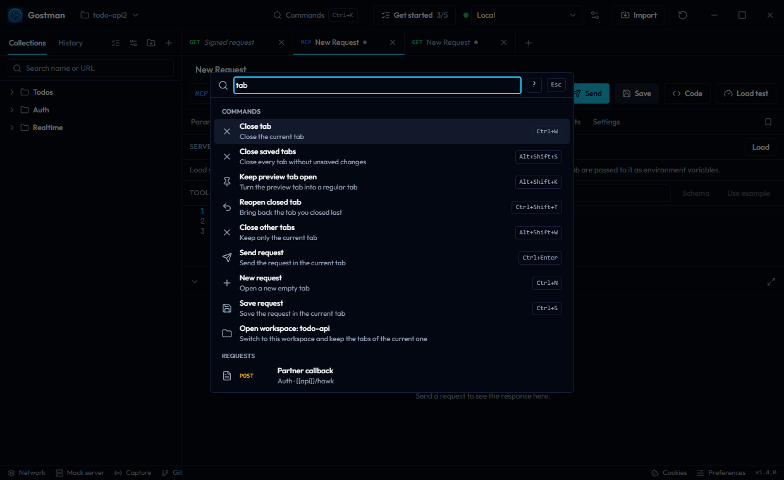

Open it with Ctrl+K, or with the **Commands** button in the header (shown on wide windows). Type to filter, use the up and down arrows to move, press Enter to run the highlighted row and Esc to close it. The **?** button in the palette opens the Keyboard shortcuts dialog.

- Typing searches command names first, then their descriptions and keywords. It also finds saved requests by name, folder, method or URL, and history entries.
- Once you type, results are grouped under **Commands**, **Requests** and **History**. Selecting a request or a history entry opens it in a tab.
- Ctrl+P (**Go to request or history**) opens the palette in a mode that lists requests and history only, with the search box reading `Go to a request or history entry`.
- The palette shows the current shortcut next to a command that has one, including any you changed.

### Commands

| Command | What it does | Shortcut |
| --- | --- | --- |
| **Send request** | Send the request in the current tab | Ctrl+Enter |
| **New request** | Open a new empty tab | Ctrl+N (Alt+N on the web) |
| **Save request** | Save the request in the current tab | Ctrl+S |
| **Duplicate request** | Save a copy of the current request | |
| **Copy request** | Copy the saved request to paste it into a folder | |
| **Paste request** | Paste the copied request or folder next to the current request | |
| **Generate code** | Show the current request as code | |
| **AI: new request from a description** | Draft a request, shown as a preview you accept | Ctrl+Shift+U |
| **AI: generate checks** | Propose checks for the last response | |
| **AI: write a script** | Propose a pre-request or post-response script | |
| **AI: explain the response** | Explain a failure and suggest a fix | Ctrl+Shift+X |
| **AI: document this request** | Propose a description for the request | |
| **AI: ask about the collection** | Find requests by describing them | |
| **AI: requests from an API description** | Turn an API description into requests; OpenAPI documents use the built-in importer | |
| **Close tab** | Close the current tab | Ctrl+W (Alt+W on the web) |
| **Close other tabs** | Keep only the current tab | Alt+Shift+W |
| **Close saved tabs** | Close every tab without unsaved changes | Alt+Shift+S |
| **Keep preview tab open** | Turn the preview tab into a regular tab | Alt+Shift+K |
| **Reopen closed tab** | Bring back the tab you closed last | Ctrl+Shift+T |
| **Toggle sidebar** | Show or hide collections and history; the button at the left of the header does the same | Ctrl+B |
| **Keyboard shortcuts** | See every shortcut | Ctrl+/ |
| **New folder** | Create a folder at the top level | |
| **Collapse all folders** | Close every folder in the sidebar | |
| **Run requests** | Run the whole collection or one folder, with its checks and scripts | |
| **Collection settings** | Headers, auth, variables and scripts of the current request's collection; see [Folder and collection settings](folder-settings.md) | |
| **Settings for all collections** | Headers, auth, variables and scripts that apply to every collection; only in the app's own storage | |
| **Request examples** | See the saved responses of the current request | |
| **Mock server** | Serve saved examples on a local port | |
| **Capture traffic** | Forward an app's calls to its API and save them as requests | |
| **Manage environments** | Create environments and edit their variables, collection variables and globals | |
| **Manage cookies** | See and delete stored cookies | |
| **Scan for secrets** | Find credentials typed into requests before you share or commit them | |
| **Preferences** | Theme, colours, fonts, text size, editor, layout and defaults | |
| **Network settings** | Proxy and certificates | |
| **Import data** | Import Postman, Insomnia, Bruno, OpenAPI, HAR and other files | |
| **Lint API spec** | Check the imported OpenAPI spec for problems | |
| **Export data** | Export collections and environments | |
| **Share collection** | Create an encrypted link or file, no account needed | |
| **AI settings** | Turn AI on or off, provider, model and key; opens the AI section of Preferences | |
| **Clear history** | Delete every history entry | |
| **Show welcome** | Getting started steps, imports and shortcuts | |
| **About Gostman** | Version, links and diagnostics | |
| **Delete all data** | See what is deleted and what is kept, then confirm; see [Data](#data) | |

With no search text, the palette lists commands in this order: the request commands first, then **Load test this request** and the AI commands when they are available, the rest, the workspace and environment commands, and **Delete all data** last. The AI commands appear only while AI is on. The shortcuts above are the defaults on the desktop app. The web version uses different keys for some of them; see [Default shortcuts](#default-shortcuts). The AI commands are described in [AI features](ai.md). **Run requests**, **Load test this request** and **Scan for secrets** are described in [Running, load testing and scanning](runner-load-and-scan.md). **Manage cookies** and **Network settings** are described in [Secrets and network settings](secrets-and-network.md).

Some commands appear only when they apply:

- **Load test this request** (description: `Send the current request many times at once and measure latency`) appears when load testing is available, which is not the case in the web version.
- **Install app** (`Add Gostman to this device and open it in its own window`) appears when the browser can install Gostman as an app.
- **Switch workspace** (`Choose another folder, pinned or recent`), **Open folder** and **Open workspace: ...** for each other known folder appear when folder workspaces are available. **Switch workspace** has the shortcut Ctrl+Shift+O.
- **Switch environment: ...** appears once for each environment that is not the active one.

## Preferences

Open **Preferences** from the command palette or with **Preferences** in the status bar. Changes apply as soon as you make them, and the window does not dim the app, so you see each change in place. They are saved on this device, in local storage under `gostman.preferences`.

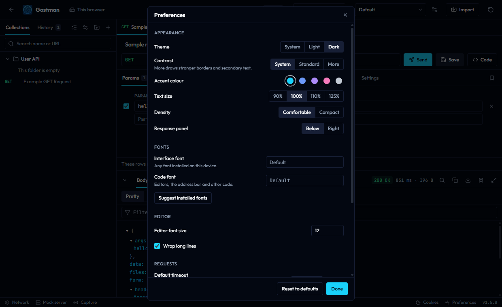

Preferences is a window you can move and resize inside the app. Its sections, in order, are Appearance, Theme, Fonts, Editor, Requests, Language, AI, Privacy and Data. Pick one on the left; Preferences opens on Appearance the first time and on the last section you used after that.

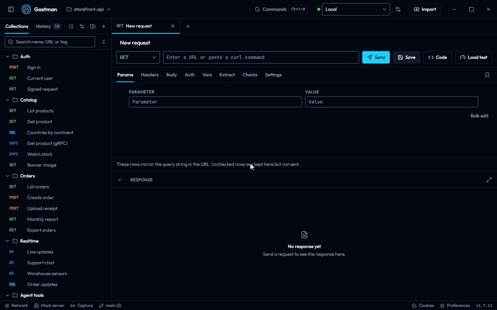

- Drag the title bar to move it, and drag an edge or a corner to resize it. It always stays inside the app.
- With the keyboard, focus the grip at the left of the title (**Move window**): the arrow keys move the window and Shift with the arrow keys resizes it.
- Double-click the title bar, or press Home on the grip, to restore the default size and position.
- Size and position are remembered. On a phone it fills the screen instead, with the sections as a row of tabs.
- Esc closes it. Clicking outside does not, so you can try settings while it stays open.

| Section | Setting | Options | Default |
| --- | --- | --- | --- |
| Appearance | **Text size** | 90%, 100%, 110%, 125% | 100% |
| Appearance | **Density** | **Comfortable**, **Compact** | **Comfortable** |
| Appearance | **Response panel** | **Below**, **Right** | **Below** |
| Theme | **Theme** | **System**, **Light**, **Dark** | **System** |
| Theme | **Contrast** | **System**, **Standard**, **More** | **System** |
| Theme | **Accent colour** | **Cyan**, **Blue**, **Violet**, **Pink**, **Graphite** or a custom colour | **Cyan** |
| Theme | **Palette** | **Default**, **Neutral**, **Slate**, **Paper**, **Moss**, **Dusk**, **Ocean**, **Ink** | **Default** |
| Theme | **Custom colours** | A background and a text colour for each part of the window, for light and for dark | None |
| Theme | **Method colours** | A text colour and an optional background for each request method, for light and for dark | None |
| Fonts | **Interface font** | The name of a font installed on this device | Empty, which uses the default |
| Fonts | **Code font** | The name of a font installed on this device | Empty, which uses the default |
| Editor | **Editor font size** | A whole number of pixels from 10 to 24 | 12 |
| Editor | **Wrap long lines** | On or off | On |
| Requests | **Default timeout** | A whole number of seconds from 0 to 3600 | 0 |
| Requests | **Ask before discarding unsaved changes when closing a tab** | On or off | On |
| Language | **Language** | **English** | **English** |
| AI | **AI** | Consent, on or off, provider, base URL, API key and model; see [AI features](ai.md) | Off |

- **Default timeout** applies to requests that set no timeout of their own. 0 uses the built-in limit of 30 seconds. See [Settings](requests-and-responses.md#settings) for request settings.
- A number field only takes effect while the value is a whole number inside the range. Otherwise the field is marked invalid, and it goes back to the saved value when you leave it.
- **Language** lists English only. The dialog says more languages will appear when translations are available.
- **Use the system title bar** appears in the desktop app on Windows and Linux, under Appearance. It replaces Gostman's own title bar and window buttons with your desktop's, and takes effect the next time Gostman starts. It is saved with the app's data rather than these preferences, so **Reset to defaults** leaves it unchanged. On macOS the system title bar is always used.

At the bottom of the window:

- **Keyboard shortcuts** opens the Keyboard shortcuts dialog over Preferences; closing it returns to Preferences.
- **Reset to defaults** restores every setting in the table, including the palette, custom colours and method colours. It keeps the shortcuts you changed (reset those in the Keyboard shortcuts dialog) and your tag colours.
- **Done** closes the window.

### Themes and colours

**Theme** has three options:

- **System** follows the light or dark setting of your operating system and changes with it.
- **Light** and **Dark** always use that appearance.

**Contrast** makes borders, field outlines and secondary text stronger. **System** turns it on when your operating system asks for more contrast, **More** always does, and **Standard** never does.

**Accent colour** sets the colour of buttons, selected tabs, links and focus outlines. Each accent has its own shade for light and dark, chosen so that text in that colour and text on it stay easy to read.

The last swatch, marked with a plus, picks a custom accent. Gostman keeps your colour where it is readable and darkens or lightens it where it is not, so text in the accent colour reaches 4.5:1 against the window. When it changes your colour, a note under **Accent colour** shows the shade used in each mode.

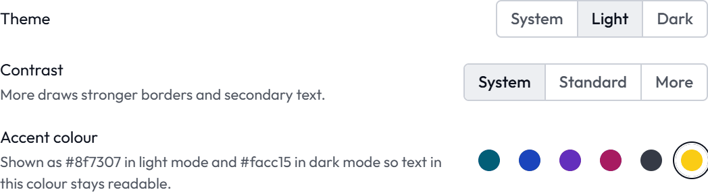

**Palette** sets the background and text colours of the whole window. Each palette has a light and a dark version, shown side by side in its preview, and most give the sidebar a slightly different tone.

**Custom colours** set the background and text colour of one part of the window on top of the palette:

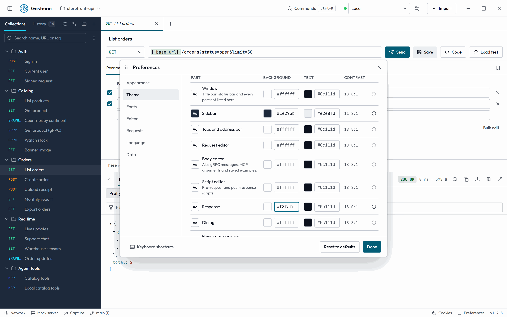

| Part | Covers |
| --- | --- |
| **Window** | The title bar, the status bar and every part not listed below |
| **Sidebar** | Collections and history |
| **Tabs and address bar** | The tab strip and the method, URL and Send row |
| **Request editor** | The request tabs: params, headers, auth and the rest |
| **Body editor** | Request bodies, gRPC messages, MCP arguments and saved examples |
| **Script editor** | Pre-request and post-response scripts |
| **Response** | The response panel |
| **Dialogs** | Every dialog and window, Preferences included |
| **Menus and pop-ups** | Context menus, drop-down lists and the command palette |

- Use **Light** and **Dark** above the table to choose which version you edit. While you edit the version that is not showing, a note says how to see it in place.
- Pick a colour or type it as `#rrggbb`. Only the colours you change are saved; the others follow the palette.
- **Contrast** shows how readable the text is on that background. Below 4.5:1 it turns into a warning.
- Borders, secondary text and highlights of each part are worked out from its two colours, so they stay readable. A dark part in the light theme, or a light part in the dark theme, uses the method, status and syntax colours made for its own background.
- The reset button at the end of a row clears that part; **Reset light colours** or **Reset dark colours** clears them all for that version.

**Method colours** set the colour of each request method (GET, POST, PUT, DELETE, PATCH, HEAD, OPTIONS, GRAPHQL, GRPC and MCP) in the sidebar, tabs, history, runner and the method menu of the address bar. Each method has a **Text** colour and a **Background**; with a background, the method is shown as a badge. They work like custom colours: **Light** and **Dark** choose the version you edit, **Contrast** warns below 4.5:1, and the reset buttons clear one method or all of them.

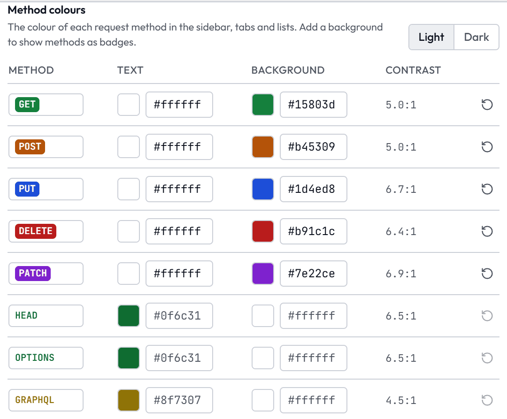

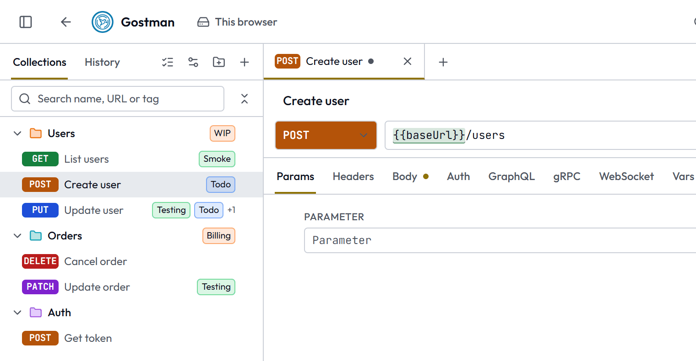

**Share a theme**: **Copy theme** copies the palette, the accent colour, and every custom and method colour, for both versions, as text. **Import theme** takes such text and applies it. A theme only holds colours; anything else, or a colour not written as `#rrggbb`, is refused.

Theme, contrast and accent also apply to the landing page and the documentation in the same browser, and the palette to the landing page.

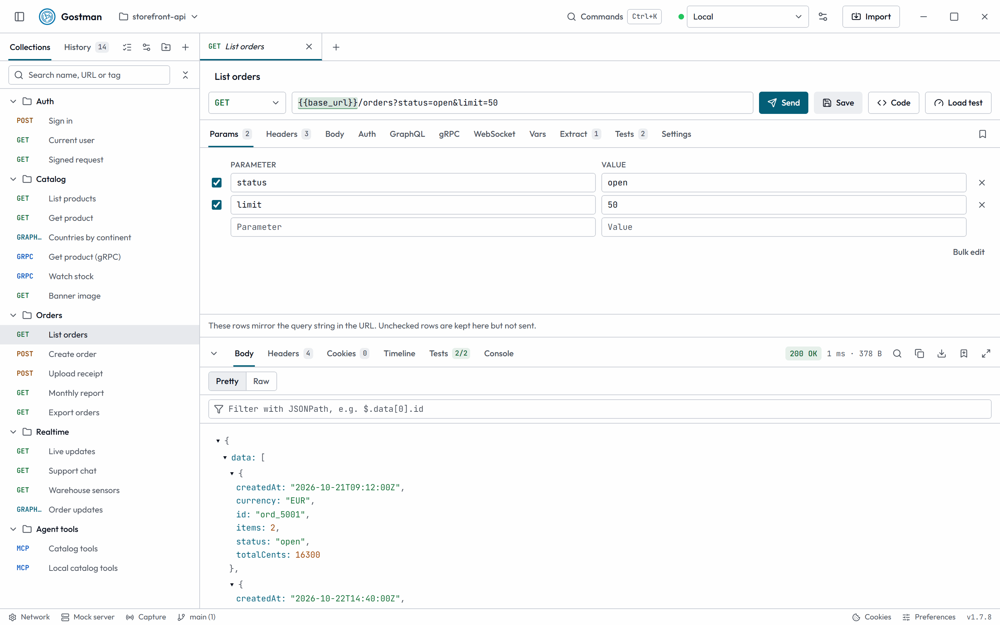

**Text size** scales all text and the spacing around it. **Compact** density makes everything a little smaller again. **Editor font size** is separate and sets the size of the code editors.

The About dialog's diagnostics report the theme setting.

### Fonts

**Interface font** is used for menus, labels and buttons. **Code font** is used for the editors, the address bar, key and value tables and other code. Leave a field empty to use the default fonts, Outfit and JetBrains Mono, which come with Gostman and need no internet connection.

- Type the name of a font installed on your device, for example `Segoe UI`, `Noto Sans JP` or `Fira Code`. The app changes as you type.
- If no installed font has that name, the field is marked and says `Not found on this device, so the default font is used.`
- Select **Suggest installed fonts**, and the font fields then suggest the names of the fonts installed on your device as you type. The up and down arrows move through the list, Enter picks a name and Esc closes the list. The desktop app reads them on Windows, macOS and Linux. In the browser the button appears in Chrome and Edge, which ask for permission first; in other browsers, type the name.

These settings are saved on this device, so the desktop app and each browser keep their own.

### AI

The AI section holds the consent line, the switch to turn AI on, the provider, base URL, API key and model. AI is off until you turn it on here; see [AI features](ai.md). **Reset to defaults** leaves these settings as they are; the button at the bottom of the section forgets them and every saved AI key.

### Data

**Where it is saved** says where your collection is kept: in this browser, in the app's data, or in the open workspace folder. In the web version, the collection and the open tabs are in this browser's IndexedDB, and preferences in its local storage; see [Where your data is kept](getting-started.md#where-your-data-is-kept).

**Backups** lists the automatic copies of your data; see [Backups](#backups) below.

**Export data** opens the Export tab of the import dialog; see [Import, export and specs](import-export-and-specs.md).

**Delete all data** opens a confirmation that lists exactly what is deleted and what is kept. It warns at the top that the automatic backups are deleted too, so they cannot bring the data back. The delete button stays off until you type the word it asks for; **Export first** opens the export instead. The command palette's **Delete all data** opens the same confirmation.

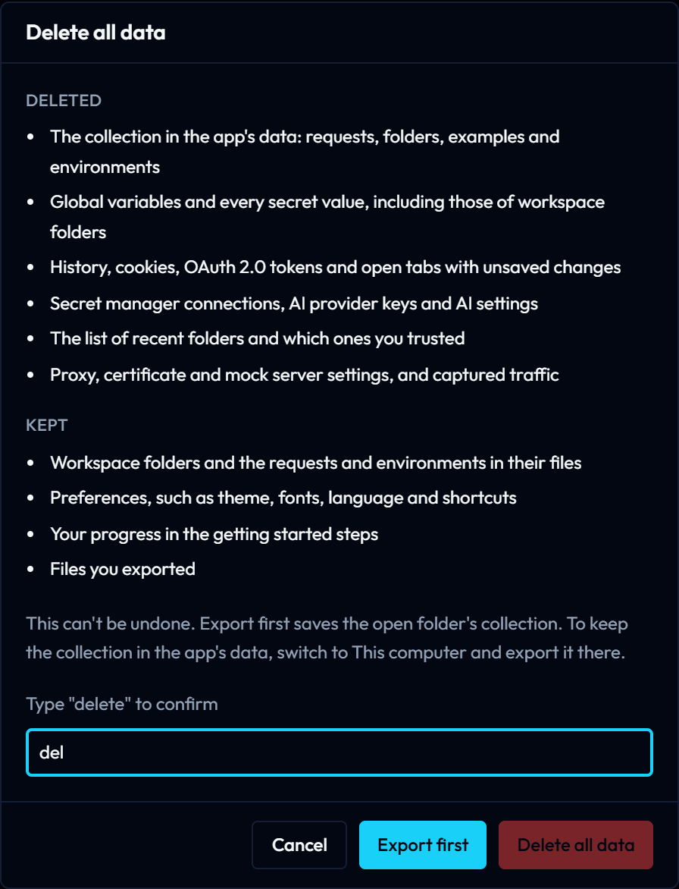

| | Desktop app | Web version |
| --- | --- | --- |
| Deleted | The collection in the app's data; global variables and every stored secret value, workspace folders' included; history, cookies, OAuth 2.0 tokens and unsaved tabs; secret manager connections and their credentials, AI provider keys and AI settings; the list of recent and trusted folders; proxy, certificate and mock server settings, and captured traffic; automatic backups | Requests, folders, examples and environments; global variables and secret values; history, cookies, OAuth 2.0 tokens and unsaved tabs; AI provider keys and AI settings; automatic backups |
| Kept | Workspace folders and their files, preferences, getting started progress and files you exported | Preferences, getting started progress and files you exported |

Running mock servers, captures and load tests stop first. The app then reloads, starts empty and shows **All data was deleted.** once. When a workspace folder is open, **Export first** exports that folder's collection; switch to **This computer** to export the collection in the app's data.

#### Backups

Gostman copies your data before a new version first touches it and at most once a day, and keeps the last 10 copies. Each row shows when the copy was made, the version that made it and its size.

| | Desktop app | Web version |
| --- | --- | --- |
| What is copied | `gostman.json`, the app's data: the collection saved on this computer, history, cookies, OAuth 2.0 tokens, global variables and network settings | The data this browser keeps for Gostman: requests, folders, environments, history and cookies |
| When | When the app starts, if the newest copy is from another version or older than a day, and then hourly while it runs | When the app opens, on the same rule |
| Where | A `backups` folder next to `gostman.json`, readable by you only. **Open folder** shows it. | In this browser's IndexedDB. Clearing the site data deletes the copies as well, so export now and then. |
| Not copied | Secret values, which are stored apart from it (in the system keychain when there is one), and workspace folders | Preferences |

**Restore** asks first and says what is replaced. Before it replaces anything it makes one more copy of the current data, listed as **Before a restore**, so a restore can be undone the same way. Open tabs with unsaved changes keep them; when a request changed under such a tab, the tab offers **Keep my edits** or **Load from disk**.

A workspace folder is plain files, so it is not copied: commit it to Git to keep its history. **Delete all data** deletes the backups as well, because they hold history, cookies and OAuth 2.0 tokens. Export first if you want a copy.

In the web version, when the collection has 50 requests or more and nothing was exported as a **Gostman** file for 30 days, the status bar shows **Export a copy**. It opens the export; the × hides it for another 30 days.

### Privacy

**Telemetry** says what the app sends: nothing about you or your use. [What Gostman connects to](getting-started.md#what-gostman-connects-to) lists every network call each part makes.

**Check for new versions** appears in the desktop app and is off until you switch it on. Then, once a day, the app reads the latest release from `api.github.com` (through your proxy settings) and, when it is newer, shows the version in the status bar. Selecting it opens the release notes and downloads on GitHub; the × hides it until the next version. Gostman never downloads or installs anything by itself. The web version is always current, so it has no such setting.

**Send requests through** appears in the web version. **Hosted relay** sends requests through `gostman.com/api/proxy`, which cannot reach `localhost` or private addresses. **Local relay on this computer** sends them through `gostman relay` running on your machine, so they reach local and private addresses and nothing passes through a third party. Enter the address the command prints, such as `http://127.0.0.1:4030`, and press **Test**; when nothing answers, it says so and asks you to check that `gostman relay` is running at that address. While the local relay is chosen, a request fails with a message rather than falling back to the hosted relay when the local one does not answer. See [Local relay for the web app](cli.md#local-relay-for-the-web-app).

**Reset to defaults** leaves both settings as they are.

## Keyboard shortcuts

Open the Keyboard shortcuts dialog with Ctrl+/, with the **Keyboard shortcuts** command, with the **?** button of the palette or with the **Keyboard shortcuts** button in Preferences. It lists every shortcut in four groups: **General**, **Request**, **Tabs** and **Navigation**. Below them, **Moving around** lists the keys that work inside lists, tabs and menus; those cannot be changed.

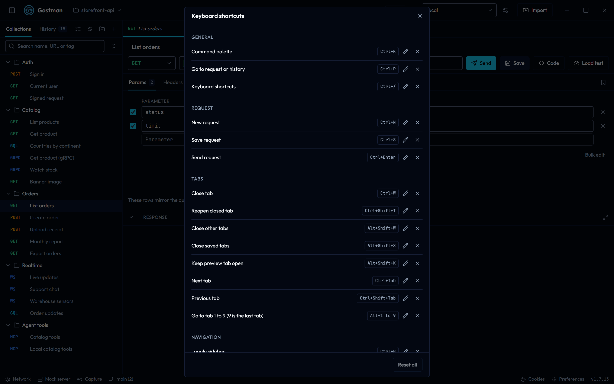

### Default shortcuts

| Group | Action | Desktop | Web |
| --- | --- | --- | --- |
| General | Command palette | Ctrl+K | Ctrl+K |
| General | Go to request or history | Ctrl+P | Ctrl+P |
| General | Keyboard shortcuts | Ctrl+/ | Ctrl+/ |
| General | AI: new request from a description | Ctrl+Shift+U | Alt+Shift+U |
| General | AI: explain the response | Ctrl+Shift+X | Alt+Shift+X |
| Request | New request | Ctrl+N | Alt+N |
| Request | Save request | Ctrl+S | Ctrl+S |
| Request | Send request | Ctrl+Enter | Ctrl+Enter |
| Tabs | Close tab | Ctrl+W | Alt+W |
| Tabs | Reopen closed tab | Ctrl+Shift+T | Alt+Shift+T |
| Tabs | Close other tabs | Alt+Shift+W | Alt+Shift+W |
| Tabs | Close saved tabs | Alt+Shift+S | Alt+Shift+S |
| Tabs | Keep preview tab open | Alt+Shift+K | Alt+Shift+K |
| Tabs | Next tab | Ctrl+Tab | Alt+] |
| Tabs | Previous tab | Ctrl+Shift+Tab | Alt+[ |
| Tabs | Go to tab 1 to 9 (9 is the last tab) | Alt+1 to 9 | Alt+1 to 9 |
| Navigation | Toggle sidebar | Ctrl+B | Ctrl+B |
| Navigation | Search the sidebar | Ctrl+Shift+F | Ctrl+Shift+F |
| Navigation | Next pane | F6 | F6 |
| Navigation | Previous pane | Shift+F6 | Shift+F6 |
| Navigation | Go to the URL | Ctrl+L | Ctrl+L |
| Navigation | Switch workspace | Ctrl+Shift+O | Not available |
| Navigation | Next workspace | Ctrl+Shift+] | Not available |
| Navigation | Previous workspace | Ctrl+Shift+[ | Not available |

On macOS the dialog shows the same shortcuts with the symbols for Control, Command, Option and Shift. In the browser, Alt replaces the shortcuts that browsers keep for themselves: Ctrl+W, Ctrl+Shift+T and Ctrl+Tab.

Enter in the address bar also sends the request, unless a variable suggestion is open or an input method is composing text.

### Change a shortcut

1. Open the Keyboard shortcuts dialog.
2. On the action's row, select the pencil button (**Change the shortcut for** the action).
3. Press the new combination. The row shows the keys as you hold them. Esc cancels.
4. If the combination is free, it is saved at once. The row gets a **Changed** badge.

Other buttons on a row:

- The **X** button (**Remove the shortcut for** the action) clears the shortcut. The row then reads **Not set**.
- The reset button (**Restore the default shortcut for** the action) appears on a changed row and brings back the default.
- **Reset all** at the bottom restores every default. It is disabled when nothing has been changed.

If another action already uses the combination, the dialog says `... is already used by ...` and offers **Replace** or **Cancel**. **Replace** clears the other action's shortcut and assigns the combination to this one.

A combination must include Ctrl, Alt or the command key. A function key can be used alone. These combinations are refused:

- Combinations that edit text in every field, such as Ctrl+C, Ctrl+V, Ctrl+X, Ctrl+A, Ctrl+Z and Ctrl+Y.
- In the browser, combinations that browsers keep for themselves.
- On macOS, combinations the operating system keeps for itself.
- Ctrl and Alt together on Windows and Linux, because many keyboards send that pair for AltGr. The Windows or Super key cannot be used, and Command with Control together is not supported on macOS.
- For **Go to tab 1 to 9**, a combination without a number key. The other tabs use the same modifier.

Your changes are saved with your preferences.

## Move around with the keyboard

Everything in the main window can be reached without a mouse.

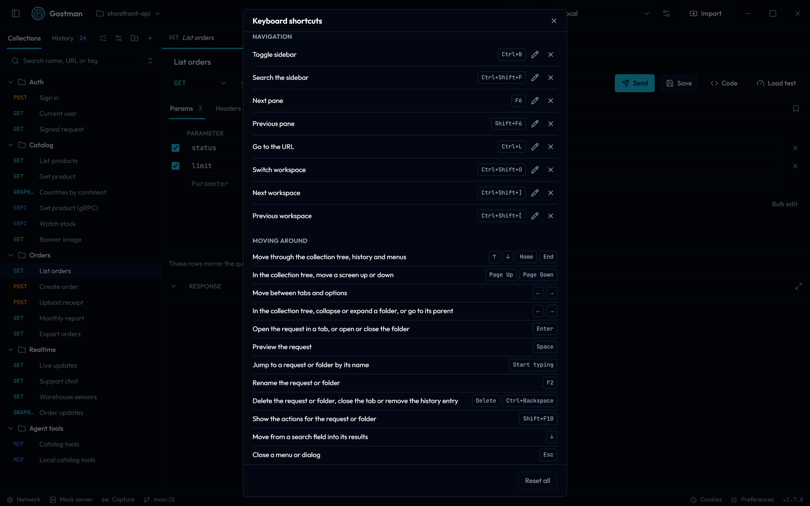

### Panes

The window has five panes: the sidebar, the open tabs, the address bar, the request and the response. F6 moves to the next pane and Shift+F6 to the previous one; a pane that is hidden, such as a closed sidebar, is skipped. Each pane remembers where you were, so coming back puts you on the same field, row or tab. The first visit lands on the selected row, tab or the URL field.

Ctrl+L goes straight to the URL field, and Ctrl+Shift+F to the sidebar search. These, too, can be changed in the Keyboard shortcuts dialog. A new request, from the shortcut, the palette or a **+** button, opens with the focus in its URL field.

### Lists, tabs and options

Each list, row of tabs and set of options is one stop for the Tab key, so Tab moves from one group to the next instead of through every item. Inside a group:

| Keys | Where | What they do |
| --- | --- | --- |
| Up Arrow, Down Arrow, Home, End | Collection tree, history, menus | Move to the previous, next, first or last item |
| Page Up, Page Down | Collection tree | Move a screen up or down |
| Left Arrow, Right Arrow, Home, End | Open tabs, the request and response sections, option buttons such as **Theme** | Move to and select the previous, next, first or last tab or option |
| Right Arrow | Collection tree | Open a closed folder, or move to its first item |
| Left Arrow | Collection tree | Close an open folder, or move to the folder that holds the row |
| Enter | Collection tree | Open the request in a tab, or open or close the folder |
| Space | Collection tree | Preview the request, or open or close the folder |
| Start typing | Collection tree | Jump to the next request or folder whose name starts with what you type. Accents and letter case are ignored, and any script works |
| F2 | Collection tree | Rename the request or folder |
| Delete or Ctrl+Backspace | Collection tree | Delete the request or folder, after you confirm |
| Delete or Ctrl+Backspace | Open tabs | Close the tab |
| Delete or Ctrl+Backspace | History | Remove the entry |
| Shift+F10 or the Menu key | Collection tree | Show the actions for the request or folder |
| Down Arrow | Sidebar search fields | Move into the results |
| Ctrl+Space | Address bar, tables and code editors | Suggest variables without typing `{{` first; the word before the caret filters the list |
| Shift+Alt+F | JSON and XML body editor | Format the body, the same as the **Format** button |
| Tab, Shift+Tab | Code editors | Indent or outdent. To leave the editor, press Esc and then Tab or Shift+Tab. In a dialog, Esc inside an editor does not close the dialog |
| Start typing | Drop-down lists such as the method | Pick the next option that starts with what you type |
| Up Arrow, Down Arrow | The bar between the request and the response | Make the response taller or shorter |
| Esc | Menus and dialogs | Close them and go back to where you were. Tab also closes a menu |

Alt+Shift+Left Arrow and Alt+Shift+Right Arrow move the focused tab, and the tree keeps its keys for moving, copying and duplicating rows; see [Move, copy and duplicate](collections-and-git.md#move-copy-and-duplicate).

Closing a dialog or a menu puts you back on the item that opened it. After you delete a row, close a tab or remove a history entry, the focus moves to the next one.

## About

Open **About Gostman** from the command palette, or select the version number at the right end of the status bar. The dialog shows:

- the version number;
- a short description: an open source API client for REST, GraphQL, gRPC and WebSocket, with no account and your data on your device;
- links to the **Website**, **Source code**, **Releases** and **Report an issue**.

**Copy diagnostics** copies a short JSON text to the clipboard, and the button then reads **Copied**. It holds the app version, whether you run the desktop or web app, the platform, the language, the theme, whether you are online, and the number of requests, folders and environments. It never includes requests, URLs, variables, tokens or secrets, so you can attach it to a bug report.
