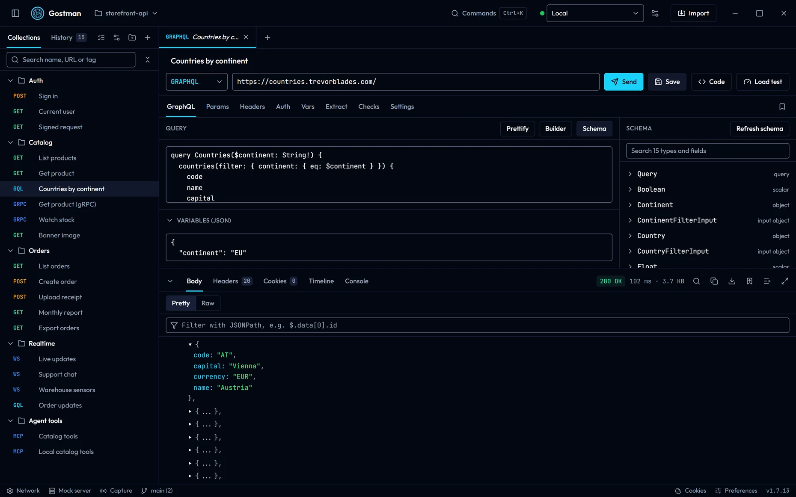
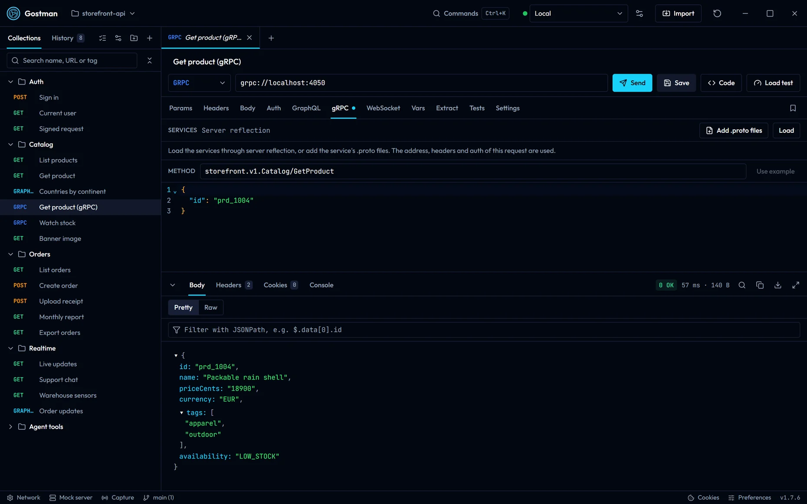
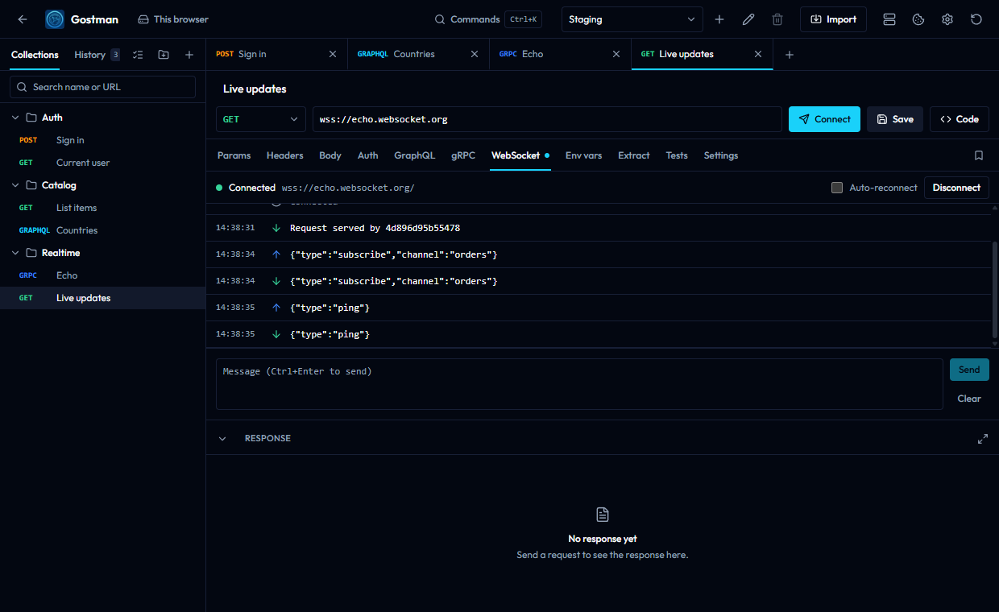
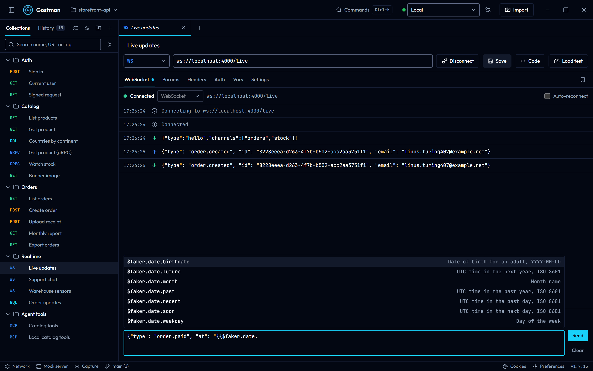
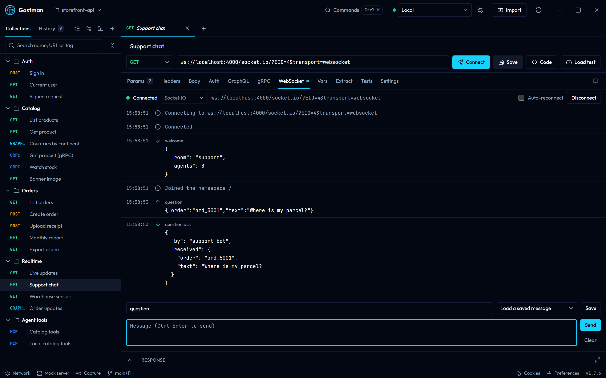
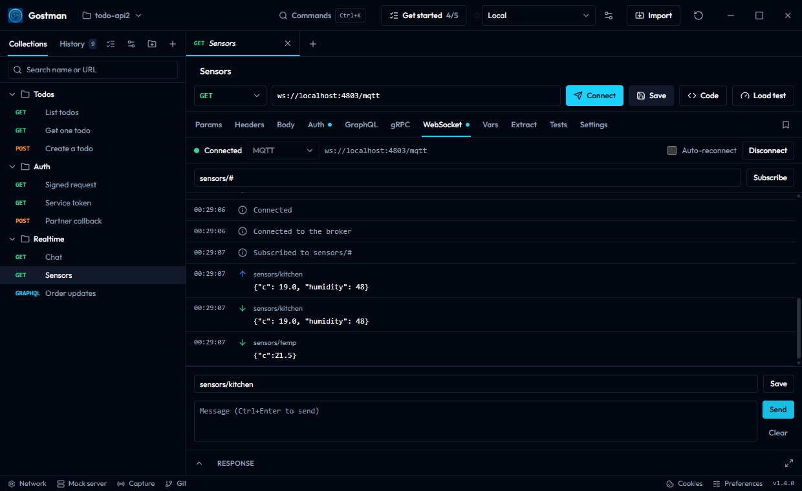
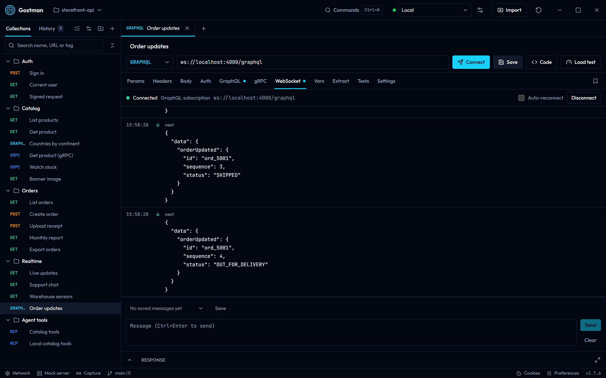
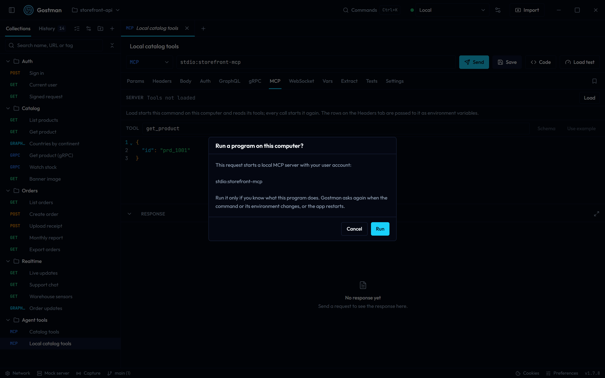
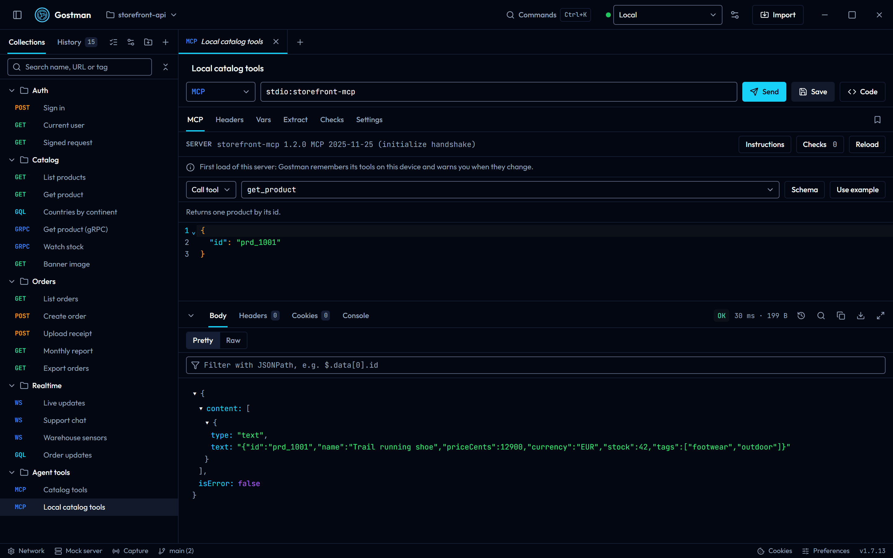
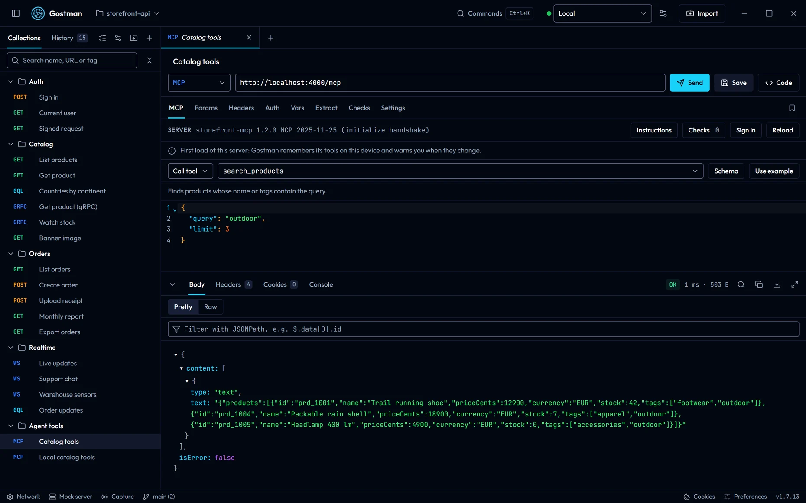

# Protocols

This page covers every protocol you can test from Gostman: REST and other HTTP requests, GraphQL, gRPC, WebSocket, Socket.IO, MQTT, Server-Sent Events, SOAP and MCP servers. It describes what each protocol's panel does and where the desktop app and the web app differ. To let a coding agent call your APIs through Gostman instead, see [Use from a coding agent](agents.md).

Every protocol uses the same request bar, variables, environments, auth and saved collections. Requests are prepared and sent by the Go engine in both the desktop app and the web app, so a request behaves the same in both unless this page says otherwise.

## REST and HTTP

The method list in the request bar offers GET, POST, PUT, DELETE, PATCH, HEAD and OPTIONS. It also offers GRAPHQL, GRPC and MCP, which switch the request to those protocols. A request that arrives with another method, for example from an import, keeps that method in the list.

- Type a URL in the bar, or paste a curl command into it to turn the command into a request.
- Use `{{name}}` placeholders for variables from the active environment.
- The Body tab offers None, JSON, Text, XML, SOAP, Form URL-encoded, Multipart and File.
- The Settings tab has Timeout (ms), Follow redirects, Verify TLS certificates, the cookie jar options, Stream as server-sent events, Tags and Description. See [Settings](requests-and-responses.md#settings).
- The Code button generates a snippet for the request. The snippet comes from the same engine, so it matches what is sent.

Limits that apply to every protocol on this page:

- The web app relays requests through a small proxy. The hosted proxy cannot reach `localhost` or private network addresses, so use the desktop app for local servers.
- Proxy, CA certificate and client certificate settings exist only in the desktop app.
- The web app truncates responses larger than 3 MB. The desktop app reads up to 50 MB.

## GraphQL

Choose GRAPHQL in the method list; the GraphQL tab opens. If a request keeps a GraphQL query under another method, its GraphQL tab stays visible with Send as GraphQL, and typing in the query also switches the method to GRAPHQL. The engine sends a POST request with a JSON body that holds `query` and, when you provide them, `variables`. If the query editor is empty, the engine falls back to the request body.

### Query and variables

- The editor labelled GraphQL query checks syntax as you type and shows the error with its line and column. Placeholders are replaced with environment values before the check.
- Prettify reformats the query. It removes comments, and it reports an error if the query cannot be parsed.
- Variables (JSON) holds the variables. It must be a JSON object, and Gostman marks it when it is not valid JSON.
- If the method is not GRAPHQL, the tab shows that the query is not sent while the method is something else.

### Schema browser

Select Schema to open the schema pane, then Fetch schema. Gostman sends an introspection query with the URL, headers and auth of this request. The button changes to Refresh schema after the schema loads.

- The search box, Search N types and fields, matches type names and field names.
- Each type shows its kind and, when you expand it, the signatures and descriptions of its fields, input fields, enum values or possible types.
- The list shows up to 100 matching types at a time. Narrow the search to see the rest.

### Query builder

Select Builder to open the query builder. It uses the same introspection result, so use Fetch schema first, or Refresh schema to reload it.

- Operation type switches between Query, Mutation and Subscription for the root types the schema defines.
- Filter fields narrows the tree.
- A checkbox next to a field selects it, and a checkbox next to an argument includes that argument. Gostman writes the result into the query editor and may update the variables.
- Fields that a fragment in the editor already selects are locked. Edit them in the editor.
- The builder pauses while the editor has a syntax error.

### Subscriptions

With an `http` or `https` URL, Gostman sends GraphQL as a normal HTTP request. To read subscriptions from a server that delivers them as server-sent events, turn on Stream as server-sent events in the Settings tab. See [Server-Sent Events](#server-sent-events). For subscriptions over WebSocket, use a `ws://` or `wss://` URL; see [GraphQL subscriptions](#graphql-subscriptions).

## gRPC

Choose GRPC in the method list. The address is a `grpc://host:port` URL for plaintext or `grpcs://host:port` for TLS; `http://` and `https://` mean the same. A bare `host:port` is plaintext, except on port 443, which uses TLS. The default port is 80 for `grpc://` and 443 for `grpcs://`. TLS certificates are verified unless you turn off Verify TLS certificates in Settings.

### Load the services

The Services line shows where the service list comes from.

- With no files added it shows Server reflection. Select Load, and Gostman asks the server for its services through reflection. The button changes to Reload afterwards.
- Select Add .proto files to pick one or more `.proto` files. When files are present, Gostman compiles them and uses them instead of reflection. The file names appear in the Services line.
- Adding a file with the same name replaces the earlier one. Remove files clears them.
- The address, headers and auth of the request are used for the connection.
- A file over the attachment size limit is rejected with a message that names the file.

If the server reports no services, the panel shows No services were found.

### Call a method

1. Pick a method from the Method list. It groups methods by service. Before you load services you can type a name in the form `package.Service/Method`.
2. The label next to the list shows the kind: Unary, Server streaming, Client streaming or Bidirectional streaming.
3. Select Use example to replace the message with a generated example of the method's input type. Choosing a method fills the message with that example when the message is empty or `{}`.
4. Edit the JSON message and select Send. Placeholders in the message are filled in when it is sent; type `{{` or `faker.` in the editor to pick a variable or a dynamic value.

Messages are written as JSON and converted with the protobuf JSON mapping.

### Streams

Gostman does not run interactive streams. It collects them.

- For a method that reads a stream from the client, write a JSON array to send several messages. All of them are written up front.
- For a server-streaming method, the response body is a JSON array of every message received. For other methods the body is the single reply message.
- The response is shown when the stream ends. The web app behaves the same way.
- If the reply is larger than the response size limit, the response is marked as truncated.

### Metadata and status

- Request headers are sent as gRPC metadata. Keys are lower-cased. A header name with characters metadata cannot carry, or a value with non-ASCII characters on a key that is not binary, is reported as an error before anything is sent.
- The response status shows the gRPC status code and its name, for example `0 OK`.
- The response headers list the server's header metadata, its trailer metadata, `grpc-status` and, when present, `grpc-message`.
- When a call fails and no message came back, the body is a JSON object with `code` and `message`.

### Desktop and web

gRPC works in both apps. In the web app the call goes through the proxy, so it cannot reach `localhost` or private addresses. In the desktop app and in `gostman run`, gRPC uses the proxy, the CA certificates and the client certificates of [Network settings](secrets-and-network.md#network-settings) and of the collection, like HTTP requests: a `grpcs://` server that asks for a client certificate gets the one set for its host.

## WebSocket

Enter a `ws://` or `wss://` URL. The Send button becomes Connect, and the WebSocket tab opens. Placeholders in the URL and in the headers are replaced with environment values. If the URL uses a variable the active environment does not define, the WebSocket tab shows which ones are missing in place of the address, and Connect writes the same message to the log instead of connecting. A header that uses an undefined variable is sent as written, and a warning in the log names the variable.

### Connect and send

- The status next to the address is Disconnected, Connecting, Connected or Waiting to reconnect.
- Connect opens the session and Disconnect closes it. Each tab keeps its own session, and closing the tab ends it.
- Type in the Message box and select Send, or press Ctrl+Enter. On macOS the shortcut is shown with the Command key. The box is disabled until the session is connected.
- Placeholders in the message and in its event or topic are filled in when you send it: environment variables, and dynamic values such as `{{$randomEmail}}` or `{{$faker.date.future}}`. Type `{{` or `faker.` to pick one. The log shows the message as it was sent. A variable that is not defined is sent as written, and a warning in the log names it. A message that cannot be filled in at all, for example one that uses `{{$file(...)}}`, is not sent, and goes back into the box.
- Sent messages are text. Clear empties the log.

### Message log

- Each entry shows a time, an icon for Sent, Received, Info, Warning or Error, and the text. Hover an entry and use Copy message to copy it.
- The log keeps the latest 1000 entries. A notice shows how many older entries were dropped.
- A text message longer than 10,000 characters is shortened, and the entry says Showing the first N of M characters.
- A binary message appears as hexadecimal bytes. The entry says Binary and the byte count, and shows the first 64 bytes.

### Saved messages

Save keeps the message box, and the event or topic, under a name. The saved messages are part of the request, so they are written with it and travel with exports and workspace folders. Pick one from Load a saved message to put it back in the message box. While the message box matches a saved message, a delete button removes it.

### Socket.IO

Choose Socket.IO in the Protocol list next to the status. Gostman speaks Socket.IO 3 and 4 (Engine.IO 4) over WebSocket.

- The URL path is the namespace: `ws://localhost:3000/admin` joins `/admin`, and `ws://localhost:3000` joins `/`. Gostman connects to `/socket.io/` on that host. A URL that already starts with `/socket.io/` is used as written and joins `/`.
- **Path**, below the toolbar, changes `/socket.io/` for servers set up with another path, such as `/api/socket`. A URL that starts with that path joins `/`.
- **Auth payload** is a JSON object sent with the namespace handshake, which the server reads as `socket.handshake.auth`, for example `{"token": "{{token}}"}`. Variables are filled in when you connect. Text that is not a JSON object stops the connection with a message.
- Both are saved with the request and can be changed while disconnected.
- Type an event name in Event and its argument in the message box. JSON is sent as JSON, other text as a string, and an empty box emits the event without arguments.
- Received events show the event name above the arguments. Acknowledgements show as `ack` with their id, and a refused connection shows the server's message.
- Gostman answers the server's pings. Binary Socket.IO packets are listed but not decoded.

### MQTT

Choose MQTT in the Protocol list to talk to a broker over MQTT 3.1.1 on WebSocket, for example `ws://localhost:8080/mqtt`. The `mqtt` subprotocol is sent for you.

- Set Auth to Basic to send a user name and password; other auth types send none. Each connection uses a new client ID that starts with `gostman-` and a clean session.
- Type a topic filter such as `sensors/#` and select Subscribe. The broker's answer is shown in the log.
- Type a topic in Topic and the payload in the message box to publish at QoS 0. Received messages show their topic above the payload; a payload that is not UTF-8 is shown as hexadecimal bytes.
- Brokers that only listen on TCP port 1883, without WebSocket, cannot be reached.

### GraphQL subscriptions

A GRAPHQL request with a `ws://` or `wss://` URL connects with the `graphql-transport-ws` protocol, which the `graphql-ws` library, Apollo Server and most current servers use.

1. Write the subscription in the GraphQL tab, with its variables.
2. Select Connect. Gostman sends `connection_init` with the request's headers and auth as its payload, which is where most servers read credentials, then subscribes once the server acknowledges.
3. Each result appears as `next`, followed by a notice when the subscription completes.

The older `subscriptions-transport-ws` protocol is not supported. For servers that send subscriptions as server-sent events instead, see [Subscriptions](#subscriptions).

### Auto-reconnect

Turn on Auto-reconnect to reconnect after the connection closes or fails. Gostman waits 3 seconds, logs `Reconnecting in 3 s` and tries again. Turning the option off while Gostman is waiting disconnects the session.

### Headers

The enabled headers on the Headers tab, together with inherited headers, are used when the session opens.

| Transport | Headers sent |
| --- | --- |
| Web app (browser) | Only `Sec-WebSocket-Protocol`. Each comma-separated value becomes a subprotocol. |
| Desktop app | Every header. |

In the web app, the panel lists the headers that are not sent, with this notice: a browser can only set Sec-WebSocket-Protocol on a WebSocket, and the desktop app sends every header.

WebSocket requests are not available to agents. See [Use from a coding agent](agents.md).

## Server-Sent Events

Gostman reads a server-sent event stream and lists the events as they arrive. A request becomes a stream in either of two ways:

- Turn on Stream as server-sent events in the Settings tab.
- Send an enabled `Accept` header that contains `text/event-stream`.

The engine treats the response as a stream only when the status is 200 and the content type is `text/event-stream`. Any other response is shown as an ordinary response.

### Settings

These options appear in the Settings tab when Stream as server-sent events is on.

| Option | Behavior |
| --- | --- |
| Reconnect when the server closes the stream | Reconnects after the server closes the stream or the stream fails. It waits for the delay the server sent in `retry`, or 3 seconds, and sends `Last-Event-ID` with the last event id it saw. It stops after 25 reconnects. |
| Max events | Stops after this many events. The placeholder is Default 10000, and the engine accepts at most 100000. |
| Max seconds | Stops after this many seconds. The placeholder is Default 300. |

The web app limits how long it streams, and the desktop app can stream longer. When the limit is reached, the stream ends and the panel says so.

### Event viewer

- A badge shows Connecting, Streaming, Reconnecting or Ended, and a counter shows how many events are shown and received.
- Each row shows the event number, the time, the event type, the id when there is one and the first line of the data.
- All event types filters by type and shows the count for each type. Search events matches the type, id and data.
- Select a row to see the full data below the list. JSON data is pretty-printed. An event that was too long is cut, and the panel says so.
- Pause autoscroll and Resume autoscroll control whether the list follows new events.
- Copy shown events copies the filtered events as text, and Clear events empties the list.
- The list shows a limited number of events. When older ones are dropped the panel says that the downloaded response still has every event.
- When the stream ends, the panel gives the reason: the server closed it, it was stopped, or it hit the event, size or time limit.

## SOAP

Choose SOAP as the body type on the Body tab. If the body is empty, Gostman inserts a SOAP 1.1 envelope template with an empty header and body.

### SOAP bar

- SOAP version switches between SOAP 1.1 and SOAP 1.2. Gostman changes the envelope namespace in the body. If the body has no envelope, it inserts a template.
- SOAPAction sets the `SOAPAction` header. Clearing the field removes the header.
- Format XML indents the envelope and keeps comments and CDATA sections. If the XML is malformed, the bar shows the parser's message and leaves the body as it is.

### What the engine sends

- SOAP 1.1: content type `text/xml; charset=utf-8`. If no `SOAPAction` header is set, Gostman sends an empty one.
- SOAP 1.2, detected from the 1.2 envelope namespace in the body: content type `application/soap+xml; charset=utf-8`. A `SOAPAction` value moves into an `action` parameter of the content type and the separate header is dropped.

### Responses and faults

When the response is `text/xml`, `application/xml` or `application/soap+xml` and holds a SOAP envelope, the Body tab shows the formatted envelope. If the body contains a fault, a SOAP Fault summary appears above it with Code, Reason, Actor and Detail where the fault provides them.

### Import a WSDL

Use Import and choose WSDL as the format, or leave Detect automatically on. The importer accepts `.wsdl`, `.xsd` and `.xml` files.

- It creates a folder named after the WSDL, with a folder for each service inside.
- Each operation becomes a POST request with a sample SOAP envelope built from the WSDL types and a `Content-Type` header. A SOAP 1.1 operation also gets a `SOAPAction` header.
- The URL of each request is a variable named after the service and ending in `Url`. Its value is the address from the WSDL port.
- Only SOAP bindings are imported. Other bindings are skipped and reported in the import summary.
- Schema files you import with the WSDL are used for the sample body. Imports that Gostman cannot find are listed as a warning.

## MCP servers

This section is about testing an MCP server from Gostman. To expose Gostman to an agent, see [Use from a coding agent](agents.md).

Choose MCP in the method list and enter the server's URL. An MCP tab appears. Gostman reaches remote servers over Streamable HTTP, and in the desktop app it can also start a local server that talks over stdio. The headers and auth of the request are sent with every call to a remote server, and placeholders work in the URL, the tool name and the arguments.

### Local servers (stdio)

In the desktop app, write `stdio:` followed by the command that starts the server, for example `stdio:npx -y @modelcontextprotocol/server-everything` or `stdio:python server.py`.

- The first time a command runs, Gostman shows it and asks **Run a program on this computer?**. Cancel is the default. You are asked again when the command or its environment changes, or the app restarts.
- The command is split into a program and its arguments; it is not passed to a shell, so pipes, `&&` and `$VAR` have no special meaning. Put an argument with spaces in double or single quotes.
- The enabled rows on the Headers tab become environment variables of the program, for example `API_KEY`, and `{{variables}}` work in both.
- Each Load and each call start the program again and stop it when the answer arrives. When it stops early, its error output is shown.
- In a folder you have not trusted, local commands are switched off like scripts. The collection runner runs a local command only after you have confirmed it from its tab.
- The web app, `gostman run` and the MCP server for coding agents never start local commands.

### Protocol versions

Gostman speaks MCP 2026-07-28 and the earlier revisions that start with an `initialize` handshake (2025-11-25, 2025-06-18, 2025-03-26 and 2024-11-05). Every Load and every call first sends `server/discover`. A server that answers it is used with 2026-07-28: each request carries its protocol version and client details in `_meta`, and over HTTP the `MCP-Protocol-Version`, `Mcp-Method` and `Mcp-Name` headers. A server that does not know `server/discover` gets the `initialize` handshake instead, and Gostman remembers that until the app restarts, so later calls skip the probe. A local server that does not answer the probe at all is given ten seconds before Gostman falls back. Headers you set on the Headers tab take precedence over the ones Gostman adds, so you can send a deliberately wrong `Mcp-Name` to test how a server validates it.

When a tool's input schema marks a parameter with `x-mcp-header` and the server reports a header mismatch, Gostman reads the tool list, sends the parameter's value as an `Mcp-Param-` header and calls again. Tools whose `x-mcp-header` annotations break the rules of the specification are left out of the tool list and listed under Checks.

### Load the server

Select Load next to Server. Gostman connects and reads the server's tools, resources, resource templates and prompts, for each kind the server says it offers. The server line shows its name, its version and the MCP protocol version in use; the button changes to Reload. When the server gives instructions to the models that use it, an Instructions button appears next to Checks; select it to read them. A server that answers 401 or 403 needs credentials: see [Sign in with OAuth](#sign-in-with-oauth).

Before you load the server, the item field is a text box where you can type a tool name, a resource URI or a prompt name. If the server lists nothing, the panel says so.

### Operations

The Operation list next to the item field chooses what Send does:

| Operation | Sends | Input |
| --- | --- | --- |
| Call tool | `tools/call` | A tool and its JSON arguments |
| List tools | `tools/list` | None |
| Read resource | `resources/read` | A resource URI. The field suggests the listed resources and templates; fill in the template parts yourself. |
| List resources | `resources/list` | None |
| List resource templates | `resources/templates/list` | None |
| Get prompt | `prompts/get` | A prompt and its arguments, as a JSON object of strings |
| List prompts | `prompts/list` | None |

List operations follow every page of the answer and return one body with all the items. The operation is saved with the request, so a collection can hold resource reads and prompt checks next to tool calls, and the collection runner and `gostman run` send them the same way.

### Call a tool

1. Pick a tool from the list next to Operation, which reads Choose a tool until you pick one.
2. The tool's description appears under the toolbar.
3. Select Schema to show the JSON Schema of the tool's arguments, or the argument list of a prompt, next to the editor. On a phone it covers the panel until you close it.
4. Select Use example to replace the arguments with an example built from that schema. Choosing a tool or a prompt fills the arguments with its example when they are empty, `{}`, or still the unedited example of the previous choice; arguments you edited are kept.
5. Edit the JSON arguments and select Send. Type `{{` or `faker.` in the editor to pick a variable or a dynamic value.

An empty arguments field is sent as `{}`.

### Result

The response body is the server's result. For a tool call it includes `content` and an `isError` flag. The status is one of:

| Status | Meaning | Counts as failed |
| --- | --- | --- |
| OK | The server returned a result. | No |
| Tool error | The tool ran and reported an error with `isError: true`. | Yes |
| JSON-RPC error | The server refused the request, for example for an unknown tool. The body holds the error. | Yes |
| Input required | The server asked for input Gostman does not provide, such as an elicitation. The body shows what it asked for. A result that only asks to be sent again with the server's `requestState` is retried automatically, up to three times. | Yes |
| An HTTP status, such as 401 Unauthorized | The server did not accept the request. | Yes |

A failed call is marked as failed in the collection runner and by `gostman run`, even when the request has no assertions, and it appears as a failure in JUnit reports. The text report and the JUnit failure message carry the tool's text content, such as `Tool error: Order 42 does not exist.` The status code stays the HTTP status of the exchange (200 for a tool error). To assert on the outcome, check the body or the status text:

- `res.body.isError` is false
- `res.statusText` equals `OK`

Progress updates and log messages the server sends while it works (`notifications/progress` and `notifications/message`) are listed above the body under Notifications, with the time each one arrived: progress as done/total with its message, and log messages with their level, logger and data. Gostman asks 2026-07-28 servers for log messages at the debug level. The first 500 notifications of a call are kept.

### Checks

After a Load, the Checks button shows how many problems Gostman found in the tool definitions; select it to list them. The checks are fixed rules and do not use a model. They report:

- a missing description, or one shorter than 20 characters
- two tools with the same name, or names that differ only in case, `_`, `-` or `.`
- names longer than 128 characters or with characters other than letters, digits, `_`, `-` and `.`
- an input schema that is not an object, has a top-level type other than `object`, uses an unknown type, or has a malformed `properties` or `required`
- parameters without a description, and required parameters the schema does not define
- more than 40 tools
- list requests that failed, and tools left out because of invalid `x-mcp-header` annotations

### Tool changes

For every server you load, Gostman keeps each tool's description and a fingerprint of its name, description and input schema on this device only; they never go into collection files or folders. The first Load of a server records them. When a later Load finds new, removed or changed tools, a warning lists them, because a changed description can carry instructions you have not seen before: new and removed tools by name, and for each changed tool its previous and current description, or a note that only its input schema changed. Read the changes, then select Accept changes to record the new state. Tools are compared on Load and Reload, not on every call.

### Sign in with OAuth

Select Sign in to get a token for a remote server that uses OAuth. Gostman follows the MCP authorization specification and shows each step as it runs. Select a finished step to see the requests it made and what came back. A step that fails opens by itself, with a plain explanation of what to change:

1. **Ask the server.** Gostman sends a request with the request's current headers and auth. A 401 or 403 answer starts the sign-in. A server that answers anyway can still be signed in to when it publishes OAuth metadata.
2. **Read the WWW-Authenticate challenge** for its `resource_metadata` address and `scope`. After a 403 with `insufficient_scope`, Gostman asks for the scopes you had plus the ones the server named.
3. **Find the protected resource metadata** (RFC 9728) at the challenge's address, or at `/.well-known/oauth-protected-resource` with and then without the server's path. Its `resource` must cover the server's URL. When it names another resource, Gostman stops, because tokens issued for that resource would not be accepted by this server.
4. **Find the authorization server metadata** at the RFC 8414 and OpenID Connect addresses, in the order the specification gives. The `issuer` in the document must be identical to the address it was found for, and the server must list S256 in `code_challenge_methods_supported`.
5. **Get a client ID.** A client ID already on the Auth tab is used when it belongs to the same authorization server. Otherwise Gostman uses its client ID metadata document when the authorization server supports those, or registers itself with dynamic client registration. When neither is offered, register a client yourself, enter its client ID on the Auth tab and sign in again.
6. **Sign in in the browser** with the authorization code flow, PKCE and the `resource` parameter. The desktop app opens the system browser and listens on `http://localhost:9876/callback`; the web app opens a pop-up.
7. **Check the issuer of the answer** (RFC 9207). An answer that names a different issuer is discarded, and one without an issuer is rejected when the authorization server says it sends one.
8. **Exchange the code for a token**, again with the `resource` parameter.
9. **Call the server with the token** by loading it again.

The token and the settings found during sign-in are stored on the request's Auth tab as an OAuth 2.0 authorization code configuration, like any other OAuth 2.0 token, and renewed with the refresh token when the server issues one. Tokens never go into collection files or folders. In a folder you have not trusted, sign-in is switched off like other OAuth 2.0 settings. Local servers started with `stdio:` take their credentials from environment variables instead.
