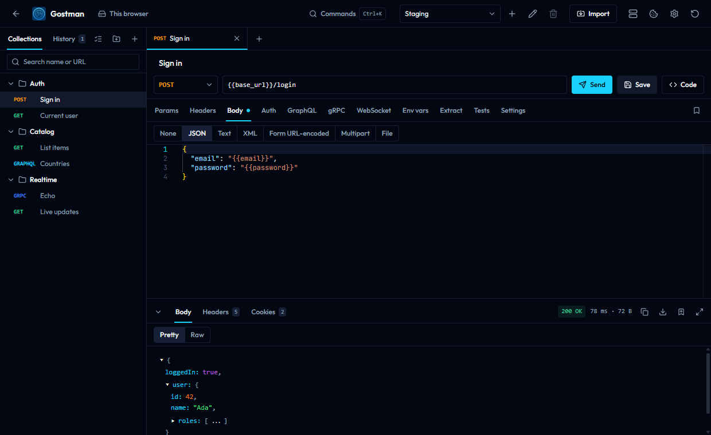

# Requests and responses

This page covers the request editor and the response viewer in Gostman: the request bar, the request tabs, variables in inputs, the response tabs, history, the cookie jar, saved examples and code generation. It describes the desktop app and the web app, which share one interface, and marks the places where they differ.

## Open requests

Each request opens in a tab above the editor.

- A small dot on a tab means the request has unsaved changes.
- Double-click a tab to keep it open. A tab shown in italics is a preview tab.
- Middle-click a tab to close it, or right-click it for a menu.
- Drag a tab to reorder it. The plus button next to the tabs creates a request.

## The request bar

The request bar sits above the request tabs.

| Control | What it does |
| --- | --- |
| Request name | A text field that shows "Untitled request" until you name the request. |
| HTTP method | GET, POST, PUT, DELETE, PATCH, HEAD, OPTIONS, GRAPHQL, GRPC or MCP. |
| Request URL | Accepts `{{variables}}`. Pasting a command that starts with `curl ` fills the request from it. |
| Send | Sends the request. While a request is running the button becomes Cancel. |
| Save | Saves the request. |
| Code | Opens the code generator. See [Code generation](#code-generation). |

When the URL is a WebSocket address, the Send button is labelled Connect. Send and Save show their keyboard shortcuts in their tooltips; see [Preferences, shortcuts and the command palette](preferences-and-shortcuts.md).

## Request tabs

The row below the request bar holds the tabs. A count or a dot on a tab shows that it has content. The GraphQL, gRPC and WebSocket tabs belong to those protocols, and an MCP tab appears when the method is MCP.

| Tab | Purpose |
| --- | --- |
| Params | Query parameters |
| Headers | Request headers |
| Body | The request body |
| Auth | Authentication |
| Vars | Variables for this request |
| Extract | Rules that copy response values into variables |
| Tests | Assertions and scripts |
| Settings | Timeout, redirects, TLS, streaming and description |

The bookmark button at the right end of the tab row opens the saved [examples](#examples) of the request.

### Params and Headers

Params and Headers use a table with a checkbox, a name and a value for each row. Clear the checkbox ("Send this row") to keep a row without sending it. The remove button deletes a row, and the empty row at the bottom adds a new one. Names and values accept `{{variables}}`.

- The Params rows mirror the query string in the URL. Unchecked rows are kept in the table but not sent.
- The Headers tab shows a count of headers inherited from folders or the collection. See [Folder and collection settings](folder-settings.md).

### Body

Choose a body type with the buttons at the top of the Body tab.

| Type | Editor |
| --- | --- |
| None | The request is sent without a body. |
| JSON | Code editor with JSON highlighting. |
| Text | Code editor, plain text. |
| XML | Code editor with XML highlighting. |
| SOAP | XML editor with a toolbar. |
| Form URL-encoded | Table of name and value rows. |
| Multipart | Table of rows where each row has a Type of Text or File. |
| File | Choose a single file to send as the body. |

Details:

- File attachments, in the File type and in Multipart file rows, are limited to 5 MB. A larger file is refused with a message.
- Switching between raw types (JSON, Text, XML, SOAP) keeps the same text. Switching between the groups None, Form URL-encoded, Multipart, File and raw types keeps a separate draft for each group, so you can switch back without losing it.
- For SOAP, the toolbar offers SOAP 1.1 and SOAP 1.2, a SOAP action field and a Format button. Choosing SOAP with an empty body inserts a SOAP 1.1 template.
- When the method is GRAPHQL, the Body tab shows a notice: the body is built from the GraphQL tab and the Body tab is not sent.

### Auth

The Type list in the Auth tab holds these choices:

- No auth. A request set to No auth is sent without authentication.
- Inherit, which uses the auth of the folder or collection. See [Folder and collection settings](folder-settings.md).
- Basic: Username and Password.
- Bearer token: Token.
- API key: Key, Value and Add to (Header or Query params).
- OAuth 2.0.
- Digest: Username and Password. The request is sent first without credentials and repeated with a Digest answer when the server challenges it.
- NTLM: Username, Password and Domain. The handshake runs when the server asks for it.
- AWS Signature V4: Access key ID, Secret access key, Session token, Region and Service.
- OAuth 1.0: consumer key and secret, access token and token secret, signature method (HMAC-SHA1, HMAC-SHA256, RSA-SHA1, RSA-SHA256 or PLAINTEXT), and optional realm, callback URL, verifier, nonce and timestamp. Send in chooses Authorization header, Query params or Form body.
- Akamai EdgeGrid: Client token, Client secret and Access token are required. Headers to sign, Max body size, Nonce and Timestamp are optional.

Secret fields are masked. The eye button shows or hides the value. Values can use `{{variables}}`, and auth overrides a header or parameter of the same name.

OAuth 2.0 has these fields:

- Grant type: Client credentials, Password or Authorization code.
- Authorization URL and Callback URL, for Authorization code only.
- Token URL, Client ID, Client secret and Scope.
- Username and Password, for the Password grant only.
- Send credentials in: Basic auth header or Request body.
- Use PKCE, for Authorization code only.
- Header prefix and Access token.

Get token requests a token and Clear token removes it. The panel shows whether a token exists and when it expires. For Authorization code, the panel waits for you to finish signing in in your browser, and Cancel stops the wait. For the callback address to register with your provider, see [Variables, scripts and settings](scripting-and-settings.md#oauth-20-callback).

### Vars

The Vars tab holds variables that apply to this request only. They use the same row table as Headers. See [Variables](variables.md) for scopes and precedence.

### Extract

Extract rules copy a value from each response into the active environment, so later requests can use it as `{{variable_name}}`. Each row has:

- A checkbox that turns the rule on or off.
- Variable: the name to save.
- From: JSON body, Header, Cookie or Status code.
- Path or name: a JSONPath such as `$.data.token` for JSON body, a header name, or a cookie name. It is disabled for Status code.
- Value in last response: a preview of what the rule finds in the current response.

Rules run after every response. Run now applies them to the last response, and a line below the table lists the variables that were saved. The same rules are described in [Variables](variables.md#setting-variables-from-a-response).

### Tests

The Tests tab has three views: Assertions, Pre-request script and Post-response script. The response panel shows the results in its Tests tab. For the script API and sandbox, see [Variables, scripts and settings](scripting-and-settings.md).

Each assertion row has an Expression, a Check and an Expected value. Expressions use `res.status`, `res.headers.name`, `res.body.path` or `res.responseTime`. The expected value can use `{{variables}}`, including values extracted from an earlier response and columns of a data file; a name that is not defined is compared as written. The Check list includes:

- Comparisons: equals, does not equal, is greater than, is at least, is less than, is at most.
- Text and list checks: contains, does not contain, starts with, ends with, matches regex, is one of, has length.
- Checks without an expected value: is defined, is undefined, is null, is empty, is not empty, is true, is false, is a number, is a string, is a boolean, is an array, is an object.

### Settings

| Setting | Meaning |
| --- | --- |
| Timeout (ms) | Empty uses the default, shown as 30000. |
| Follow redirects | On by default. |
| Verify TLS certificates | On by default. Clear it to accept certificates that fail verification. |
| Stream as server-sent events | Streams the response as events. Adds Reconnect when the server closes the stream, Max events (default 10000) and Max seconds (default 300). |
| Description | Markdown shown in generated documentation. |

A dot on the Settings tab means a timeout, a disabled redirect or TLS check, or streaming is set.

## Variables in inputs

URL, header, parameter and body fields recognise `{{name}}`. Defined names are underlined, and hovering one shows its value and where it comes from. Typing `{{` opens a list of names; use the arrow keys with Enter or Tab to pick one, and Escape to close the list. Secret values are masked in these hints.

A name written as `{{?name}}` is asked for when you send the request. A dialog titled "Values needed" lists each name with a field. Send continues with the values you entered and Cancel stops the send. See [Variables](variables.md#prompt-variables) for scopes, dynamic variables and secrets.

## The response viewer

The response panel sits below the request. Drag its top edge to resize it and double-click the edge to reset the height. The chevron button collapses it, and the fullscreen button expands it.

Before the first send the panel reads "No response yet". While a request runs it reads "Sending request".

### Summary and toolbar

The toolbar shows the status and, for a completed request, the duration in milliseconds and the size. Hover the timing for a breakdown. A request that failed shows an error title instead: Invalid request, Network error, Request timed out, Request cancelled or Address blocked, with a message and an Explain this error with AI button.

The toolbar buttons are:

- Search body (Ctrl+F)
- Copy body
- Download body
- Save as example
- Explain with AI, for a failed status
- Fullscreen

The panel shows a notice when the response was cut off because it exceeded the size limit. The README gives the limits: 3 MB on the web app and 50 MB on the desktop app.

### Tabs

| Tab | Shown when | Content |
| --- | --- | --- |
| Body | Always | The response body. |
| Headers | The request completed | Name and Value table, with a count. |
| Cookies | The request completed | Name, Value, Domain, Path, Expires, Secure and HttpOnly. |
| Timeline | The response has timing data | See [Timeline](#timeline). |
| Tests | There are test results or a script error | Each result with a pass or fail mark. The count shows passed over total. |
| Console | The request completed | Output of `console.log()` in scripts. |
| Visualize | A script called `visualize()` | See [Visualize](#visualize). |

### Body views

The Body tab chooses a view from the response type.

| Response | Views |
| --- | --- |
| JSON | Pretty and Raw |
| HTML | Raw and Preview |
| Other text | Raw |
| Image, PDF, audio, video | Preview, plus Raw when the content is text such as SVG |
| Binary | A notice with the type and size. Use Download body. |
| No body | "Empty response body" with the status. |

- Pretty shows a collapsible tree. The first two levels are expanded. Very large trees are trimmed, and a notice tells you how many values are hidden.
- The HTML preview runs in a sandboxed frame.
- Text longer than 500,000 characters is cut in the view, with a notice. Download body saves the whole response.

### Filter and search

For a JSON body, the filter field accepts a JSONPath such as `$.data[0].id` and shows only the matching value. An invalid path shows an error under the field, and the clear button removes the filter. Copy body copies the filtered text while a filter is active.

Search works in the Pretty and Raw views. Press Ctrl+F while the response panel has focus, or use the search button. Type in the "Find in body" field and the matches are highlighted.

- Enter goes to the next match and Shift+Enter to the previous one.
- The counter reads "1 of 12". It shows a plus sign when the match limit of 2000 is reached.
- Escape closes the search.

### Timeline

The Timeline tab shows the total time and the number of requests, then a legend with DNS, Connect, TLS, TTFB and Download times. Each request in the chain, including redirects, has a row with its method, URL, status, total time and a bar for its phases. Open a row to see:

- Remote address, Protocol and whether the connection was new or reused.
- TLS version and cipher, and the certificate subject and issuer.
- Request headers and Response headers. A masked header has a button to reveal its value.

On the web app, the timings were measured by the Gostman proxy, from the proxy to the target, and a notice in the tab says so.

### Console

The Console tab lists `console.log()` calls from pre-request and post-response scripts, grouped by request. Filter by level with the buttons at the top, or clear the console with the trash button.

### Visualize

Visualize shows HTML that a post-response script produced with `visualize(template, data)`. The view is sandboxed: scripts, network access, forms and navigation are blocked inside it.

## Status bar

The bar at the bottom of the window holds shortcuts to dialogs and shows state:

- Network, which opens the proxy and certificate settings. These settings exist only in the desktop app.
- Mock server and Capture, each marked "(running)" while active. See [Folders, mock server and capture](workspaces-and-mock.md).
- The Git branch, with the number of changes, when a folder is open.
- Cookies, which opens the [cookie jar](#cookie-jar).
- Preferences and the app version.

## History

The History tab at the top of the sidebar lists sent requests, with the method, the URL and the time since sending (for example "5m" or "2d"). The tab shows a count.

- Click an entry to open it as a request tab.
- Search history filters by method and URL.
- The remove button, shown when you hover an entry, deletes it. Clear history deletes all entries.
- The app keeps up to 50 entries.

## Cookie jar

Cookies set by responses are kept and sent back to the same site on later requests. Open them with Cookies in the status bar. The dialog lists Name, Value, Domain, Path and Expires. Session cookies show "Session" as the expiry. You can filter by name or domain, delete one cookie, or choose Clear all. The frontend keeps the cookies and sends them with each request; the engine holds no state between requests.

## Examples

A response can be saved as a named example for its request.

1. Send the request.
2. Choose Save as example in the response toolbar.
3. Open the Examples dialog with the bookmark button in the request tabs.

The Save as example button is not offered for failed requests or for gRPC, MCP and other protocol responses. In the dialog, each example has a Body and a Headers view. You can:

- Edit the body, then choose Save body or Discard. Binary bodies cannot be edited.
- Mark an example as Serve by default. The first example saved is the default.
- Rename or delete an example.

A request keeps up to 20 examples, and an example body is limited to 2 MB. Headers named set-cookie, authorization, proxy-authenticate and www-authenticate are not saved. The mock server, which is available in the desktop app, serves these examples; see [Folders, mock server and capture](workspaces-and-mock.md).

## Code generation

Code opens the Generate code dialog. It has one tab per language:

- cURL
- JavaScript
- Python
- Go
- PHP
- Java

Copy copies the snippet for the selected language. The snippets are built from the request as the engine prepares it, so variables, inherited headers and auth appear as they are sent.

