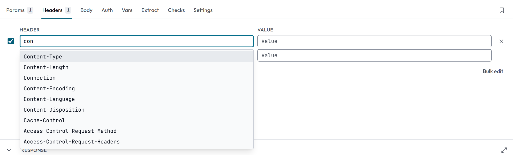
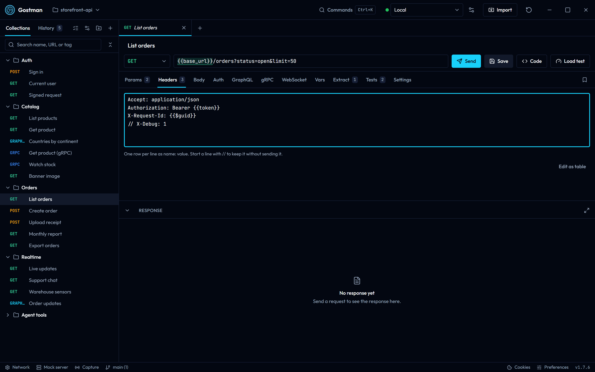
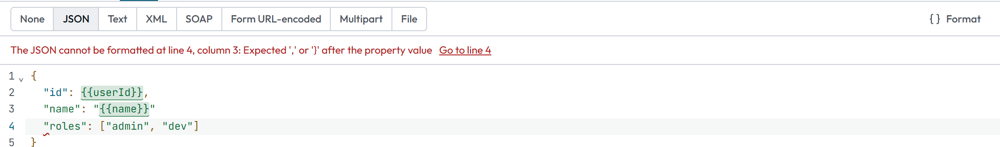
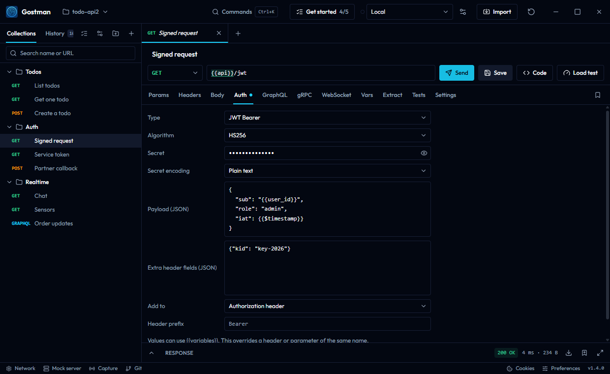
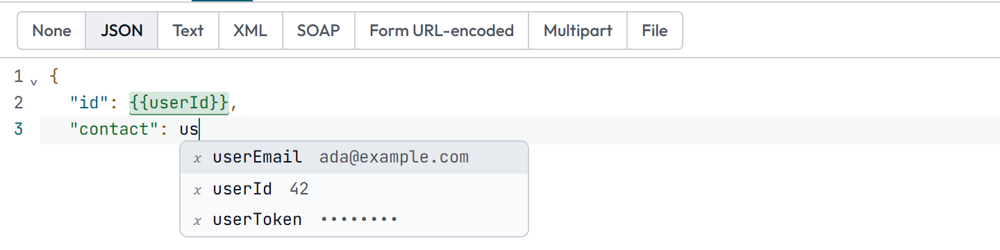
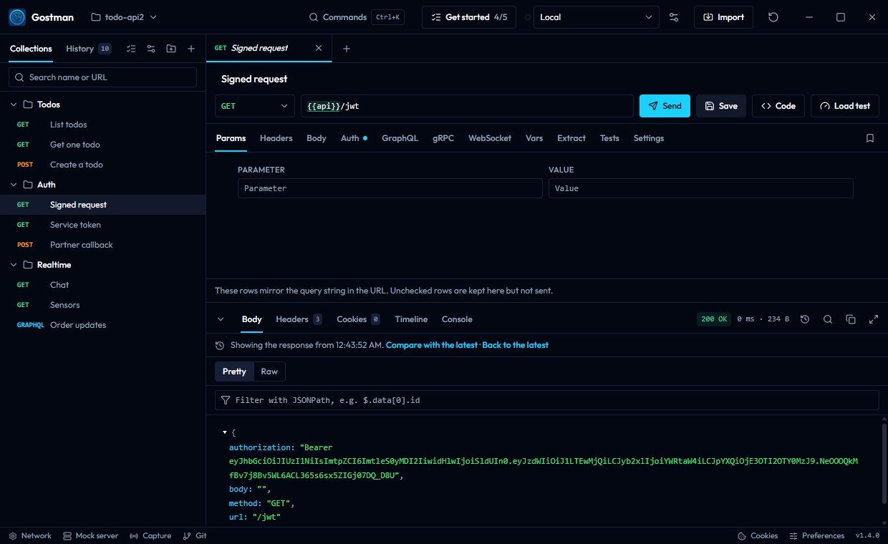
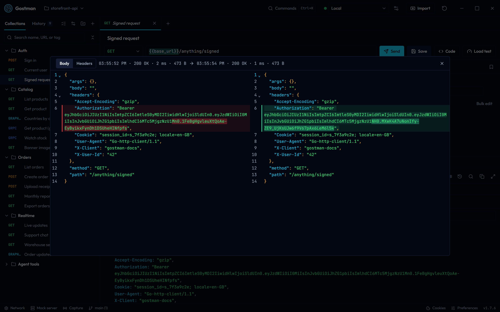

# Requests and responses

This page covers the request editor and the response viewer in Gostman: the request bar, the request tabs, variables in inputs, the response tabs, history, the cookie jar, saved examples and code generation. It describes the desktop app and the web app, which share one interface, and marks the places where they differ.


## Open requests

Each request opens in a tab above the editor.

- A small dot on a tab means the request has unsaved changes.
- Double-click a tab to keep it open. A tab shown in italics is a preview tab.
- Middle-click a tab to close it, or right-click it for a menu.
- Drag a tab to reorder it. The plus button next to the tabs creates a request.

## The request bar

The request bar sits above the request tabs.

| Control | What it does |
| --- | --- |
| Request name | A text field that shows "Untitled request" until you name the request. |
| HTTP method | GET, POST, PUT, DELETE, PATCH, HEAD, OPTIONS, GRAPHQL, GRPC or MCP. |
| Request URL | Accepts `{{variables}}`. Pasting a command that starts with `curl ` fills the request from it, see [Pasting curl commands](#pasting-curl-commands). Press Enter to send. |
| Send | Sends the request. While a request is running the button becomes Cancel. |
| Save | Saves the request. |
| Code | Opens the code generator. See [Code generation](#code-generation). |
| Load test | Desktop app only, and not shown for gRPC and MCP requests. Opens the Load test dialog for this request. See [Load test](runner-load-and-scan.md#load-test). |

When the URL is a WebSocket address, the method list shows WS (or GRAPHQL for GraphQL subscriptions) and the Send button is labelled Connect; while the connection is open it becomes Disconnect. Send and Save show their keyboard shortcuts in their tooltips; see [Preferences, shortcuts and the command palette](preferences-and-shortcuts.md).

### Pasting curl commands

A curl command pasted into the address bar fills the method, URL, headers, body, basic auth, cookies and timeout. Options with no counterpart, such as `-o` or `--proxy`, are ignored.

- `-F name=@path` becomes a Multipart file row that reads the file from disk, keeping `;type=` and `;filename=`, and `-F name=<path` a text row filled from the file. `--form-string` and `--data-raw` keep a leading `@` as text.
- `-d @path`, `--data-binary @path` and `--json @path` become a body of `{{$file(path)}}`, see [Reading files](variables.md#reading-files).
- When the command reads files, through these or a `{{$file(...)}}` placeholder of its own, a prompt lists the paths before anything is filled in. **Paste with file reads** keeps them, **Paste without file reads** fills in the rest and leaves the file parts empty, and **Cancel** leaves the request as it was. The files are read only when the request is sent, and only where file reads are allowed: the desktop app reads them, the web app does not.

## Request tabs

The row below the request bar holds the tabs. Only the tabs that apply to the kind of request are shown, and a protocol's own tab comes first:

- HTTP: Params, Headers, Body, Auth, Vars, Extract, Checks, Settings.
- GraphQL (method GRAPHQL): GraphQL, Params, Headers, Auth, Vars, Extract, Checks, Settings.
- gRPC (method GRPC): gRPC, Headers, Auth, Vars, Extract, Checks, Settings.
- WebSocket, Socket.IO and MQTT (a `ws://` or `wss://` URL): WebSocket, Params, Headers, Auth, Vars, Settings. With the method GRAPHQL the GraphQL tab follows WebSocket.
- MCP: MCP, Params, Headers, Auth, Vars, Extract, Checks, Settings. A local `stdio:` server has no Params or Auth tab.

A tab that does not apply stays visible while it still holds something, for example a GraphQL query on a request whose method is now POST, so nothing you entered is hidden. A count or a dot on a tab shows that it has content. When the row is too narrow, the tabs that do not fit move into a More menu; the selected tab always stays in the row.

| Tab | Purpose |
| --- | --- |
| Params | Query parameters |
| Headers | Request headers |
| Body | The request body |
| Auth | Authentication |
| Vars | Variables for this request |
| Extract | Rules that copy response values into variables |
| Checks | Assertions and scripts |
| Settings | Timeout, redirects, TLS, cookies, streaming, tags and description |

The bookmark button at the right end of the tab row opens the saved [examples](#examples) of the request.

### Params and Headers

Params and Headers use a table with a checkbox, a name and a value for each row. Clear the checkbox ("Send this row") to keep a row without sending it. The remove button deletes a row, and the empty row at the bottom adds a new one. Names and values accept `{{variables}}`.

- The Params rows mirror the query string in the URL. Unchecked rows are kept in the table but not sent.
- Header names and values suggest as you type. Click a header name field, or start typing, and a list shows the usual request headers with the best match first: names that start with what you typed, then names that contain it, each group with the common ones on top. For a well-known header the value field suggests values too: media types for `Content-Type`, `Accept` values, `Cache-Control` directives, `Authorization` schemes (`Bearer `, `Basic `), `Accept-Encoding` and more. Use the arrow keys with Enter or Tab to pick one, and Esc to close the list; anything you type that is not in the list stays as you wrote it. The list also works in folder and collection headers, and typing `{{` in a value still lists your variables.

  
- Gostman sends `User-Agent: Gostman/<version>` unless a header of the request, a folder or an auth setting sets one. The web app's proxy sends `Gostman` without a version.
- The Headers tab shows a count of headers inherited from folders or the collection, and lists them under **Inherited** below the table with the folder they come from. Click the folder name to open its settings. An inherited header that a row of the request replaces is marked **Replaced**, and one that an unchecked row with the same name stops is marked **Switched off**. See [Folder and collection settings](folder-settings.md).

#### Bulk edit

**Bulk edit**, under the table, turns the rows into text you can paste or edit in one go, one row per line:

```text
Accept: application/json
Authorization: Bearer {{token}}
// X-Debug: 1
```



- The name ends at the first colon, and spaces around the name and the value are dropped.
- A line that starts with `//` or `#` is kept without being sent, like an unchecked row; switching back to text writes it with `//`.
- Blank lines are ignored. **Edit as table** switches back.
- Typing `{{` suggests variable names, as in the table.

Bulk edit works the same way for Vars, Form URL-encoded bodies and folder headers. It is not offered for Multipart bodies, because a file row cannot be written as text, and rows with a colon in the name or spaces at the start or end of a name or value can only be edited in the table.

### Body

Choose a body type with the buttons at the top of the Body tab.

| Type | Editor |
| --- | --- |
| None | The request is sent without a body. |
| JSON | Code editor with JSON highlighting. |
| Text | Code editor, plain text. |
| XML | Code editor with XML highlighting. |
| SOAP | XML editor with a toolbar. |
| Form URL-encoded | Table of name and value rows. |
| Multipart | Table of rows where each row has a Type of Text or File. Use it to upload files with form fields, as an HTML form does. |
| File | Choose a single file to upload as the whole body. |

Details:

- File attachments, in the File type and in Multipart file rows, work differently in the two apps:
  - The desktop app keeps only the file's path and reads the file from disk while the request is sent, so the file is never loaded into memory or saved in the collection. The file row shows its current size on disk, and hovering it shows the path. The files of one request can be up to 1 GB together. A folder you have not trusted cannot send them, and the CLI does not send them. Files on network shares (`\\server\share\...` or `//server/share/...`) and device paths are refused, so Windows never sends your sign-in to another computer; copy the file to this computer or map the share to a drive letter. AWS Signature, Hawk, EdgeGrid and OAuth 1.0 sign the whole body, so with them the files are limited to 10 MB. A large upload can take longer than the default 30 second timeout; raise it under **Settings**.
  - The web app keeps the file's content in the request, and a file is limited to 3 MB, because the hosted proxy accepts requests of at most 4.5 MB. A larger file is refused with a message that says so.
- Gostman adds a `Content-Type` for the body type (`application/json`, `text/plain`, `application/xml`, a multipart boundary and so on) only when the request has no `Content-Type` header of its own. For a custom media type such as `application/vnd.acme.event+json`, choose **Text** (or JSON or XML) and add a `Content-Type` header with that value in the Headers tab; the header is sent as you wrote it, and **Code** shows it. A row that is switched off does not count. Do not set `Content-Type` yourself for Form URL-encoded and Multipart bodies, because a multipart body needs the boundary Gostman writes into it.
- Switching between raw types (JSON, Text, XML, SOAP) keeps the same text. Switching between the groups None, Form URL-encoded, Multipart, File and raw types keeps a separate draft for each group, so you can switch back without losing it.
- For JSON and XML, **Format** at the right of the toolbar (or Shift+Alt+F in the editor) indents the body. `{{variables}}` are kept as written, also where JSON expects a value, and numbers, key order and duplicate keys are left exactly as they are. Undo (Ctrl+Z) restores the previous text. When the body is not valid, nothing is changed: a notice names the problem with its line and column, for example "The JSON cannot be formatted at line 3, column 3: Expected ',' or '}' after the property value", the cursor moves to that place, and **Go to line** takes you back to it later. The same message appears when you hover the underlined spot while typing.

  
- For SOAP, the toolbar offers SOAP 1.1 and SOAP 1.2, a SOAPAction field and a Format XML button. Choosing SOAP with an empty body inserts a SOAP 1.1 template.
- When the method is GRAPHQL, the Body tab shows a notice: the body is built from the GraphQL tab and the Body tab is not sent.


### Auth

The Type list in the Auth tab holds these choices:

- Inherit, which uses the auth of the folder or collection. See [Folder and collection settings](folder-settings.md).
- No auth. A request set to No auth is sent without authentication. New requests start with No auth.
- Basic: Username and Password.
- Bearer token: Token.
- API key: Key, Value and Add to (Header or Query params).
- OAuth 2.0.
- Digest: Username and Password. The request is sent first without credentials and repeated with a Digest answer when the server challenges it.
- NTLM: Username, Password and Domain. The handshake runs when the server asks for it.
- AWS Signature V4: Access key ID, Secret access key, Session token, Region and Service.
- OAuth 1.0: consumer key and secret, access token and token secret, signature method (HMAC-SHA1, HMAC-SHA256, RSA-SHA1, RSA-SHA256 or PLAINTEXT), and optional realm, callback URL, verifier, nonce and timestamp. Send in chooses Authorization header, Query params or Form body.
- Akamai EdgeGrid: Client token, Client secret and Access token are required. Headers to sign, Max body size, Nonce and Timestamp are optional.
- JWT Bearer: Gostman signs a token from Payload (JSON) for every request. HS256, HS384 and HS512 use a Secret, plain or Base64; the RS, PS and ES algorithms use a Private key (PEM). Extra header fields such as `kid` are optional. Add to puts the token in the Authorization header after Header prefix (default `Bearer`) or in a query parameter (default `token`). A payload that is not a JSON object stops the send with a message.
- ASAP (Atlassian): Issuer, Audience, Key ID and Private key are required; Subject, Additional claims and Expires after (default `1h`) are optional. Each request gets a new token with `iat`, `exp` and `jti`, sent as a Bearer token.
- Hawk: Hawk Auth ID and Hawk Auth Key, with the Algorithm `sha256` or `sha1`. Payload hash set to Include adds a hash of the body. Extra data, App ID and Delegation are optional; Nonce and Timestamp are generated when empty.

JWT Bearer and ASAP also apply to WebSocket and gRPC connections, because they do not depend on the body.



Password, token and secret fields accept `{{variables}}` like other fields, with the same suggestions and colours. A value made only of placeholders, such as `{{token}}`, stays readable; a value with typed text in it is masked, and the eye button shows it. Auth overrides a header or parameter of the same name.

OAuth 2.0 has these fields:

- Grant type: Client credentials, Password, Authorization code or Device code.
- Issuer, with **Discover**: enter the provider's issuer, such as `https://login.example.com/realm`, and Discover reads its `/.well-known/openid-configuration` and fills in the authorization, token and device authorization URLs. The document must name the same issuer, or nothing is filled in. With an issuer set, a sign-in answer that names another issuer is discarded; an issuer written with variables is compared after they are filled in. An issuer written as a variable, such as `{{idp}}`, is kept as you wrote it, and the URLs it fills in start with the variable, such as `{{idp}}/token`, so each environment can point at its own provider.
- Authorization URL and Callback URL, for Authorization code only.
- Device authorization URL, for Device code only.
- Token URL, Client ID, Client secret and Scope.
- Username and Password, for the Password grant only.
- Send credentials in: Basic auth header or Request body.
- Use PKCE, for Authorization code only.
- Header prefix.
- Send the ID token instead of the access token: sends the OpenID Connect ID token the provider returned, for APIs that expect it. The provider returns one when the scope includes `openid`.
- Access token, or ID token when the option above is on.

Get token requests a token and Clear token removes it. The panel shows whether a token exists and when it expires. For Authorization code, the panel waits for you to finish signing in in your browser, and Cancel stops the wait. In the web version the sign-in opens in a pop-up; if you close it before you finish, choose Cancel. For Device code, the panel shows a code and a link to the provider's sign-in page; open it on any device, enter the code, and the token arrives when you finish. Cancel stops the wait. For the callback address to register with your provider, see [Scripts and checks](scripting-and-settings.md#oauth-20-callback).

A token belongs to the environment that was active when it was fetched or typed in. After you switch environments it is not sent: the panel says so, a client credentials or password token is fetched again for the new environment, and the other grants ask you to choose Get token. Tokens saved by an earlier version of Gostman have no environment, so they are treated the same way once.

### Vars

The Vars tab holds variables that apply to this request only. They use the same row table as Headers. See [Variables](variables.md) for scopes and precedence.

### Extract

Extract rules copy a value from each response into a variable, so later requests can use it as `{{variable_name}}`. The **Keep in** column chooses where: a session value that is never written to disk, or the active environment. See [Variables](variables.md#setting-variables-from-a-response) for the default in each kind of collection. Each row has:

- A checkbox that turns the rule on or off.
- Variable: the name to save. Any name you can write between `{{` and `}}` works, dots included, such as `auth.token`; it cannot contain `}` or start or end with a space.
- From: JSON body, Header, Cookie or Status code.
- Path or name: a JSONPath such as `$.data.token` for JSON body, a header name, or a cookie name. It is disabled for Status code.
- Value in last response: a preview of what the rule finds in the current response.

Rules run after every response. Run now applies them to the last response, and a line below the table lists the variables that were saved. The same rules are described in [Variables](variables.md#setting-variables-from-a-response).

### Checks

The Checks tab has three views: Assertions, Pre-request script and Post-response script. The response panel shows the results in its Checks tab, whose count turns red when a check fails and green when all pass. For the script API and sandbox, see [Scripts and checks](scripting-and-settings.md).

Each assertion row has a checkbox that turns it on or off, an Expression, a Check and an Expected value. Expressions start at the response, `res`: `res.status`, `res.headers.name`, `res.body.path` or `res.responseTime`. An expression that does not, such as `status` or `$.data.id`, fails with a message that gives the fix (`Write res.status`, `Write res.body.data.id`), in the app and in `gostman run` alike. Checks share the collection's script time limit; when they run past it, the result names the checks rather than a script. A matches regex check whose pattern runs for more than 1 second fails with a message that the regular expression was too slow, rather than as a mismatch; in the app a pattern that never finishes stops the checks at the time limit. The expected value can use `{{variables}}`, including values extracted from an earlier response and columns of a data file; a name that is not defined is compared as written. The Check list includes:

- Comparisons: equals, does not equal, is greater than, is at least, is less than, is at most.
- Text and list checks: contains, does not contain, starts with, ends with, matches regex, is one of, has length.
- Checks without an expected value: is defined, is undefined, is null, is empty, is not empty, is true, is false, is a number, is a string, is a boolean, is an array, is an object.
- matches schema: the expected value is a JSON Schema, such as `{"type": "object", "required": ["id"]}`, or a `{{variable}}` that holds one. The button next to the field opens the schema in an editor. A failure lists each place that does not match and why, for example `$.items[2].price should be a number, but it is the text "12.5".` See [JSON Schema checks](scripting-and-settings.md#json-schema-checks).

**Add checks from this response**, in the response toolbar and at the top of the Assertions view once an HTTP response has arrived, builds assertions from the response you just received: the status code, the content type, a JSON Schema of the body, and a response time budget. A dialog lists them with checkboxes, and the **Add checks** button (for example **Add 3 checks**) appends the checked ones to the request's assertions. Checks the request already has are not offered again. The schema records each field's type and which fields were present; extra fields are allowed, numbers are not required to be whole, a field seen as both null and a value accepts both, and a field that was only ever null accepts any value. The response time budget is twice the time the response took, rounded up to 100 ms and at least 200 ms, and starts unchecked.


### Settings

| Setting | Meaning |
| --- | --- |
| Timeout (ms) | Empty uses the **Default timeout** from Preferences, which is 30 seconds unless you change it. |
| Follow redirects | On by default. |
| Verify TLS certificates | On by default. Clear it to accept certificates that fail verification. |
| Send cookies from the cookie jar | On by default. Clear it to send the request without stored cookies. |
| Store cookies the response sets | On by default. Clear it to leave the cookie jar unchanged. |
| Stream as server-sent events | Streams the response as events. Adds Reconnect when the server closes the stream, Max events (default 10000) and Max seconds (default 300). |
| Tags | Labels such as `smoke` or `regression`. Type a tag and press Enter or a comma; Backspace in the empty field removes the last one. Tags already used in the collection are suggested. Case is ignored, so `Smoke` and `smoke` are one tag. The runner dialog and `gostman run --tags` use them to run a subset. |
| Description | Markdown shown in generated documentation. |

The tab shows only the settings that apply to the request: gRPC and remote MCP requests have Timeout (ms) and Verify TLS certificates, a local `stdio:` MCP server has Timeout (ms), and WebSocket requests have only Tags and Description. A setting you changed stays visible even when it does not apply.

A dot on the Settings tab means one of the settings above the tags differs from its default: a timeout is set, redirects, TLS verification or one of the cookie options is turned off, or streaming is on.

## Variables in inputs

URL, header, parameter and body fields recognise `{{name}}`. Defined names are underlined, and hovering one shows its value and where it comes from. Typing `{{` opens a list of names; use the arrow keys with Enter or Tab to pick one, and Escape to close the list. Ctrl+Space opens the same list without typing `{{`: the word before the caret filters it, and the name you pick is written with its braces. With nothing before the caret, it lists your variables first and then the dynamic ones.

 Secret values are masked in these hints.

When a sent request used a name that nothing defines, the response panel says so and lists the names. Select a name, or **Open Environments**, to open the Environments dialog with a new row for that name in the active environment, ready for its value.

A name written as `{{?name}}` is asked for when you send the request. A dialog titled "Values needed" lists each name with a field. Send continues with the values you entered and Cancel stops the send. See [Variables](variables.md#prompt-variables) for scopes, dynamic variables and secrets.

## The response viewer

The response panel sits below the request. Drag its top edge to resize it and double-click the edge to reset the height; the height you choose is kept for the next time you open the app. The chevron button collapses it, and the fullscreen button expands it.


Before the first send the panel reads "No response yet". While a request runs it shows placeholder lines.

### Summary and toolbar

The toolbar shows the status and, for a completed request, the duration in milliseconds and the size. Hover the timing for a breakdown. A request that got no response shows an error title instead: Invalid request, Script failed, Network error, Request timed out, Request cancelled, Address blocked or Folder not trusted. The Body tab then shows the message with an **Explain with AI** button when [AI](ai.md) is turned on; for Folder not trusted it offers **Trust this folder** instead.

The toolbar buttons are:

- Earlier responses, once the request has been sent more than once
- Search body (Ctrl+F)
- Copy body
- Download body
- Explain with AI, for a response with a failed status, when AI is turned on
- Save as example
- Add checks from this response, for an HTTP response
- Fullscreen

Responses are limited to 50 MB in the desktop app, the CLI and the [local relay](cli.md#local-relay-for-the-web-app), and to 3 MB in the web app through the hosted proxy. A longer response is cut off at the limit, and the panel says so; the body shown, copied and saved is then only the first part.

### Earlier responses and comparing

Each tab keeps its last 10 responses while the app is open. They are kept in memory only, like the current response, and responses with a body over 2 MB are not kept.

1. Select **Earlier responses** in the toolbar and pick one. The list shows the time, the status, the duration and the size of each.
2. The panel shows that response with its headers, cookies and timeline, under the notice "Showing the response from" and its time. Download body, Save as example and Add checks from this response are hidden while it is shown.
3. Select **Compare with the latest** to open the two side by side. **Body** compares the bodies, with JSON formatted first so that only real changes stand out; **Headers** compares the headers sorted by name.
4. Select **Back to the latest**, or send the request again, to return to the newest response.





### Tabs

| Tab | Shown when | Content |
| --- | --- | --- |
| Body | Always | The response body. |
| Headers | The request completed | Name and Value table, with a count. |
| Cookies | The request completed | Name, Value, Domain, Path, Expires, Secure and HttpOnly. |
| Timeline | The response has timing data, or scripts ran | See [Timeline](#timeline). |
| Checks | There are check results or a script error | Each result with a pass or fail mark. The count shows passed over total. |
| Console | The request completed | Output of `console.log()` in scripts. |
| Visualize | A script called `visualize()` | See [Visualize](#visualize). |

### Body views

The Body tab chooses a view from the response type.

| Response | Views |
| --- | --- |
| JSON | Pretty and Raw |
| HTML | Raw and Preview |
| Other text | Raw |
| Image, PDF, audio, video | Preview, plus Raw when the content is text such as SVG |
| Binary | A notice with the type and size, and **Save to file**. |
| No body | "Empty response body" with the status. |

- Pretty shows a collapsible tree. The first two levels are expanded. Very large trees are trimmed, and a notice tells you how many values are hidden.
- The HTML preview runs in a sandboxed frame without scripts, forms or navigation. Images, styles and fonts from other addresses are blocked, so a page cannot reveal your IP address or make the desktop app reach devices on your network; images and fonts written into the page as `data:` addresses still show. **Load remote content** in the notice above the preview loads them for that response only, and **Block again** switches them off. The next response starts blocked again.
- A body over 500,000 characters is shown whole as plain text, without the tree or colours, so the window stays responsive. Only the lines on screen are drawn, and long lines are wrapped to the width of the panel. For JSON, **Format anyway** in the notice above the body pretty-prints it in the background and then offers Pretty and Raw; the rest of the app keeps working while it formats.

### Filter and search

For a JSON body, the filter field accepts a JSONPath such as `$.data[0].id` and shows only the matching value. Filter expressions such as `$.items[?(@.id == 2)]` work here, in checks and in Extract rules; they can read fields and call methods such as `startsWith`, but cannot use `constructor`, `prototype`, `call`, `apply`, `bind` or names that start with `__`. An invalid path shows an error under the field, and the clear button removes the filter. The filter runs in the background, so a slow one never holds up the app; one that runs for more than 10 seconds is stopped with a message under the field. Copy body copies the filtered text while a filter is active.

Search works in the Pretty and Raw views, across the whole body, also for large bodies. Press Ctrl+F while the response panel has focus, or use the search button. Type in the "Find in body" field and the matches are highlighted.

- Enter goes to the next match and Shift+Enter to the previous one.
- The counter reads "1 of 12". It shows a plus sign when the match limit of 2000 is reached.
- Escape closes the search.

### Timeline

The Timeline tab shows the total time and the number of requests, then a legend with DNS, Connect, TLS, TTFB and Download times. Each request in the chain, including redirects, has a row with its method, URL, status, total time and a bar for its phases. Open a row to see:

- Remote address, Protocol and whether the connection was new or reused.
- TLS version and cipher, and the certificate subject and issuer.
- Request headers and Response headers. A masked header has a button to reveal its value.

When the request has scripts, the timeline lists everything the send did, in order: the pre-request script, each request a script sent with `sendRequest` (indented below its script, with the same bar and details), the request itself, and the post-response script. A script row shows how long it ran, its number of console lines, and how many tests and assertions passed or failed; open it to read its console lines and test results. The total then covers the scripts and the requests. The Console tab keeps showing the same lines.

On the web app, the timings were measured by the Gostman proxy, from the proxy to the target, and a notice in the tab says so.

### Console

The Console tab lists `console.log()` calls from pre-request and post-response scripts, grouped by request. Filter by level with the buttons at the top, or clear the console with the trash button.

### Visualize

Visualize shows HTML that a post-response script produced with `visualize(template, data)`. The view is sandboxed: scripts, network access, forms and navigation are blocked inside it.

## Status bar

The bar at the bottom of the window holds shortcuts to dialogs and shows state:

- Network, which opens the proxy and certificate settings. These settings exist only in the desktop app.
- Mock server and Capture, each marked "(running)" while active. See [Folders, mock server and capture](workspaces-and-mock.md).
- The Git branch, with the number of changes, when a folder is open.
- Cookies, which opens the [cookie jar](#cookie-jar).
- Preferences and the app version.

## History

The History tab at the top of the sidebar lists sent requests, with the method, the URL, the HTTP status of the response, in the colours of the response panel, and the time since sending (for example "5m" or "2d"). Sends that got no response are marked **No response**. Screen readers read the time in full, for example "sent 5 minutes ago". The tab shows a count.

- Click an entry to open it as a request tab.
- Search history filters by method, URL and status, so `404` finds the requests that got one.
- The remove button, shown when you hover an entry, deletes it. Clear history deletes all entries.
- The app keeps up to 50 entries.

## Cookie jar

Cookies set by responses are kept and sent back to the same site on later requests. Open them with Cookies in the status bar. The dialog lists Name, Value, Domain, Path and Expires. Session cookies show "Session" as the expiry. You can filter by name or domain, delete one cookie, or choose Clear all. The frontend keeps the cookies and sends them with each request; the engine holds no state between requests.

## Examples

A response can be saved as a named example for its request.

1. Send the request.
2. Choose Save as example in the response toolbar, and give the example a name. The status, such as `200 OK`, is offered as the name.
3. Open the Examples dialog with the bookmark button in the request tabs.

The Save as example button is not offered for failed requests or for gRPC, MCP and other protocol responses. In the dialog, each example has a Body and a Headers view. You can:

- Edit the body, then choose Save body or Discard. Binary bodies cannot be edited. A JSON or XML body can be formatted with the braces button or Shift+Alt+F.
- Mark an example as Serve by default. The first example saved is the default.
- Rename or delete an example.

A request keeps up to 20 examples, and an example body is limited to 2 MB. Headers named set-cookie, authorization, proxy-authenticate and www-authenticate are not saved. The mock server, which is available in the desktop app, serves these examples; see [Folders, mock server and capture](workspaces-and-mock.md).

## Code generation

Code opens the Generate code dialog. Pick a language from the list at the top:

| Language | What the snippet uses |
| --- | --- |
| cURL | `curl` |
| JavaScript | `fetch` |
| Python | `requests` |
| Go | `net/http` |
| Java and Kotlin | `java.net.http.HttpClient` |
| C# | `HttpClient` |
| PHP | the cURL extension |
| Ruby | `Net::HTTP` |
| Swift | `URLSession` with `async`/`await` |
| Rust | `reqwest` with the `blocking` feature |
| Dart | the `http` package |
| PowerShell | `Invoke-WebRequest`, for Windows PowerShell 5.1 and PowerShell 7 |

Copy copies the snippet for the selected language, and the dialog opens on the language you picked last. Text is escaped for each language, so quotes, `$`, backslashes, line breaks and non-ASCII characters arrive as typed. The snippets are built from the request as the engine prepares it, so variables, inherited headers and auth appear as they are sent.

A File body and the file rows of a Multipart body are read from disk by the snippet, using the file name you attached: put the file next to the snippet or change the path. Multipart text rows are sent as form fields, and the snippet uses each language's own multipart support where it has one; Java, Kotlin and Swift build the multipart body themselves.


