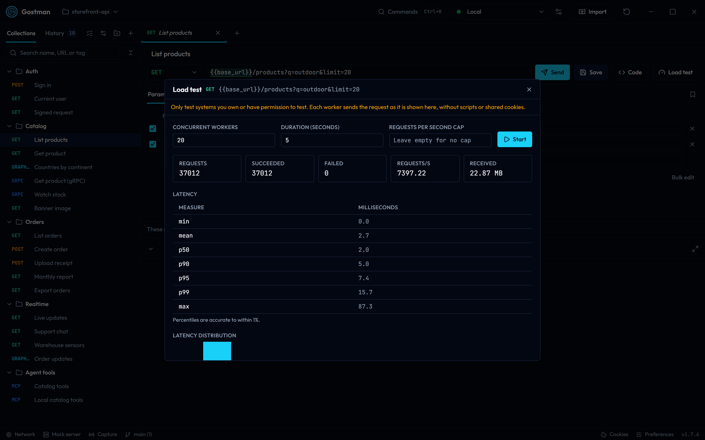
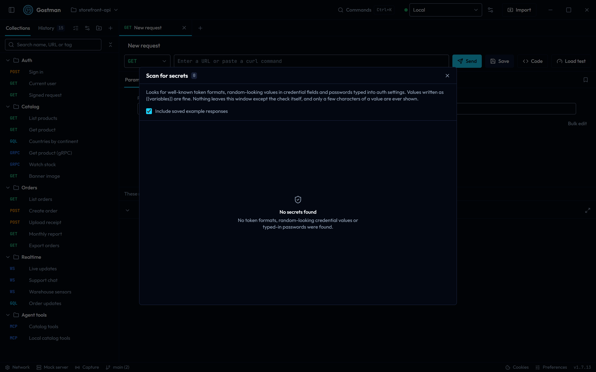

# Running, load testing and scanning

This page covers the Run requests dialog (the collection runner), the Load test dialog and the Scan for secrets dialog, including the notices the scanner shows in the Share and Export tabs. Each one is opened from the command palette; see [Preferences and shortcuts](preferences-and-shortcuts.md) for the palette. The command line equivalents are described in [Command line](cli.md) and [Gostman in CI](ci.md), so this page does not repeat their flags.

## Run requests

The Run requests dialog sends the requests of your collection one after another and shows the outcome of each. Open it with the **Run requests** command or the **Run requests** button at the top of the sidebar, or with **Run folder** in a folder's menu in the sidebar, which preselects that folder.

Requests run in sidebar order, with their scripts, extraction rules and assertions, using the active environment, from top to bottom: a folder's requests run where the folder sits, so a Login request above a Users folder runs before every request in it. `gostman run` and an agent's `run_folder` use the same order, and so do exports and imports where the other tool allows it; see [Order of requests and folders](collections-and-git.md#order-of-requests-and-folders). WebSocket requests are skipped.

Scripts can change the order with `setNextRequest`; see [Scripting](scripting-and-settings.md). A pass through the run may send at most 1000 more requests than it holds, so a loop that never ends, such as a retry on a 401 that always comes back, stops the run with a message that names the request that kept jumping, and that request counts as failed.

### Options

| Control | What it does |
| --- | --- |
| **Requests to run** | Chooses **All requests** or one folder. Folders are listed by their full path, separated by ` / `. |
| **Delay (ms)** | Waits this many milliseconds after each request before the next one. Empty means no delay. |
| **Stop on failure** | Stops the run after the first request that fails. |
| **Data file (CSV or JSON)** | Loads a file with one row per iteration. See [Data files](#data-files). |
| **Iterations** | Limits the number of iterations. Empty shows the number that will run: the row count of the data file, or 1. The highest value is 10000. |
| **Parallel** | Sends up to this many requests at once. Empty means 1. |
| **Only tags** and **Skip tags** | Shown when a request or folder in the collection has tags. **Only tags** keeps the requests that have at least one of the tags you add; empty keeps every request. **Skip tags** leaves out requests that have any of them. A folder's tags count for every request inside it. Case is ignored. Both apply inside the chosen folder, and the footer counts what is left. Set a request's tags in its [Settings](requests-and-responses.md#settings) tab or with **Tags…** in its menu in the sidebar, and a folder's with **Colour and tags…**. |
| **Run** and **Stop** | Starts the run. While a run is going, **Stop** cancels the requests in flight and ends it. |

All controls except **Stop** are disabled while a run is going. **Run** is disabled when no request is in scope.

### Data files

A data file runs the whole selection once per row.

- A CSV file needs a header row. Quoted fields may contain commas and line breaks, and every value is text.
- A JSON file must be an array of objects, one object per iteration.
- A data file can have at most 10000 rows, and it must have at least one.
- A row's columns become variables for that iteration and win over request, folder and environment variables with the same name, so a column `id` fills `{{id}}` even in a request whose **Vars** tab sets `id`. The dialog lists the columns a file sets. The values are kept as session values for the run and put back when it ends. `iteration` (starting at 1) and `iterationCount` are set as well, so you can write `{{iteration}}` in a request.
- With a data file loaded, the dialog shows its name and row count. Select that button to remove the file.
- If **Iterations** is set, only that many rows are used, up to the number of rows in the file. Without a data file, **Iterations** repeats the run that many times.

The active environment's variables are restored after the run.

### Parallel runs

With **Parallel** above 1, requests are sent together and do not see each other's extracted variables, so use it for requests that do not depend on each other. With several iterations, the parallel count applies inside each iteration, and iterations run one after another.

### Results

Each row of the results list shows:

- an icon for the outcome: passed, failed or skipped;
- the method and the request name, with `#` and the iteration number when the run has iterations;
- the number of passed assertions out of the total, such as `3/4 checks`, the duration in milliseconds and the status;
- the message of any error, any `{{variables}}` that no variable defined, and each failed assertion with its detail. Select an undefined name to open Environments with a new row for it in the active environment.

A skipped row shows **Skipped** and the reason, for example that a script stopped the run or continued it with another request.

Select a row to expand it. It then shows the address that was called, the assertions that passed and the response body, with JSON formatted. A run keeps the first 64 KB of each body; send the request on its own to see a longer one.

The footer reads, for example, `Ran 5 of 5 · 4 passed · 1 failed`. Before a run it shows how many requests are in scope, and how many iterations when there is more than one.

A 4xx or 5xx status does not fail a request by itself. Add an assertion such as `res.status equals 200`, as in the screenshot above. A request also counts as failed when it gets no response, when its script raises an error, or when an MCP tool reports an error.

Requests in a folder linked to an OpenAPI spec also get the spec's contract checks, which count like assertions; see [Contract checks](import-export-and-specs.md#contract-checks).

### Download HTML report

**Download HTML report**, at the bottom of the dialog, saves the results of the last run as `gostman-report.html`. It is disabled while a run is going and when there are no results. The command line produces the same report with `--reporter html`; see [Command line](cli.md) and [Gostman in CI](ci.md).

The report is not redacted for you. Review it before you share it.

## Load test

The Load test dialog sends the current request many times at once and measures how the server responds. Open it with the **Load test** button next to **Code** in the request bar, or with the **Load test this request** command while the request you want to test is the active tab.

The button and the command appear only in the desktop app. In the web version neither the request bar nor the palette offers them. The button is also hidden for gRPC and MCP requests.

Only test systems you own or have permission to test.

### Before you start

The dialog shows the request's method and URL, and a notice: each worker sends the request as it is shown there, without scripts or shared cookies.

The dialog refuses a request in these cases and shows the reason:

- The request has no URL: `Give the request a URL first.`
- The request is gRPC, MCP, WebSocket or streaming: `Only HTTP requests can be load tested. gRPC, MCP, WebSocket and streaming requests are not supported.`

### Settings

| Field | Meaning |
| --- | --- |
| **Concurrent workers** | Number of workers sending at the same time. Starts at 10, at most 500. |
| **Duration (seconds)** | How long the test runs. Starts at 10, at most 600. |
| **Requests per second cap** | Limits the overall rate. Leave it empty for no cap. |

**Start** is disabled until workers and duration are at least 1. While the test runs, the badge **Running** is shown and **Stop** ends it early; the result is then labelled **Stopped early**. Closing the dialog also stops a running test.

### Results

While the test runs, the dialog shows **Elapsed**, **Requests**, **Requests/s**, **p95** and **Failed**.

When it ends, it shows:

- **Requests**, **Succeeded**, **Failed**, **Requests/s** and **Received** (bytes). Hover over **Failed** to see how many were network errors and how many came back with an error status.
- **Latency** in milliseconds: min, mean, p50, p90, p95, p99 and max. Percentiles are accurate to within 1%.
- **Latency distribution**, a histogram of response times.
- **Status codes**, with a count per code.
- **Error samples**, when some requests failed.

For thresholds that fail a pipeline, a fixed request count or a ramp-up, use `gostman load`; see [Load testing](cli.md#load-testing) in the command line page.

## Scan for secrets

The Scan for secrets dialog looks through your collection for credentials that were typed into it, before you share or commit it. Open it with the **Scan for secrets** command.

It looks for well-known token formats, random-looking values in credential fields and passwords typed into auth settings. Values written as `{{variables}}` are not reported. Nothing leaves the window except the check itself, and only a few characters of a value are ever shown.

The scanner is a heuristic. A clean result is not proof that nothing is exposed; see [Secret scanner](cli.md#secret-scanner) for what it can miss.

### Reading the findings

The dialog title shows the number of findings. When the list is empty it shows **No secrets found**.

Each finding shows:

- a severity, **High** or **Medium**;
- where it was found: **Request**, **Folder**, **Environment** or **Collection**, with the path and the field;
- a short preview of the value, the reason and the name of the rule that matched.

For a finding in a request, **Go to request** opens that request.

By default the scan includes saved example responses. Clear **Include saved example responses** to leave them out.

To fix a finding, move the value into a variable and refer to it as `{{name}}`. Mark the variable as secret so it stays out of the collection files; see [Variables](variables.md#secret-variables).

## Notices in Share and Export

The Share and Export tabs run the same scan on what you are about to hand over. When something is found, a notice reads `N possible secrets found` with advice and a **Show findings** button, which lists them the same way as the dialog.

- In **Share**, the notice says the values stay in the link or file you create. Creating the link or file is held back until the scan has finished. If there are findings, it stays held until you replace the values or select **Share anyway**.
- In **Export**, the notice says the values are written into the export. It does not block the export.

If the scan itself fails, the tab shows `The check could not run` with the reason.

For the Share tab, a separate message counts requests that hold a password, token or key typed directly into the Auth tab. Those are part of the request and are shared with it.
