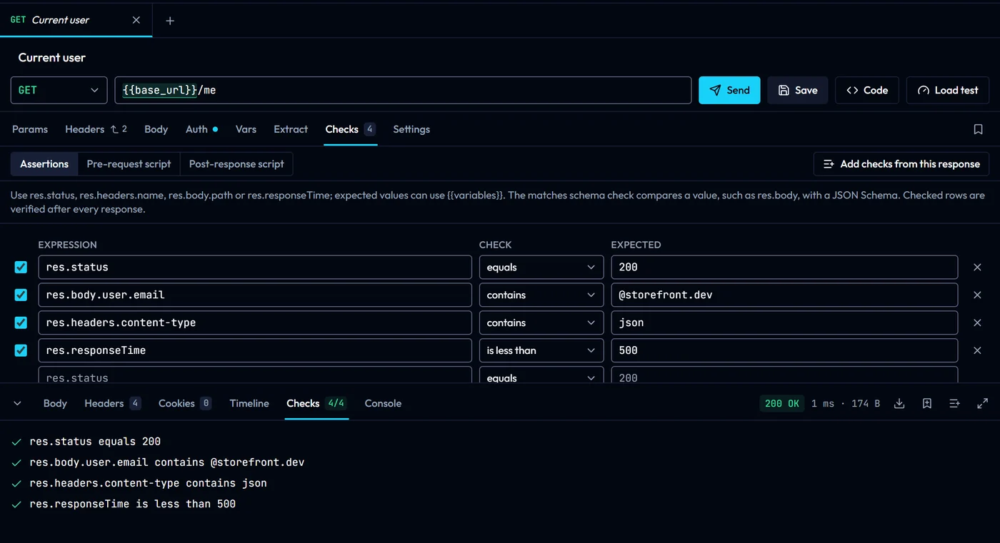

# Variables, scripts and settings

This page covers variables, tests and scripts, the desktop network settings and the OAuth 2.0 callback.

## Variables

Define variables in an environment, a folder, the collection or a request, and reference them anywhere with `{{name}}`. [Variables](variables.md) covers scopes, secrets, dynamic values and extraction.

## Tests and scripts

The Tests tab of a request holds assertions (`res.status equals 200`, `res.body.user.id is a number`) and pre-request and post-response scripts. Use assertions for checks that fit in one row and a script for anything else. Results appear in the Tests tab of the response, and the runner and `gostman run` apply the same checks.



Scripts are JavaScript. They run in an isolated worker with no network access of their own and are stopped after 10 seconds. Folder and collection scripts run around the request's own, outermost first; see [Folder and collection settings](folder-settings.md).

### Script API

| Name | What it is |
| --- | --- |
| `req` | The request: `name`, `method`, `url`, `headers` (an object), `body` (parsed when it is JSON) and `timeout` in milliseconds (0 uses the default). A pre-request script can change it with `setUrl`, `setMethod`, `setHeader(name, value)`, `setHeaders`, `deleteHeader(name)`, `setBody` and `setTimeout(ms)`; `getHeader(name)` ignores case. `getHost()`, `getPath()` and `getQueryString()` read the URL with variables filled in, and `headerList` offers `get`, `has`, `all`, `toObject`, `add`, `upsert` and `remove`. |
| `res` | The response, in post-response scripts: `status`, `statusText`, `headers` (lower-case names), `body` (parsed when it is JSON, text otherwise), `responseTime` in milliseconds, `size` and `url`. `res(path)` reads a value from the body; see [Response queries](#response-queries). `getSize()` returns `body`, `headers` and `total` bytes, `headerList` reads headers ignoring case, and `setBody(value)` changes the body seen by the rest of the script. |
| `env` | Variables: `get(name)`, `has(name)`, `set(name, value)`, `unset(name)`, `all()` and `clear()`. Values set here are saved into the active environment. Objects are stored as JSON text. `env.name` is the active environment's name and `env.interpolate(text)` replaces `{{name}}` with variable values; dynamic values such as `{{$guid}}` are left for the send. |
| `test(name, fn)` | Records a passing test, or a failing one when `fn` throws. `fn` may be `async`. |
| `expect` | [Chai](https://www.chaijs.com/api/bdd/)'s `expect`. |
| `console` | `log`, `info`, `warn` and `error`, shown in the console panel and in run output. |
| `sendRequest(request)` | Sends another request and returns its response, up to 50 times per script. Pass the name of a saved request, or `{ method, url, headers, body, timeout }`; `timeout` is in milliseconds and at most 5000. |
| `setNextRequest(name)`, `skipRequest()`, `stopExecution()` | Change the order of a run: jump to a request by name or `Folder/Name` path, skip this one, or stop. `setNextRequest(null)` also stops. |
| `utils` | `uuid()`, `md5`, `sha1`, `sha256`, `sha512` (`hex` or `base64` output), `hmac(algorithm, key, text)`, `base64`, `hex` and `url` with `encode` and `decode`, `date` (`now`, `timestamp`, `unix`, `format`, `add`) and `random` (`int`, `string`, `pick`). |
| `visualize(template, data)`, `visualize.table(rows)` | Renders an HTML view of the response in its **Visualize** tab. Templates use `{{field}}`, `{{#each list}}` and `{{#if value}}`; values are escaped. |
| `require(name)` | The bundled modules `lodash`, `crypto-js`, `uuid`, `moment`, `dayjs`, `ajv` and `chai`. In a trusted folder on the desktop, also `./` and `../` files inside the folder. |
| `bru` | Bruno's script API, so scripts pasted from Bruno run as they are; see [Scripts from Postman and Bruno](#scripts-from-postman-and-bruno). `bru.cookies` reads and changes the cookies sent to this request's URL. |

### Response queries

`res(path)` reads values from the response body, the way Bruno does:

| Query | Result |
| --- | --- |
| `res("customer.address.city")` | One value along a dotted path. |
| `res("customer.orders.items.amount")` | Paths go through arrays, so this returns every amount as one flat array. |
| `res("customer.orders.items.amount[0]")` | `[n]` picks one item. |
| `res("..amount")` | `..` searches at any depth. |
| `res("..items[?].amount", (item) => item.amount > 20)` | `[?]` filters with the next argument: a function, or an object such as `{ id: 2 }` that items must match. |
| `res("..items..amount[?]", (amount) => amount + 10)` | A function that returns a value other than `true` or `false` maps the items instead. |

A query that finds one value returns it, several values come back as an array, and a path that does not exist returns `undefined`.

### Examples

Fail the test when a field is missing or has the wrong type:

```js
test("the user has an id and an email", () => {
  expect(res.body).to.have.property("id").that.is.a("number")
  expect(res.body.email).to.match(/@/)
})
```

Validate the whole body against a JSON Schema:

```js
const Ajv = require("ajv")
const validate = new Ajv().compile({
  type: "object",
  required: ["id", "title", "completed"],
  properties: { id: { type: "number" }, title: { type: "string" }, completed: { type: "boolean" } },
})

test("matches the schema", () => {
  expect(validate(res.body), JSON.stringify(validate.errors)).to.equal(true)
})
```

Sign a request in a pre-request script:

```js
const timestamp = String(utils.date.unix())
const signature = utils.hmac("sha256", env.get("API_SECRET"), `${req.method}\n${req.url}\n${timestamp}`)
req.setHeader("X-Timestamp", timestamp)
req.setHeader("X-Signature", signature)
```

Fetch a token once, before the first request that needs it:

```js
if (!env.has("access_token")) {
  const login = await sendRequest("Log in")
  env.set("access_token", login.body.access_token)
}
```

Keep polling until a job finishes, in a run:

```js
if (res.body.state !== "done") setNextRequest("Jobs/Get job status")
```

Show a list as a table:

```js
visualize.table(res.body.map(({ id, title, completed }) => ({ id, title, completed })))
```

### Scripts from Postman and Bruno

Scripts imported from Postman or Bruno keep working for the common `pm.*` and `bru.*` calls, which the importer rewrites to the names above. Bruno's variable scopes all map to `env`, `bru.getProcessEnv(name)` reads the active environment, `bru.interpolate` becomes `env.interpolate`, `bru.runRequest("Folder/Name")` sends the saved request with that name, and responses from `bru.sendRequest` and `bru.runRequest` keep Bruno's `data` field next to `body`. `res("path")` queries, `bru.cookies` (including `bru.cookies.jar()`) and Bruno's `req` and `res` methods such as `req.setTimeout`, `req.getName` and `res.headerList` work as written.

Scripts pasted from Bruno without importing run too: `bru` has the same calls, with Bruno's names. Calls that need something Gostman does not have are listed in the import summary and kept as written: `bru.cwd()`, `bru.getCollectionName()`, `bru.getSecretVar`, the OAuth 2 credential calls, `bru.getTestResults()`, `bru.getAssertionResults()`, `bru.runner.iterationIndex`, `bru.runner.totalIterations`, `req.setMaxRedirects`, `req.onFail`, `req.getAuthMode()`, `req.getTags()`, `req.getPathParams()`, `req.getExecutionMode()` and `req.disableParsingResponseJson()`.

## Network settings (desktop)

**Network**, at the bottom left of the window, opens the proxy and certificate settings: use the system proxy, none, or a custom HTTP, HTTPS or SOCKS5 proxy with a bypass list; add a CA certificate; and attach client certificates to hosts. Certificates and keys are PEM files, and keys must not be passphrase-protected.

## OAuth 2.0 callback

For the authorization code grant, register the callback URL shown in the Auth tab with your provider. The desktop app listens on `http://localhost:9876/callback` by default and the address can be changed; the web version uses `/oauth-callback` on its own origin.
