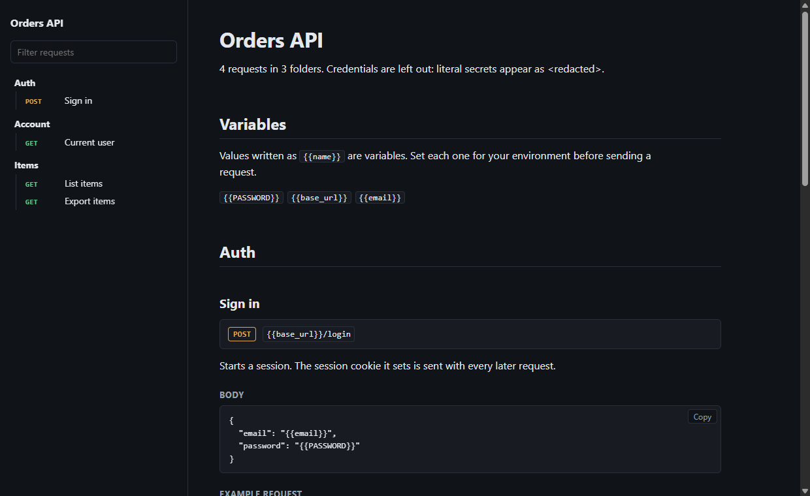

# Sharing and documentation

The **Share** tab of the import dialog encrypts a folder or the whole collection in your window (AES-256-GCM) and gives you a link, or an encrypted file plus a key. Nothing is uploaded: the key sits after the `#` in the link, which browsers do not send to servers.

- Anyone holding the whole link can open it. Use a passphrase, or the file with the key sent separately, for anything sensitive.
- Variable values and saved responses are left out unless you tick them. OAuth tokens, cookies and history are never included.
- The recipient sees what is inside before importing, and their own variable values are kept.
- A link carries up to 32 KB; larger selections go as a file.

**Export → HTML docs** (or `gostman docs`) writes one self-contained documentation page: every request with its description, parameters, headers, body, a curl example and saved examples. Values in auth settings, credential headers and parameters with names such as `token` or `key` are shown as `<redacted>`; other literal secrets in bodies are not detected, so review the page before publishing.

## Open in Gostman links

A link can ask Gostman to download a Postman, OpenAPI, Insomnia, HAR, Bruno or Gostman file and import it, for example from a README button:

- Web: `https://gostman.com/web#open=<percent-encoded https address>`
- Desktop: `gostman://open?url=<percent-encoded https address>` (new, and not yet verified on every operating system; prefer the web link when you publish one)

A link never imports anything by itself. Gostman shows the source host and address, downloads only after you choose **Download**, shows the detected format, and imports only after you choose **Import**. Only `https` addresses work, private and internal addresses are refused (including after redirects), and the file goes through the same import path as every import: it only adds data, and scripts are kept but reported. Files are limited to 4 MB in the web version and 10 MB on the desktop. The Share tab can copy the link and a Markdown badge for a collection you host.
