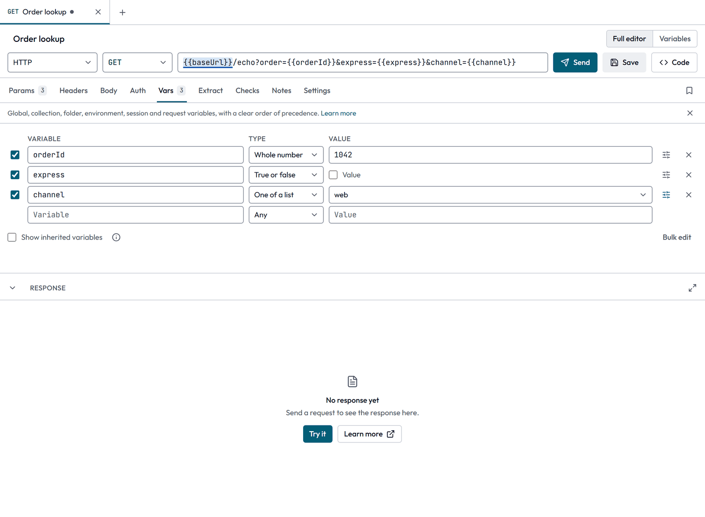
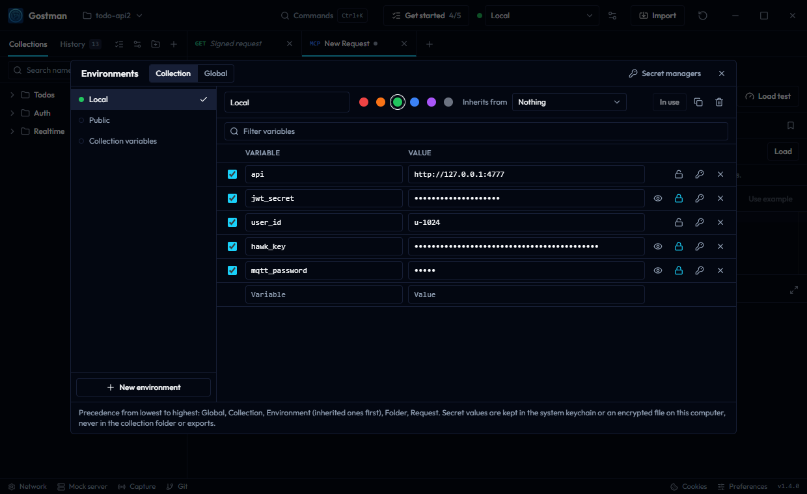

# Variables

Variables let you define a value once and reuse it across requests. Open **Environments** in the header (the sliders icon next to the environment picker) to edit them in a table.

## Scopes and precedence

When a name is defined in more than one place, the most specific scope wins. From lowest to highest:

| Scope | Where it is edited | Notes |
| --- | --- | --- |
| Global | Environments, **Globals** tab | Shared by every collection. One global environment is in use at a time. |
| Collection | Environments, **Collection variables**, or the **Vars** tab of the collection's settings | The shared list applies to every request; a folder workspace keeps it in `gostman.yaml`. Each collection, that is each top-level folder, can also keep its own list on top of the shared one, under **Collection variables** in the **Vars** tab of its top-level folder's settings; a folder workspace keeps it in that folder's `folder.yaml` (see [Environments per collection](#environments-per-collection)). Rows can be marked secret. |
| Environment | Environments, **Environments** tab | The environment selected in the header for the request's collection (see [Environments per collection](#environments-per-collection)). If it inherits from another environment, the parent's variables come first and the child overrides them. |
| Folder | Folder settings, **Vars** tab | Outer folders first, the request's own folder last. See [Folder and collection settings](folder-settings.md). |
| Request | **Vars** tab of a request | Rows can be switched off without deleting them. |
| Session | Environments, **Session values** | Set by scripts and Extract rules for this session only. Never written to disk. |

A session value wins over a request variable with the same name, so a token that a login request extracts replaces a placeholder value in the Vars tab. The Vars tab says so under a row that a session value replaces. If the row has a type, the session value is read with it: it has to fit, and a script gets it as that type (see [Typed request variables](#typed-request-variables)).

Values you give when you start a run or a send win over everything saved in the collection: `--var`, `--var-from-env` and `--env-file` in the CLI, each row of a data file (in the CLI and in the runner), the fields of the [Variables view](requests-and-responses.md#variables-view) when you send from it, and the `variables` of an agent's `send_request`. A script or Extract rule that writes the same name later replaces them. The others are kept as session values, so such a write lasts for the rest of the run, and each new data row replaces what the previous iteration left; in the runner they last for the run only: when it ends, the session values it set go back to what they were. The fields of the Variables view apply to that one send only and are never kept as session values, so the next send starts again from what the fields show. A field is always the value of its variable, even when it is empty: a session value with that name is not used in its place.

### Typed request variables

Every variable is text unless you give it a type. In the **Vars** tab of a request, the **Type** column offers:

| Type | Value in scripts | Accepted text | Empty value in scripts |
| --- | --- | --- | --- |
| Any (default) and Text | text | anything | `""` |
| Number | a number | a number written as in JSON: an optional `-`, digits without a leading zero, an optional `.` followed by digits, and an optional exponent: `42`, `-1.5`, `0.25`, `2e3` | `null` |
| Whole number | a number | an optional `-` and digits without a leading zero, from -9007199254740991 to 9007199254740991 | `null` |
| True or false | `true` or `false` | `true` or `false`, in lowercase | `false` |
| JSON | the parsed object, array or value | valid JSON whose numbers a script can hold exactly | `null` |
| One of a list | text | one of the comma-separated choices of the row; a choice listed twice appears once, and a choice cannot contain a comma | `""` |



`env.get("count")`, `pm.variables.get("count")`, `insomnia.variables.get("count")` and `bru.getRequestVar("count")` return the typed value, in the apps and in the CLI. `bru.getVar` reads session values only, as it does in Bruno, where request variables are read with `getRequestVar`; a session value that replaces a typed variable is typed too. The type never changes what is sent: `{{count}}` in a URL, header or body is filled in with the text exactly as you wrote it, so `1.50` and `2e3` are sent as written. Only an empty True or false is sent as `false`, the value its unticked box shows. Because the text is used as written, it is never trimmed or case-folded: spaces before or after a Number, Whole number, True or false or choice, and `TRUE` or `True` for True or false, are refused, so that a field shows exactly what is sent and the script and the request receive the same value. Spaces around a JSON value are part of its formatting and are kept.

Any and Text behave the same: the value reaches scripts as text. Any means that no type was chosen, Text says that the value is meant as text.

Numbers are never guessed. A leading `+`, a leading zero such as `007`, `0x1F`, `.5`, spaces inside the number and a decimal comma are refused: `1,5` is `1.5` in some languages and `1,500` is fifteen hundred in others, so write `1.5` or `1500`. A number that a script cannot hold exactly is refused too rather than rounded: a whole number beyond 9007199254740991 (`2^53 - 1`), a number with more significant digits than a double keeps, or such a number inside a JSON value. Use Text for codes, long IDs and account numbers, or put them in quotes inside JSON.

A typed value may refer to other variables, such as `{{base}}`, and to [dynamic variables](#dynamic-variables) such as `{{$randomInt}}`, `{{$timestamp}}` or `{{$randomBoolean}}`, also inside JSON. The field shows what you wrote, the references are filled in when the request is sent, and the type applies to the result: a script gets `1.5` for a Number whose value is `{{base}}` when `base` is `1.5`, and the send stops with a message naming the variable when the result does not match its type. A typed variable that holds a dynamic variable is generated once per send, and that one value goes to the script and into the request, so `env.get("ts")` and `{{ts}}` agree. A typed variable that refers to another typed variable gets that variable's value: with `n` set to `{{$randomInt}}` and `m` set to `{{n}}`, both are the same number. A variable of type Any or Text keeps the usual rule: the text is passed on as written, and each `{{$...}}` in it is generated where it is filled into the request. Dynamic variables are filled in for values written in the Vars tab or the Variables view; a session value that holds one is passed on as it is. The answer to a [prompt variable](#prompt-variables) in a typed value, such as `{{?page}}`, is a value like any other: it is asked for before the pre-request script, the type applies to it, and the script gets it as the declared type. A `{{$file(...)}}` in a typed value is filled in when the request is sent, after the check, so the type is not enforced on it and scripts see it as written.

The type applies to the value that is used, wherever it comes from. A session value (an Extract rule or a script that wrote the name), a `--var`, a data file row or a flow value that replaces a typed variable is read with the same type: `42` from a response reaches a Whole number as the number `42`, `{"a":1}` reaches a JSON variable as an object, and `abc` for a Whole number stops the send with a message that says the value replaces the one in the Vars tab. The runner and the CLI do the same as the apps.

An empty optional Number, Whole number or JSON value reaches scripts as `null`, so `env.get("count") ?? 10` gives a default; Gostman 1.15.1 and earlier gave an empty string. An empty True or false row is `false`, and is sent as `false`. A True or false whose value comes from a reference, a session value or `--var` that turns out empty is refused instead, because nothing says which of the two was meant; the message says that the value is empty, and for `TRUE` or `True` that only lowercase `true` and `false` are accepted. Mark a row **Required** under **Field options** to ask for a value. Required works the same for every type and checks the value that would be sent: a value that is only spaces is empty, and so is a reference that gives no value, such as `{{token}}` when `token` is empty or not defined anywhere.

A value that does not match its type, or an empty required value, stops the send before any script runs. A value that a pre-request script writes into a typed variable, with `env.session.set` for example, is checked again after the scripts, before the request is sent, with the same message. The request is not sent, the response says which variable is wrong, and the CLI counts it as a request without a response. When you change the type of a row that has a value, the field keeps showing that value next to the message, until you change it. Rows that are switched off are not checked. Only request variables have types; environment, collection and global values keep the JSON type they were saved with.

See [Variables view](requests-and-responses.md#variables-view) to turn a request into a short form of its typed variables.

## Values set by scripts and Extract rules

Scripts choose where a value goes:

| Call | Where the value goes |
| --- | --- |
| `env.set`, `pm.environment.set`, `bru.setEnvVar` with `{ persist: true }`, `insomnia.environment.set` | The active environment. It is saved with the environment, in its YAML file in a folder workspace, unless the variable is marked secret, which keeps the value in the keychain. |
| `env.session.set`, `pm.variables.set`, `bru.setVar`, `bru.setEnvVar` without `persist`, `insomnia.variables.set` | Session values. |
| `env.collection.set`, `pm.collectionVariables.set`, `insomnia.collectionVariables.set`, `insomnia.baseEnvironment.set` | Collection variables: the request's collection when it keeps its own list (its top-level folder's `folder.yaml` in a folder workspace), otherwise the shared list (`gostman.yaml` in a folder workspace). A collection variable marked secret stays secret, so a token written there keeps its value on this device only. |
| `env.globals.set`, `pm.globals.set`, `bru.setGlobalEnvVar`, `insomnia.globals.set` | The global environment in use. When none is in use, a global environment named Globals is created and used. |

In the CLI and in agent sessions nothing is written to disk: a value lasts for the run (for an agent, the session) in the scope the script chose, so a collection variable a script sets still sits below the environment, and `unset` removes it from the request's collection variables only. They start with no global environment, so the first global a script sets creates one for the run.

Session values sit above every other scope, the way Postman's local variables and Bruno's runtime variables do. They are kept in memory: closing the app, opening another collection or **Clear session values** in the Environments dialog removes them. They are treated as secret, so hover previews mask them, and they never go into exports, share links or AI prompts. Setting a name in the environment, the collection or the globals removes the session value with that name, so the newest value wins; unsetting or clearing a scope leaves session values alone.

Use session values for tokens and other values that come from a response, so they are not committed to Git with the environment. Each scope object reads only its own scope: `pm.environment.get("token")` returns the active environment's value, while `pm.variables.get("token")` and `env.get("token")` return the value the request would use. `bru.getEnvVar` reads a session value with that name first, because `bru.setEnvVar` without `persist` keeps its value there. A number or `true`/`false` set by a script reads back as a number or a boolean, in the apps and the CLI alike; it becomes text only where it is filled into a request.

The Go engine, the desktop and web apps and the CLI resolve a name the same way.

## The environment table

Each environment is a table of rows: a checkbox (Use this variable) that turns the row on or off, a name, a value and a lock. Pick an environment in the list on the left, or create one with **New environment**; **Use this environment** makes it the active one.



- **Secret** (lock): the value is masked in the table (the eye reveals it) and in hover previews and suggestions. It is never written to the workspace YAML, to exports or to share links. See [Secret variables](#secret-variables).
- **Colour**: a label shown next to the environment picker, so production is hard to mistake for staging. Choose one of six colours, or the swatch with a plus for any colour from your system's colour picker.
- **Inherits from**: the environment whose variables are used first. Cycles are not offered.
- **Duplicate**, **Delete** and **Filter variables** (matches names and the values of non-secret rows).

Names may contain letters of any script, digits, underscores, dots and hyphens. Values can be strings, numbers or booleans; a value of `null` is treated as undefined.

## Environments per collection

In the app's own storage (the desktop app without a folder open, and the web app), every top-level folder is a collection, and an environment either belongs to one collection or is shared by all of them. Environments you create yourself are shared, so with one collection, or when you never move an environment, there is a single list and a single choice, as in Postman.

- **Imports**: environments that come with a Bruno or Insomnia collection belong to the folder the import creates, as they do in those tools, so two collections can each have their own `Local`. Postman environment files imported together with one Postman collection belong to it; otherwise they are shared, as are Postman data dumps, globals and `.http` environment files.
- **The picker** lists the environments of the active request's collection under its name, then the shared ones. Each collection remembers its own choice, so switching to a tab from another collection switches the environment with it; the picker's border flashes when that happens. A collection without environments of its own uses the shared choice.
- **Available in**: in the Environments dialog, set an environment to **Every collection** to share it, or to one collection to keep it there. The control appears when there is more than one collection. **New environment** creates one in the active request's collection when that collection has environments of its own, and a shared one otherwise.
- **Everywhere else** the request decides: a send, a run (each request uses its own collection's environment), values that scripts and Extract rules write, and OAuth 2.0 tokens. Sharing a folder includes the shared environments and the ones of its collection; a Gostman export keeps which folder each environment belongs to.
- **Collection variables** follow the same idea. A collection imported from Postman, Bruno, Insomnia, an OpenAPI spec or a WSDL file keeps its own collection variables, so two collections can each have their own `baseUrl` or `apiVersion`; they apply to its requests, on top of the shared collection variables, and an environment still wins over both. Scripts (`pm.collectionVariables.set` and the like) write to the request's own collection variables when it has them, and to the shared ones otherwise. In the Environments dialog, **Collection variables** under the collection's name edits the list of the active request's collection, and the one under **Shared** edits the shared list, which is listed for a collection with its own list only when it has values. The same lists are in the **Vars** tab of the top-level folder's **Collection settings** (the collection's own) and of **Settings for all collections** (the shared one). Collections you create yourself and data saved before this change use the shared list until you add a variable to their own. Folder workspaces keep these lists too (see below). Exports and shares carry each collection's list and, in a full export or a share of everything, the shared list; a folder share carries the shared variables its requests use onto the shared folder, and a share without values carries only the names. Collection variables have the same secret lock as environment variables; the secret check of **Export** and **Share**, and `gostman scan`, look at collection variables too, and never see the values of secret ones.
- **The CLI** does the same for an export from the app. Without `--folder`, `gostman run` and `send` give each request its collection's environment: without `--env`, the collection's first own environment, or the first shared one for a collection without its own (and for requests outside any collection). `--env Name` picks the collection's own environment named Name, or the shared one with that name, so `--env Local` runs every collection against its own `Local`. When a collection with environments of its own has neither, nothing is sent and the error names the collection; run it on its own with `--folder`. With `--folder`, one environment is used for the whole run.
- A folder workspace keeps one list of environments, so its environments are always shared and environment files carry no folder. Its top-level folders still count as collections for collection variables, so precedence is the same as in the app's own storage: the shared list is in `gostman.yaml`, and a top-level folder keeps its own as `collectionVariables` in its `folder.yaml`, with secret and off marks in `collectionVariablesMeta` and never a secret value. Edit it under **Collection variables** in the **Vars** tab of the folder's settings, or under its name in the Environments dialog. **Save collection to folder** and `gostman import` write each collection's list into its own folder, so no value changes. They keep every environment too: when two collections each have a `Dev`, the collections' ones are saved as `Dev (Ledger)` and `Dev (Orders)`, and a notice lists the new names. Workspaces saved by earlier versions, which put every collection's variables into `gostman.yaml`, keep working as they are. Older versions of Gostman ignore a folder's own list, so there its requests see only the shared list, and they keep the list in the file when they save the folder.

## Using variables

Write `{{name}}` wherever the value should appear: URL, query parameters and headers (keys and values), body (including form and multipart text fields), auth fields, GraphQL query and variables, and WebSocket URL and headers.

- Names are case-sensitive and whitespace inside the braces is ignored: `{{ name }}` is `{{name}}`.
- A placeholder with no matching variable is left as written, so the mistake is visible in the request that goes out. The response view names such placeholders in a notice with a link to the Environments dialog, and `gostman run` and `send` print a warning for them. Dynamic values (`{{$...}}`) and prompts (`{{?...}}`) are not listed.
- Every occurrence is replaced. Values are inserted as they are; a value placed in a URL is not percent-encoded apart from spaces.
- A value can refer to other variables: with `host` set to `https://api.example.com` and `api` to `{{host}}/v1`, `{{api}}/users` becomes `https://api.example.com/v1/users`. Values are filled in up to 8 levels deep; a placeholder deeper than that, or one that refers back to a variable being filled in, is left as written, the same way in the apps' previews, in scripts and in what is sent. One field fills in at most 10,000 values that themselves hold placeholders and leaves the rest as written, and a request that needs more than 100,000 in all is not sent. A dynamic value inside a variable, such as `{{$guid}}`, is generated once per request, so every use of that variable gets the same value. `{{$file(...)}}` inside a variable's value is never read; write it in the request itself.
- In fields with variable support, defined names are underlined, hovering shows the value (masked for secrets) and the scope it came from, and typing `{{` or pressing Ctrl+Space offers completions. For a value that refers to other variables, the hover also shows what it resolves to and through which variables, with secret parts masked.

## Secret variables

Mark a row as secret with its lock. Environment variables, global variables and collection variables (shared and per collection) all have it.

- **Desktop**: values live in the operating system keychain (Windows Credential Manager, macOS Keychain, the Secret Service on Linux). If no keychain is available they are kept in `secrets.enc` in the app data folder, encrypted with AES-256-GCM using a key file next to it. That fallback protects against casual reading and accidental sharing, not against someone who can read both files.
- Only the name of a secret variable is written to the environment file (as `meta`), or for collection variables to `gostman.yaml` (as `variablesMeta`) or to the top-level folder's `folder.yaml` (as `collectionVariablesMeta`), never its value. Copying a workspace folder to another computer therefore leaves the secret values behind.
- **Web**: there is no keychain in a browser, so values stay in the browser's storage (IndexedDB) and are still left out of exports and share links.
- **CLI**: provide the value yourself, for example `gostman run <collection> --var-from-env API_TOKEN` (the environment variable name becomes the variable name) or `--var token=value`.
- **A variable you do not mark is saved as plain text.** When the value of an unmarked variable looks like a credential (a known token format such as a GitHub or AWS key, a JSON Web Token, a private key, or a random-looking value under a name such as `token` or `api_key`), the row shows a warning with a **Mark as secret** button. The check runs in your window and never sends the value anywhere. Short passwords are not recognised, so mark those yourself.
- **`.gitignore`**: a new workspace folder gets a `.gitignore` that keeps `.env`, `.env.*` (except `.env.example`) and the `.gostman-*.tmp` leftovers of an interrupted save out of Git. An existing `.gitignore` is never changed, and workspaces created by earlier versions get the file when you run `gostman init` on them.

## Secret managers

A variable can read its value from HashiCorp Vault, AWS Secrets Manager, Azure Key Vault, Google Cloud Secret Manager, KeePassXC, 1Password, Bitwarden or Bitwarden Secrets Manager. In the environment table choose the key icon on a row, pick a connection and give the secret path, an optional field and, for the secret managers, an optional version. [Password managers](secrets-and-network.md#password-managers) describes each password manager. **Test** reads the secret and shows only that it worked and how many characters it has.

- The collection stores only the reference. Connections (address, namespace, sign-in) are settings of this computer under **Secret managers**, with credentials in the keychain, so a cloned collection cannot point your credentials at its own server. An unknown connection name fails with a message.
- References are resolved when a request is sent and cached in memory for five minutes. Values are never saved, exported or shared. If a reference cannot be read the request is not sent.
- Folders that are not trusted yet never resolve references.
- Desktop app and CLI only; KeePassXC works in the desktop app only. See the [command line](cli.md) page for the CLI variables, `--secrets` and `--secrets-env-file`.

## Dynamic variables

Dynamic variables are generated by the engine every time a request is sent, so each occurrence gets its own value; a typed request variable that holds one is generated once, see [Typed request variables](#typed-request-variables). They are the same in the apps and the CLI. Type `{{$` in any field or editor to pick one; every suggestion says what it produces.

| Variable | Value |
| --- | --- |
| `{{$guid}}`, `{{$uuid}}`, `{{$randomUUID}}`, `{{$uuidV4}}` | Random UUID v4 |
| `{{$uuidV7}}` | Random UUID v7: it begins with the time in milliseconds, so ids sort by creation |
| `{{$timestamp}}`, `{{$timestampMs}}` | Unix time in seconds, in milliseconds |
| `{{$isoTimestamp}}` | UTC time such as `2026-10-21T15:18:24.870Z` |
| `{{$date}}` | UTC date such as `2026-10-21`; see [Dates](#dates) for other formats and offsets |
| `{{$randomInt}}`, `{{$randomInt(min,max)}}` | Integer from 0 to 1000, or from `min` to `max` (both included, at most 2,147,483,648 values apart) |
| `{{$randomFloat}}`, `{{$randomFloat(min,max)}}`, `{{$randomFloat(min,max,decimals)}}` | Number from 0 to 1000, or from `min` to `max`, with 2 decimals or the `decimals` you give (0 to 15) |
| `{{$randomBoolean}}`, `{{$randomHex}}`, `{{$randomAlphaNumeric}}` | Random boolean, 16 hex characters, 12 letters and digits |
| `{{$randomColor}}`, `{{$randomHexColor}}`, `{{$randomColorName}}` | A `#rrggbb` colour, or a colour name |

The `$random*` names follow Postman's, so collections imported from Postman keep working. Groups:

| Group | Variables |
| --- | --- |
| Names and jobs | `$randomFirstName`, `$randomLastName`, `$randomFullName`, `$randomNamePrefix`, `$randomNameSuffix`, `$randomJobTitle`, `$randomJobArea`, `$randomJobDescriptor`, `$randomJobType` |
| Contact and location | `$randomEmail`, `$randomExampleEmail`, `$randomUserName`, `$randomPhoneNumber`, `$randomPhoneNumberExt`, `$randomCity`, `$randomStreetName`, `$randomStreetAddress`, `$randomZipCode`, `$randomState`, `$randomCountry`, `$randomCountryCode`, `$randomLatitude`, `$randomLongitude`, `$randomTimeZone`, `$randomLocale` |
| Dates | `$randomDatePast`, `$randomDateFuture`, `$randomDateRecent`, `$randomDateSoon`, `$randomBirthdate`, `$randomWeekday`, `$randomMonth` |
| Internet | `$randomIP`, `$randomIPV6`, `$randomMACAddress`, `$randomPassword`, `$randomUserAgent`, `$randomProtocol`, `$randomSemver`, `$randomUrl`, `$randomDomainName`, `$randomDomainSuffix`, `$randomDomainWord` |
| Finance and shop | `$randomPrice`, `$randomBankAccount`, `$randomBankAccountName`, `$randomBankAccountBic`, `$randomBankAccountIban`, `$randomCreditCardNumber`, `$randomCreditCardMask`, `$randomTransactionType`, `$randomCurrencyCode`, `$randomCurrencyName`, `$randomCurrencySymbol`, `$randomBitcoin`, `$randomProduct`, `$randomProductName`, `$randomProductAdjective`, `$randomProductMaterial`, `$randomDepartment` |
| Business | `$randomCompanyName`, `$randomCompanySuffix`, `$randomCatchPhrase`, `$randomCatchPhraseAdjective`, `$randomCatchPhraseDescriptor`, `$randomCatchPhraseNoun`, `$randomBs`, `$randomBsAdjective`, `$randomBsBuzz`, `$randomBsNoun` |
| Files and data | `$randomFileName`, `$randomFileType`, `$randomFileExt`, `$randomCommonFileName`, `$randomCommonFileType`, `$randomCommonFileExt`, `$randomFilePath`, `$randomDirectoryPath`, `$randomMimeType`, `$randomDatabaseColumn`, `$randomDatabaseType`, `$randomDatabaseCollation`, `$randomDatabaseEngine` |
| Images | `$randomAvatarImage`, `$randomImageUrl`, `$randomImageDataUri`, and one per category such as `$randomCatsImage` or `$randomFoodImage` |
| Words | `$randomWord`, `$randomWords`, `$randomNoun`, `$randomVerb`, `$randomIngverb`, `$randomAdjective`, `$randomAbbreviation`, `$randomPhrase` |
| Lorem ipsum | `$randomLoremWord`, `$randomLoremWords`, `$randomLoremSentence`, `$randomLoremSentences`, `$randomLoremParagraph`, `$randomLoremParagraphs`, `$randomLoremText`, `$randomLoremSlug`, `$randomLoremLines` |

- Dates are UTC in ISO 8601, such as `2027-03-17T13:11:50.000Z`, unless you give a pattern (see [Dates](#dates)). `$randomBirthdate` is a date such as `1990-04-12` for someone aged 18 to 80.
- `$randomBankAccountIban` has valid check digits and `$randomCreditCardNumber` passes the Luhn check, so validators accept them. Neither belongs to a real account.
- Every value is a single line, so it is safe inside a JSON string. Emails use `example.*` domains.
- The sample data is in English.

A variable you define with the same name takes precedence. The code snippet view and the request that is actually sent each generate their own values.

### Faker names

Every generator also has a name in the style of the faker library, such as `{{$faker.date.future}}`, `{{$faker.person.fullName}}`, `{{$faker.location.city}}` or `{{$faker.finance.iban}}`. Typing `faker.` in a body or field lists them, and the one you pick is inserted as `{{$faker...}}`. The groups are `string`, `number`, `datatype`, `color`, `person`, `phone`, `location`, `internet`, `system`, `image`, `finance`, `company`, `database`, `date`, `commerce`, `hacker`, `word` and `lorem`.

A faker name takes the same arguments as the generator it stands for, and the list shows each form: `{{$faker.number.int(1,100)}}`, `{{$faker.number.float(0,1,4)}}`, `{{$faker.date.past(dd/MM/yyyy)}}`, `{{$faker.date.now(yyyy-MM-dd)}}`. Arguments are written in Gostman's order and notation, not as faker's options object, and the result is the same in the apps and in the CLI. There is no faker name for UUID v7, because faker has none: use `{{$uuidV7}}`.

### Dates

`{{$date(pattern)}}` is today's UTC date written the way you ask, and the generators that return a date or time take a pattern too: `$isoTimestamp`, `$randomDatePast`, `$randomDateFuture`, `$randomDateRecent`, `$randomDateSoon` and `$randomBirthdate`, with their faker names. Patterns use the Unicode letters that Java, .NET and date-fns share:

| Letters | Meaning | Example |
| --- | --- | --- |
| `yyyy`, `yy` | Year | `2026`, `26` |
| `MM`, `M`, `MMM`, `MMMM` | Month as a number, short name, full name | `03`, `3`, `Mar`, `March` |
| `dd`, `d` | Day of the month | `07`, `7` |
| `EEE`, `EEEE` | Weekday, short and full | `Tue`, `Tuesday` |
| `HH`, `H` | Hour, 0 to 23 | `15` |
| `hh`, `h`, `a` | Hour, 1 to 12, and AM or PM | `03`, `PM` |
| `mm`, `ss` | Minutes, seconds | `09`, `45` |
| `S`, `SS`, `SSS` | Fraction of a second, up to 9 digits | `870` |
| `X` | The time zone, always `Z`, because dates are UTC | `Z` |

Anything that is not a letter is copied as it is, and so is text in single quotes, with `''` for a quote itself: `{{$date(dd/MM/yyyy)}}` is `21/10/2026`, `{{$date(EEEE d MMMM yyyy)}}` is `Wednesday 21 October 2026`, and `{{$isoTimestamp(yyyy-MM-dd'T'HH:mm:ss.SSSX)}}` is the ISO form. A letter that is not in the table, or a quote that is never closed, stops the send with a message that names the placeholder. Month and weekday names are in English.

`$date` also takes an offset before the pattern: `{{$date(+7d,dd/MM/yyyy)}}` is a week from now and `{{$date(-1M)}}` is a month ago, in the default format. An offset is a sign, a number and a unit: `s`, `m`, `h`, `d`, `w`, `M` (months) or `y`. Months and years move on the calendar.

### Templates and encoding

Test data often has to be a whole document, or a document inside a field. A variable can hold a multi-line JSON or XML document with placeholders in it, a placeholder inside a variable is filled in when the variable is used, and a dynamic value inside a variable is generated once per request, so the document is consistent wherever it appears. These functions complete it:

| Function | Result |
| --- | --- |
| `{{$base64(name)}}` | The value of the variable `name`, with everything inside it filled in, as base64 |
| `{{$base64Url(name)}}` | The same as base64url without padding, as used in JWTs |
| `{{$urlEncode(name)}}` | The same percent-encoded, to put in a query value |
| `{{$template(path)}}` | A file read like `{{$file(path)}}`, with the placeholders in it filled in (desktop app and CLI, see [Reading files](#reading-files)) |

The argument of an encoder is anything a placeholder can hold, so `{{$base64($template(templates/order.xml))}}` and `{{$base64($uuidV7)}}` work, and one encoder can wrap another. It is a name, never text with `{{ }}` inside it: put that text in a variable first. A variable that is not defined is reported like any other. A template holds what any variable holds: other variables, faker values, dates, UUIDs and numbers, up to 8 levels deep.

**Open in editor**, at the end of a variable's value field, shows a large document in the request body editor, in a movable, resizable window. It completes `{{` variables, `{{$` dynamic values and `$faker.` names, flags invalid JSON as you type, and **Format** indents JSON or XML and keeps the `{{placeholders}}` as written (an XML problem is reported by Format, as in the body editor). It picks Text, JSON or XML from the content, and you can change it. Edits are saved as you type, and a secret variable opens in it only while its value is shown.

To send a JSON body with a base64 attribute whose content is an XML document filled with test values, in the web app, the desktop app and the CLI:

1. Create a variable `order` with the document as its value, in **Environments**, in **Collection variables** to share it with every request of a collection, or in the **Vars** tab of a folder. Press Shift+Enter in the value field for a new line:

   ```xml
   <order id="{{$uuidV7}}" placed="{{$date(dd/MM/yyyy)}}">
     <customer>{{$faker.person.fullName}}</customer>
     <email>{{$faker.internet.email}}</email>
     <total>{{$randomFloat(10,500,2)}}</total>
   </order>
   ```

2. In the body, write `{ "type": "order", "payload": "{{$base64(order)}}" }`. Every send generates a new document and encodes it. `{{order}}` elsewhere in the same request is the same document, not encoded.
3. To keep a generated document, open **Code** on a request whose body is `{{order}}` and pick **Request body**: **Save as file** writes what the engine produced. To send exactly that document again, or to compare a response with a fixed input, put the file in the workspace and use `{{$fileBase64(fixtures/order-1.xml)}}`.

In the desktop app and the CLI the library can be files instead: keep documents in a `templates/` folder of the workspace, under Git next to the collection, and write `{{$base64($template(templates/order.xml))}}`. A template file is filled in like a variable and cannot read other files. `{{$template(...)}}` counts as active content like `{{$file(...)}}`: folders that are not trusted do not read it, and imports and agents are refused it.

A tool such as [CUE](https://cuelang.org) can generate a file first, in a CI step (`cue export order.cue -o order.json`), and a request then sends it with `{{$file(...)}}` or `{{$fileBase64(...)}}`. Gostman does not run it for you. The code snippet view fills in fresh generated values of its own; the request that is sent generates its own too.

### Reading files

`{{$file(path)}}` is replaced by the contents of a file as text, and `{{$fileBase64(path)}}` by its contents encoded as base64, for example to send a PDF inside a JSON body:

```json
{ "type": "application/pdf", "base64content": "{{$fileBase64(fixtures/invoice.pdf)}}" }
```

- `{{$template(path)}}` reads a file the same way and then fills in the placeholders in it; see [Templates and encoding](#templates-and-encoding). The rules on this page about paths and limits apply to it.
- Files are read when the request is sent: by the desktop app, and by `gostman run`, `send` and `load` when you pass `--allow-files`, so a collection you did not write cannot send your files. The web app and agent sessions (`gostman mcp`) do not read files, a request that uses them there is not sent, and an agent cannot save a request that reads a file.
- A path starts at the workspace folder in the desktop app, and at the workspace folder or export file given to the CLI (the current folder for a request given as a method and a URL), and must stay inside that folder: `..`, absolute paths, `~/` and links that lead outside it are refused, so a collection cannot read other files on your computer. Without a workspace folder, the desktop app reads absolute paths, and `~/` is your home folder.
- Network paths such as `\\server\share\file.txt` or `//server/share/file.txt`, and device paths such as `\\.\pipe\name`, `\\?\C:\...` or `COM1`, are refused with a message, so reading a file never makes Windows send your sign-in to another computer. Copy the file to this computer, or map the share to a drive letter.
- A file can be up to 10 MB, all the files a request reads at most 10 MB together, and the whole request at most 10 MB once filled in. A file that cannot be read stops the send with a message.
- File placeholders count as active content, like scripts: a folder that is not trusted does not read files, imports, share links and pasted curl commands list the paths they read and ask before keeping them, and importing without active content removes them.
- The code snippet view shows the placeholder, not the file.
- Files are read in HTTP and GraphQL requests. A gRPC or MCP request or a WebSocket message that uses `{{$file(...)}}` is not sent.

## Prompt variables

`{{?name}}` asks for a value when the request is sent. A dialog lists every prompted name found in the request, pre-filled with a variable of the same name if one exists (a value that is itself a prompt, such as `page` set to `{{?page}}`, is not offered). It opens before the pre-request script runs, so the script sees the answers; a prompt that a script adds to the request is asked for after it. When an answer is the value of a typed variable, as in `page` set to `{{?pageNo}}` with the type Whole number, it is checked in the dialog with the usual message, and nothing is sent until it fits. Cancelling the dialog stops the send. The values are not saved.

In the CLI, `--var name=value` (or `--var-from-env`) supplies the value, and a typed variable checks it like any other value; without one the placeholder is left as written. The runner asks once per run: each name is asked the first time a request uses it, and later requests and iterations reuse the answer. The dialog says so, and its button reads **Continue run**. Cancelling marks that request as failed, and every later request that needs a prompted value fails without asking again; the run goes on unless **Stop on failure** is checked.

## .env files

In a folder workspace, a `.env` file next to `gostman.yaml` is read as process environment variables and exposed as `{{process.env.NAME}}`. Lines look like `NAME=value`, `export NAME=value` or `NAME="quoted value"`; `#` starts a comment. The file is listed read-only in the Environments dialog (values masked), is never written back and never exported. `gostman run` on a workspace folder reads it too. Other operating system variables are not exposed; pass them with `--var-from-env`.

## Setting variables from a response

The **Extract** tab stores rules on a request. After each response, every enabled rule copies a value into a variable. **Keep in** chooses where:

- **Session**: a session value, never written to disk. This is the default in a folder workspace, where environment files are usually shared through Git and a token written there would be committed with them.
- **Environment**: the active environment, saved with it. This is the default when the collection is kept in the app's own storage, which is never shared, so existing rules keep working as before.

A rule saved with an explicit choice keeps it wherever the collection is opened. In the CLI a rule without a choice keeps its value as a session value; nothing is written to disk either way.

| Source | Expression | Example |
| --- | --- | --- |
| JSON body | JSONPath | `$.data.token` |
| Header | Header name, case-insensitive | `Location` |
| Cookie | Cookie name | `session` |
| Status code | none | `200` |

Rules run in the background with the collection's script time limit (10 seconds unless you change it). Rules that run past it, usually because of a slow regular expression in a JSONPath filter, keep no values: the Extract tab and the Checks tab of the response say so, the runner and `gostman run` count the request as failed, and its checks and post-response script still run. The value column of the Extract tab is worked out the same way, so a slow rule shows that it was stopped instead of holding up the app.

## Where substitution happens

Substitution is done by the Go engine in [`engine/`](../engine) when the request is prepared, identically for the desktop app, the web version and the CLI. Scope resolution runs in the frontend for the apps and in [`runner/variables.go`](../runner/variables.go) for the CLI.
