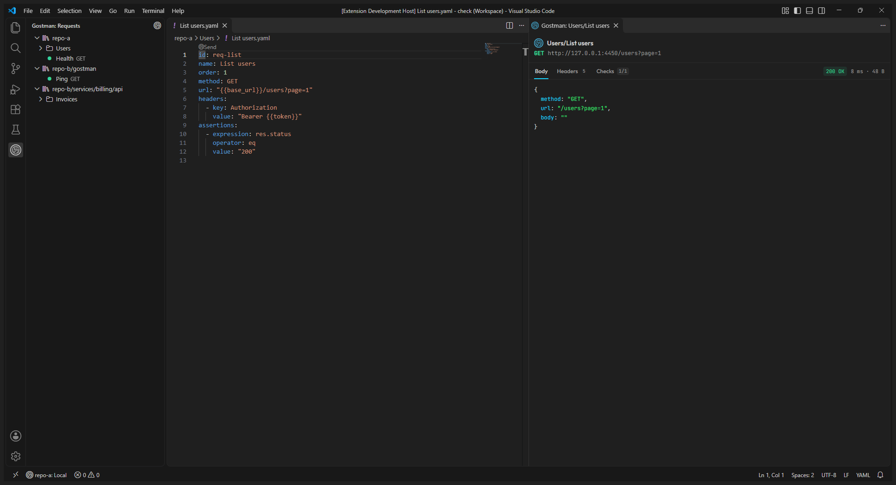

# VS Code extension

The Gostman extension sends requests and runs collections from the editor. It is a thin layer over the `gostman` command line: it prepares nothing itself, so a request sent from VS Code, a run in the Testing view, a run in [CI](ci.md), the [desktop app](getting-started.md) and the [MCP server](agents.md) all give the same result. It reads a collection kept as files in a folder (`gostman.yaml`, one YAML file per request; see [Workspaces and mock server](workspaces-and-mock.md)), the same folder the desktop app opens and Git tracks.

The extension does four things: a **Send** lens above each request file, a **Requests** view under the Gostman icon in the activity bar, the collection in the Test Explorer, and an environment picker in the status bar. It also puts the CLI's other commands in the Command Palette. Its source is in [`editors/vscode`](https://github.com/kunalgoesbyken/gostman/tree/main/editors/vscode).

## Requirements and install

- VS Code 1.85 or later, or a compatible editor such as VSCodium or Cursor.
- The Gostman command line. Downloads are on the [releases page](https://github.com/kunalgoesbyken/gostman/releases); see [Command line](cli.md). The extension starts `gostman` from the PATH; when it is not there, it also looks in `GOBIN`, the `bin` folder of each `GOPATH` entry and `~/go/bin` (where `go install` puts it), and on macOS and Linux in `/opt/homebrew/bin`, `/usr/local/bin` and `~/.local/bin`. Anywhere else, set `gostman.path` to its full path.
- A collection: a folder that holds `gostman.yaml`. Create one with `gostman init`, or with **Gostman: Create a collection in this folder**, or open a folder you already use in the desktop app.

Install the extension from the [Visual Studio Marketplace](https://marketplace.visualstudio.com/items?itemName=Gostman.gostman), or run `ext install Gostman.gostman` in the Quick Open box (`Ctrl+P`). Then open the collection folder, or a repository that holds one, with **File > Open Folder**. The extension starts when a `gostman.yaml` is anywhere in the workspace, and the status bar shows the environment on the left.

## Collections in a workspace

The extension finds every collection in every folder of the workspace: each folder that holds `gostman.yaml`, at the root of a workspace folder or up to four folders below it, such as the `gostman` folder that `gostman init` creates in a repository that already holds other files. Hidden folders (`.git`, `.venv`), `node_modules`, `bower_components`, `vendor` and `__pycache__` are not searched, and the search does not look inside a collection for another one. A collection created, moved or deleted while VS Code is open is picked up on its own.

A collection is named after its workspace folder and the path below it, such as `api` or `shop/services/billing`. With one collection the extension works as before. With several:

- the Testing view shows one item per collection, with its folders and requests under it;
- the Send lens and **Send this request** use the collection the file is in;
- the status bar shows the environment of the collection of the active editor;
- the commands that run the CLI in a terminal use the collection of the active editor, and ask which collection to use when the active editor is not in one.

## Send a request from its file

Open a request file of the collection. A **Send** lens appears above its first line. Select it to run `gostman send --json` for that request and show the result in a panel beside the editor. A file with unsaved changes is saved first, because the CLI reads the file from disk.

The panel is laid out like the response panel of the app, with its colours taken from your VS Code theme (light, dark or high contrast):

- the request name, its method and the address that was sent;
- the status, the time and the size of the response;
- a **Body** tab with the body as the CLI returned it, up to 256 KB, with JSON formatted and coloured; a larger body is cut and the panel says how much of it is shown. When the request got no response, the tab says **Request failed** and why;
- a **Headers** tab with the response headers, a **Checks** tab with each check passed or failed and its message, and a **Console** tab with the logs of the request's scripts, when there are any.

When something in the request had no value, the panel says so above the tabs. **Placeholders with no value** lists each `{{name}}` that nothing defined, so a literal `{{base_url}}` or `{{token}}` in a result is explained: the wrong environment, or none, is selected, or a variable is missing. **Secrets not filled in** lists secrets Gostman left out, and the CLI's own warnings follow.

The panel is plain HTML with no scripts, no remote content and a strict content security policy, and it escapes everything it shows. Its fonts and the Gostman mark ship with the extension. Secret values appear as `{{name}}`, as in `gostman send`; the extension never passes `--reveal`, so it cannot print a secret.

Two commands send without the lens: **Gostman: Send this request** sends the YAML file in the active editor, and **Gostman: Send a saved request** asks for a name, id or `Folder/Name` and runs `gostman send` in the Gostman terminal.

A request is a YAML file with a `method` or a `url`. It is sent by its `id` when the file has one that no other file shares, and by `Folder/Name` otherwise, for example after you copied a request file.

## The Requests view

Select the Gostman icon in the activity bar to see the **Requests** view: every collection, its folders and its requests in the order the collection keeps them, each request with its method in the app's colours. Select a request to open its file, or use the send button next to it to send it as the lens does. The selector in the view's title bar picks the environment. When the workspace has no collection, the view offers to create one.

Every command line the extension starts, and what the CLI printed to stderr, is logged in the **Gostman** output channel (**View > Output**, then **Gostman**).

## Run in the Test Explorer

The folders and requests of the collection appear in the Testing view, in the order the collection keeps them. Use the Run button on everything, on a folder or on one request, or select several requests.

- **Everything** runs `gostman run .`.
- **One folder** runs `gostman run . --folder <folder>`.
- **One or several requests**, or a folder with some requests excluded, runs `gostman run . --only <request>` once for each request, in a single run.

Every run adds `--reporter json` and `--redact` and the selected environment of the collection, and reads the JSON report. A run that covers several collections runs the CLI once per collection, one after the other, in the collection folder; the test output starts each part with the collection name. Each request becomes one test item:

| Result | Meaning |
| --- | --- |
| Passed | the request got a response and every check passed |
| Failed | a check, a script or the request itself failed; the message lists the error and each failed check with its message |
| Skipped | the CLI did not send the request, for example a WebSocket request, which a run leaves out, or it is not in the report |
| Errored | the run produced no report: the CLI could not be started, or it refused the input, such as an unknown environment; the message is what it printed |

A 4xx or 5xx status alone is not a failure, as in `gostman run`; add a check such as `res.status equals 200` to the request. Requests in a run share variables and cookies as usual, so a request that needs a value extracted by an earlier one fails when run alone. Cancelling the run stops the CLI. The Testing view refreshes when YAML files in the collection are created, changed or deleted.

## Choose an environment

The status bar item on the left shows the environment passed as `--env`; with several collections it shows the collection name first. Select it, or run **Gostman: Select environment**, to pick one of the environments of the collection. The list is read from the files in the collection's `environments` folder, in the order the CLI uses, with **Collection default** first, which leaves `--env` out so the CLI uses the first environment. A name is the file's `name:` value, or the file name without its extension.

Each collection keeps its own choice, stored in VS Code's storage for this workspace, so it never lands in a file you commit. A collection where you have not chosen yet uses the `gostman.environment` setting, which a team can commit in `.vscode/settings.json` to share a default; when that is empty too, `--env` is left out. If the name in use is not one of the collection's environments, the status bar item turns to a warning and its tooltip says so; select another, or **Collection default**.

These use the selected environment: Run collection, Run a folder, Send a saved request, Run a flow, the Send lens and the Test Explorer. Scan, Lint, Create a collection and Open the documentation take none.

## Commands

Open the Command Palette (`Ctrl+Shift+P`) and type `Gostman`. Commands that do not use the lens or the Testing view run the CLI in a terminal task named after the collection, in the collection folder, so you see its normal output. With several collections they use the collection of the active editor, or ask which one.

| Command | Runs |
| --- | --- |
| Run collection | `gostman run .` |
| Run a folder of the collection | asks for a folder, such as `auth` or `auth/tokens`, then `gostman run . --folder <name>` |
| Send a saved request | asks for a request, then `gostman send --workspace . <request>` |
| Send this request | sends the request file in the active editor and shows the panel; the Send lens runs the same command |
| Select environment | opens the environment list described above |
| Run a flow | asks for a flow name, then `gostman flow run <name> --workspace .`; see [Flows](flows.md) |
| Lint an OpenAPI spec | `gostman lint <file>`; also in the Explorer context menu of `.yaml`, `.yml` and `.json` files |
| Scan the collection for leaked secrets | `gostman scan .`; see [Runner, load and scan](runner-load-and-scan.md) |
| Create a collection in this folder | `gostman init .` in the workspace folder, asking which one when there are several; in a folder that already holds files, the collection goes in a new `gostman` folder, which the extension finds |
| Open the documentation | opens https://gostman.com/docs |

## Settings

| Setting | Default | Meaning |
| --- | --- | --- |
| `gostman.path` | `gostman` | Command that starts the CLI. Use a full path when `gostman` is neither on the PATH nor in one of the folders listed in [Requirements and install](#requirements-and-install). A machine-scoped setting: a workspace cannot set it, so a repository cannot choose which program the extension starts. |
| `gostman.environment` | empty | Environment name passed as `--env` for collections where no environment was selected in the status bar. Empty uses the first environment of the collection. |

## Trust and safety

> [!IMPORTANT]
> Running a collection sends requests and runs its scripts, so the extension does not run in a workspace VS Code has not trusted. Choose **Trust** for a folder only when you know its collection.

- The CLI starts without a shell, and every argument is passed as one value, so a request name or an environment name cannot run another command.
- Scripts run as the CLI runs them: in its sandbox, with the collection's own checks. The extension adds none.
- Secrets stay redacted. The Send panel and the Testing view show them as `{{name}}`; the extension never passes `--reveal`. The terminal commands print what `gostman run` and `gostman send` print by default.
- `{{$file(...)}}`, secret managers and OAuth 2 sign-in by browser are off, as in the CLI without `--allow-files`, `--secrets` or a token variable. A request that needs them reports the missing value; run it with the CLI or the app.
- The panel runs no scripts, loads nothing from the network and escapes every value.

## Limits

- The search for collections stops four folders below each workspace folder and after 5,000 folders. The Send lens still works in a collection deeper than that, but the Testing view and the commands do not list it; add its folder to the workspace instead.
- Virtual workspaces, such as `vscode.dev` and remote repositories without a local folder, are not supported: the CLI needs the files on disk.
- The tree and the references are read from the first lines of each YAML file: top-level `id`, `name` and `order` written on one line. A name or an id written as a multi-line block, or a file in flow style (`{...}`), is shown under its file name. The CLI itself reads every file in full, so a run is unaffected.
- `gostman.path` must start an executable. A `.cmd` or `.bat` wrapper does not start without a shell.
- Request editing, the mock server, capture, load tests and WebSocket or gRPC clients are not in the extension; use the app or the CLI.
- The extension is in English only for now. See [Translating](#translating).

## Troubleshooting

- **`Could not start "gostman"`.** The CLI is neither on the PATH of VS Code nor in the folders listed in [Requirements and install](#requirements-and-install). Install it, restart VS Code after changing the PATH, or set `gostman.path` to the full path of the executable.
- **The Send lens does not appear.** The file must be inside the collection folder, outside hidden folders such as `.git`, and have a `method` or a `url` key. Files of `environments`, `flows` and `specs`, and `folder.yaml`, are not requests.
- **The Testing view is empty.** No collection was found: a `gostman.yaml` must be in a workspace folder or up to four folders below it, outside hidden folders, `node_modules`, `bower_components`, `vendor` and `__pycache__`. See [Collections in a workspace](#collections-in-a-workspace).
- **A literal `{{token}}` or `{{base_url}}` in a result.** The selected environment does not define it. Check the status bar, then the Placeholders section of the panel.
- **An error about an unknown environment.** The selected name, or the one in `gostman.environment`, is not among the environments of the collection; the CLI lists the ones that exist. Select one from the status bar item.
- **Exit codes.** In the terminal, `gostman run` and `gostman send` exit with 0 when everything passed, 1 when a check or a script failed, 2 when the command or its input is wrong and 3 when a request got no response. The Send panel shows results for 0, 1 and 3; with 2 it shows an error notification with what the CLI printed. In the Testing view a run with no report marks the requests as errored with that same text. See [Exit codes](cli.md#exit-codes).

## Translating

The extension's text uses VS Code's own localisation. English is the source and the only language that ships today; a language is listed here only after native speakers have reviewed it.

To add a language, create two files in `editors/vscode`, named with the VS Code display language, such as `de`, `fr`, `pt-br` or `zh-cn`:

1. `package.nls.<locale>.json`: copy `package.nls.json` (command titles, setting descriptions) and translate the values, keeping the keys.
2. `l10n/bundle.l10n.<locale>.json`: copy `l10n/bundle.l10n.json` (messages, the Send panel and the status bar) and translate the values, keeping the keys, which are the English sentences. Keep `{0}` and `{1}` where they are; they hold names, numbers and paths.

Open a pull request, or ask for a language on [issue #15](https://github.com/kunalgoesbyken/gostman/issues/15), the place to request a language and to report a translation. A developer who adds a message runs `npm run l10n:export` in `editors/vscode` to refresh `l10n/bundle.l10n.json`. The app's own translation workflow is in [Translating Gostman](translating.md).

## See also

- [Command line](cli.md): every command and flag the extension calls.
- [Gostman in CI](ci.md): the same runs in a pipeline.
- [Use from a coding agent](agents.md): the MCP server.
- [Workspaces and mock server](workspaces-and-mock.md): the folder format.
