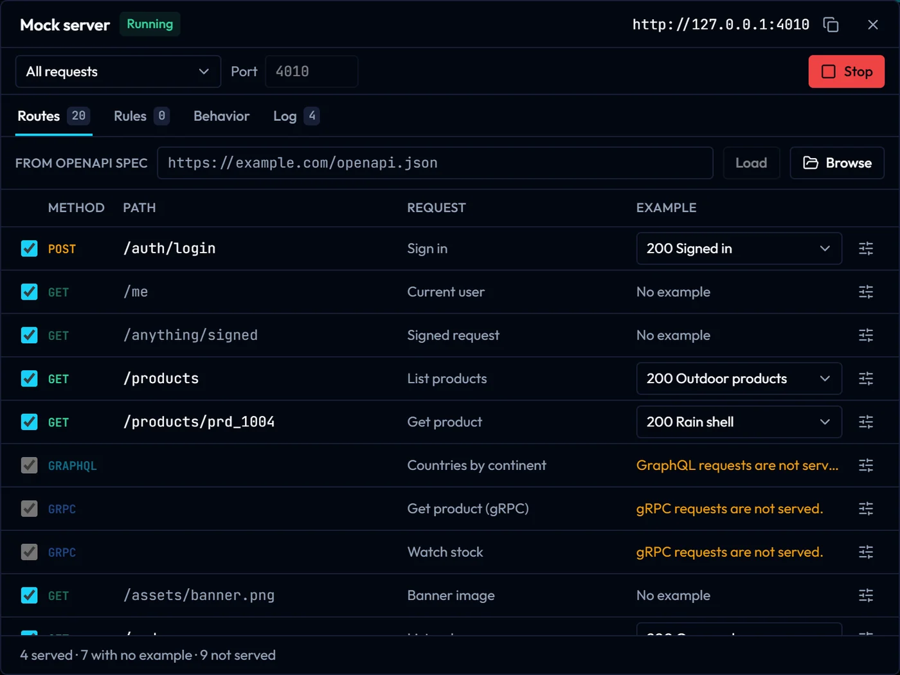
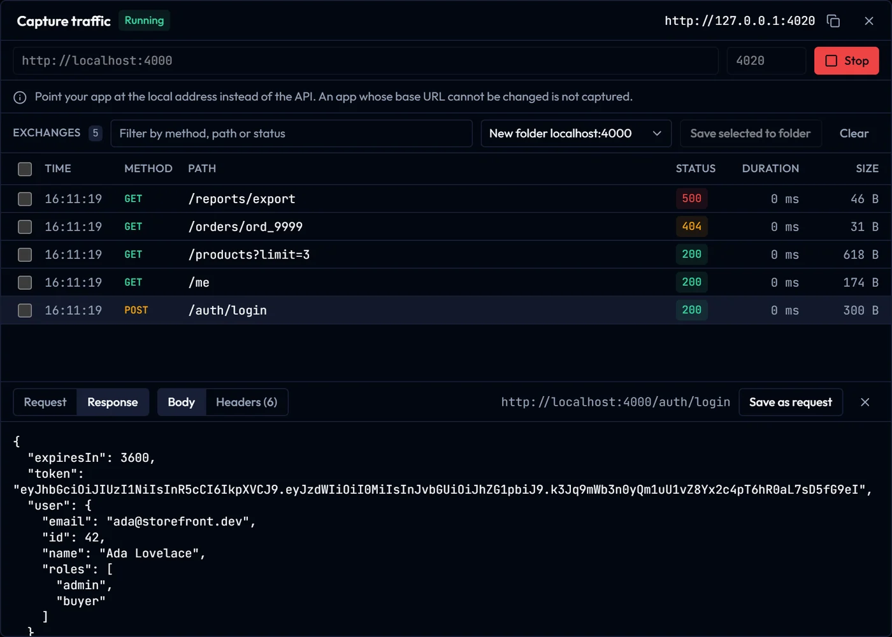

# Folders, mock server and capture

## Folders and Git (desktop)

The control next to the logo shows where the collection lives. **Open folder** keeps it as files: `gostman.yaml`, one YAML file per request, one directory per folder and `environments/<name>.yaml`.

- A YAML file is read as a request only when it has a `method` or `url` field, so other YAML files in the folder, such as Kubernetes manifests or CI workflows, are left out.
- A directory without a `folder.yaml` that holds no requests, such as `docs/` or `assets/`, is not shown in the sidebar.
- OAuth tokens, cookies, history, network settings and open tabs are never written to the folder.
- Values typed into environments and auth fields are written as typed. Keep secrets in an environment file that Git ignores, or pass them at run time.
- After a `git pull`, choose **Reload from disk**. Files that cannot be read are listed and left untouched.
- A folder you did not create opens with its scripts, OAuth 2.0 settings and local MCP commands switched off until you choose **Trust this folder**.

## Examples and the mock server (desktop)

Save any response as a named example from the response panel (up to 20 per request, 2 MB each; cookie and authorization headers are not kept). The mock server, opened with **Mock server** at the bottom of the window, serves each request's method and path with one of its examples on `127.0.0.1`.

- `{{base_url}}/users/42` is served at `/users/42`; a literal base path such as `/v1` is kept. A path segment written `:id` or holding a variable, such as `/users/{{user_id}}`, matches any value, whatever the variable holds, and its value is available as `{{request.params.user_id}}`. A variable that holds several path segments, such as `api/v1`, is treated as one segment, so write those segments out in the URL instead.
- GraphQL, gRPC and WebSocket requests, and requests without an example, are not served.
- Examples travel with exports and workspace folders, so they can contain whatever the response body held.
- **From OpenAPI spec**: load a spec from an address or a file and every operation becomes a route (base path from `servers`, `{id}` segments typed by the spec, status codes, headers and example bodies from the spec). Operations without an example answer with an empty body.
- **Rules** run before the routes, in the order listed; the first match wins. A rule can match the method, a path template, query parameters, headers and JSON body values (`$.user.name`) and then override the status, headers and body, or only answer its Nth match.
- **Templating**: response bodies and headers can use `{{request.params.id}}`, `{{request.query.x}}`, `{{request.header.x}}`, `{{request.body.json.path}}` and the dynamic variables `{{$guid}}`, `{{$timestamp}}`, `{{$randomInt}}`. Missing values render empty, and values are escaped inside JSON responses.
- **Behavior**, for the whole server or one route or rule: a fixed or ranged delay, a slow body, and failures (an error status, a connection reset or an empty reply) at a chosen rate. CORS is off by default; when on, only localhost origins (any port, `127.0.0.1`, `[::1]`) are answered, and the CLI's repeatable `--cors-origin https://app.example.com` adds exact extra origins. Other origins get no CORS headers.
- **Log**: the last 500 requests with headers and body (up to 4 KB). Credential-like header names and query parameters show as `***`.
- Rules, per-route options and an imported spec are saved in `.gostman/mock.yaml` of a workspace folder, or in the app data folder otherwise. The server binds to `127.0.0.1` only, refuses other `Host` headers, never reads files, and caps request bodies at 10 MB, responses at 10 MB, routes at 10,000 and rules at 200.

## Capture (desktop and CLI)

Start a capture with the address of your API, then point your app at `http://127.0.0.1:4020`. Gostman forwards each call, lists it, and lets you save any of them as a request with its response as an example.

- It is a forwarding address for one API, not an intercepting proxy: there is no certificate to install, and an app whose base URL cannot be changed is not captured.
- `Authorization`, `Cookie` and `Proxy-Authorization` request headers are never saved. Bodies are saved as captured, so check them for tokens before sharing.
- Only requests from localhost pages are forwarded. On an Android emulator use `adb reverse tcp:4020 tcp:4020`.
