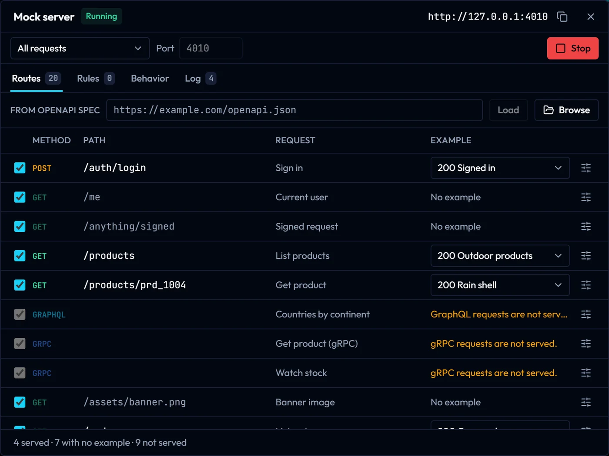
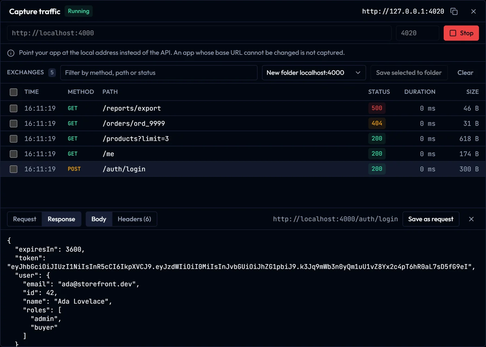

# Folders, mock server and capture

## Folders and Git (desktop)

The control next to the logo shows where the collection lives. **Open folder** keeps it as files: `gostman.yaml`, one YAML file per request, one directory per folder, `environments/<name>.yaml`, `flows/<name>.yaml` for [flows](flows.md) and `specs/<name>.yaml` or `specs/<name>.json` for the [OpenAPI specs](import-export-and-specs.md#designing-an-api) you write. A top-level `flows` folder is kept for flows; one made by an older version that holds requests (it has a `folder.yaml`) stays a folder of requests, and flows cannot be saved in that workspace until it is renamed. When the folder you pick already holds other files, such as a repository root, the collection goes in a `gostman` folder inside it, the same place `gostman init` uses, and the workspace is listed under the name of the folder you picked.

- A YAML file is read as a request only when it has a `method` or `url` field, so other YAML files in the folder, such as Kubernetes manifests or CI workflows, are left out.
- A directory without a `folder.yaml` that holds no requests, such as `docs/` or `assets/`, is not shown in the sidebar.
- `order` in a request file and in `folder.yaml` places the item among everything in the same directory. With `sharedOrder: true` in `gostman.yaml`, requests and folders share one numbering, so a request with `order: 1` sits above a folder with `order: 2`; new workspaces and `gostman import` write it. Without it, as in folders made by older versions, each directory shows its folders first, until the first move or import, in the app or by an agent, writes the numbers and the marker. A new request or folder goes last.
- Collection variables shared by every request are `variables` in `gostman.yaml`. A top-level folder's `folder.yaml` can hold the collection's own as `collectionVariables`, which win over the shared ones for its requests, as in the app's own storage; their secret and off marks are `collectionVariablesMeta`, and secret values are never written. See [Environments per collection](variables.md#environments-per-collection).
- A request's tags are a list under `tags`, after `description`, for example `tags: [smoke, regression]`. Leading and trailing spaces are dropped, and a tag repeated with different case is kept once, in its first spelling. Files without `tags` load as before.
- OAuth tokens, cookies, history, network settings and open tabs are never written to the folder.
- Values typed into environments and auth fields are written as typed. Keep secrets in an environment file that Git ignores, or pass them at run time.
- Changes made outside the app, by a `git pull`, a branch switch or an editor, are picked up within a few seconds: the open folder's YAML files and its `.env` are checked every two seconds, and once they have stopped changing the collection is reloaded and a short notice says so. Hidden entries such as `.git/` and `.gostman/` are not watched, and the app's own saves do not count as changes.
- A tab with unsaved edits keeps them. When its request changed on disk, the tab shows **This request changed on disk while you were editing it** with **Keep my edits** (saving then overwrites the file) and **Load from disk** (drops the edits). When its file was deleted or can no longer be read, the tab keeps its content as an unsaved request.
- **Reload from disk** reloads at once and lists files that cannot be read; they are left untouched. After an automatic reload the notice only counts them.
- The open folder is not part of the app's [automatic backups](preferences-and-shortcuts.md#backups); its history is whatever you commit to Git.
- A folder you did not create opens with its scripts, OAuth 2.0 settings, local MCP commands and file reads switched off until you choose **Trust this folder**.

## Examples and the mock server (desktop)

Save any response as a named example from the response panel (up to 20 per request, 2 MB each; cookie and authorization headers are not kept). The mock server, opened with **Mock server** at the bottom of the window, serves each request's method and path with one of its examples on `127.0.0.1`.



- `{{base_url}}/users/42` is served at `/users/42`; a literal base path such as `/v1` is kept. A path segment written `:id` or holding a variable, such as `/users/{{user_id}}`, matches any value, whatever the variable holds, and its value is available as `{{request.params.user_id}}`. A variable that holds several path segments, such as `api/v1`, is treated as one segment, so write those segments out in the URL instead.
- GraphQL, gRPC, MCP and WebSocket requests, and requests without an example, are not served. A call to the route of a request without an example answers 404 with a message that names the request and says to save one of its responses as an example; the log shows the request with **no example**.
- A route answers with the example chosen for it, or the default example. A request can ask for another example of the route with Postman's headers: `x-mock-response-name: Not found` picks the example with that name (case does not matter), `x-mock-response-code: 404` the first example with that status, and both together the example that matches both. When no example matches, the answer is a 404 that says so. Rules go first: a request that a rule matches gets the rule's answer.
- Examples travel with exports and workspace folders, so they can contain whatever the response body held.
- **From OpenAPI spec**: load a spec from an address or a file and every operation becomes a route (base path from `servers`, `{id}` segments typed by the spec, status codes, headers and example bodies from the spec). Operations without an example answer with an empty body.
- **Rules** run before the routes, in the order listed; the first match wins. A rule can match the method, a path template, query parameters, headers and JSON body values (`$.user.name`) and then override the status, headers and body, or only answer its Nth match.
- **Data file rules** (see [Data file rules](#data-file-rules)): a rule can pick its response from a row of a CSV, JSON or XLSX file.
- **Templating**: response bodies and headers can use `{{request.params.id}}`, `{{request.query.x}}`, `{{request.header.x}}`, `{{request.body.json.path}}` and the dynamic variables `{{$guid}}`, `{{$timestamp}}`, `{{$randomInt}}`. Missing values render empty, and values are escaped inside JSON responses.
- **Behavior**, for the whole server or one route or rule: a fixed or ranged delay, a slow body, and failures (an error status, a connection reset or an empty reply) at a chosen rate. CORS is off by default; when on, only localhost origins (any port, `127.0.0.1`, `[::1]`) are answered, and the CLI's repeatable `--cors-origin https://app.example.com` adds exact extra origins. Other origins get no CORS headers.
- **Rules file**: **Export rules** and **Import rules** on the Rules tab save and read the rules as a separate YAML file (`kind: gostman-mock-rules`), so a set of rules can move between workspaces. Imported rules arrive switched off.
- **Log**: the last 500 requests with headers and body (up to 4 KB). Credential-like header names and query parameters show as `***`.
- Rules, per-route options and an imported spec are saved in `.gostman/mock.yaml` of a workspace folder, or in the app data folder otherwise. The server binds to `127.0.0.1` only, refuses other `Host` headers, reads files only for [data file rules](#data-file-rules), and caps request bodies at 10 MB, responses at 10 MB, routes at 10,000 and rules at 200.

## Data file rules

A rule can answer from a data file, in the same formats as the runner's [data files](runner-load-and-scan.md#data-files) (CSV, JSON array of objects, or the first sheet of an XLSX workbook, the first row naming the columns). In the **Data file** part of a rule, name the file, what to match in the request (a path parameter such as `id`, a query value, a header, or a JSON body path such as `$.user.id`) and the column to compare it with. In `.gostman/mock.yaml`:

```yaml
rules:
  - name: user by id
    method: GET
    path: /users/{id}
    data: { file: users.csv, field: param, name: id, column: id }
```

A request whose value equals a cell of the column gets that row as a JSON object; with a rule body, the body is used instead and `{{row.name}}` fills in a column of the row. When two rows share a value the first wins, and a request with no matching row (or an empty value) does not match the rule, so later rules and the routes answer it. The rule's status, headers and behavior apply as usual.

The file is read when the server starts or the rules change, from the open workspace folder only (a path outside it is refused), up to 100,000 rows. An untrusted folder cannot read files until you trust it, the web app has no mock server, and rules imported from a rules file or run by an agent session never read files.

## Capture (desktop and CLI)

Open **Capture** at the bottom of the window and start a capture with the address of your API, then point your app at `http://127.0.0.1:4020`. Gostman forwards each call, lists it, and lets you save any of them as a request with its response as an example.



1. Type the API your app talks to in **API to forward to**, such as `https://api.example.com`.
2. **Port** is the local port to listen on, 4020 unless you change it. Both fields are locked while the capture runs.
3. Press **Start**. The header shows **Running** and the local address; **Stop** ends the capture.

Each call appears as a row with its time, method, path, status, duration and size. Type in the filter to narrow the list by method, path or status. Select a row to see its request and response, body or headers, below the list; **Save as request** opens it in a new tab.

To save several calls at once, tick their rows (the box in the header ticks every row shown), choose a folder in **Folder to save into** and press **Save selected to folder**. The first choice is a top-level folder named after the API's host, created when needed; you can also pick **Top level** or any existing folder. Each call becomes a request with its response as an example, and repeated calls to the same method and path are saved once. **Clear** empties the list.

## Calls, rules and held calls

The capture dialog has three views. **Calls** is the list above. **Rules** edits the [capture rules](#capture-rules) below: add, reorder and switch them off, import and export them as a YAML file (imported rules arrive switched off), and set how long a held call waits. Rules take effect on the running capture as soon as they are saved. **Held** lists the calls that a rule with a breakpoint is holding.

- **Breakpoints**: a rule with **Hold the request** stops a matching call before it goes to the API, and **Hold the response** stops the answer before it goes back to your app. The Held view shows the method, URL, headers and body of a held request, or the status, headers and body of a held response, and you can edit them. **Release** sends the edited call on, **Drop** closes the connection without an answer. A held call that nobody releases within the timeout (60 seconds unless you change it, at most an hour) goes on unchanged. At most 25 calls are held at once; further matching calls pass through. A body over 2 MB is not held. Held calls are shown only in the app and are not written to logs.
- **Export HAR** saves the exchanges you ticked, or all shown, as a HAR 1.2 file that other tools and Gostman's HAR import read. `Authorization`, `Cookie`, `Proxy-Authorization` and `Set-Cookie` values show as `***`. Exchanges that were closed before a URL was known are left out.
- **Make mock rule** adds a [mock server](#examples-and-the-mock-server-desktop) rule that answers the call's method and path with the captured status, headers and body (complete text responses only). **Answer with this** adds a capture rule that does the same inside the capture.
- **Compare responses** opens the body or headers of two ticked exchanges side by side.
- A row's detail lists the rules that fired and what happened at a breakpoint.

## Capture rules

Rules change what the capture does with a call. Every enabled rule whose match fits applies, in the order listed. The first rule that answers locally or injects a failure decides the answer; the others add their header and body edits only when the call is forwarded. The journal lists the names of the rules that fired in each row.

A rule is written in `.gostman/capture.yaml` of a workspace folder, or `capture.yaml` in the app data folder otherwise, and `gostman capture --rules rules.yaml` reads any file with a `rules` list (an export from the app works too). Up to 200 rules.

```yaml
rules:
  - id: add-flag
    name: Turn on the beta flag
    match:
      method: GET,POST
      path: /users/*
      conditions:
        - {field: header, name: X-Env, op: equals, value: staging}
    request:
      setHeaders: [{key: X-Beta, value: "1"}]
      removeHeaders: [If-None-Match]
    response:
      setHeaders: [{key: Cache-Control, value: no-store}]
      body:
        - {path: "$.user.plan", value: '"pro"'}
        - {find: "http://old.example.com", replace: "https://api.example.com"}
  - id: stub
    name: Stub the health check
    match: {path: /health}
    answer: {status: 200, body: '{"ok":true}', contentType: application/json}
  - id: slow-search
    match: {path: /search*}
    delayMs: 800
    throttle: {downloadKBps: 20}
```

- **Match**: `method` (a comma-separated list), `host` (the upstream host and port; `*` matches any text), `path` (the request path without the query; `*` matches any text), `pathRegex` (a Go regular expression, matched anywhere in the path) and `conditions` on query parameters and headers (`equals`, `contains` or `exists`). A field left out matches everything.
- **Edit the request or the response**: `setHeaders`, `removeHeaders` and `body` changes, applied in order. A body change is `find` and `replace` (plain text, or a regular expression with `regex: true`, where `$1` in `replace` inserts a group), or `path` and `value` for JSON. A `path` looks like `$.user.name`, `$.items[0].id` or `$.items[*].id`; `value` is read as JSON when it parses (`'"pro"'`, `9`, `true`) and used as text otherwise. A JSON body that is rewritten keeps its values, but its keys come out in alphabetical order. Response bodies are decoded from gzip first; bodies over 2 MB and request bodies with a `Content-Encoding` are left alone.
- **Map Remote**: `mapRemote: https://staging.example.com` sends the matching call there instead of to the upstream, keeping the path and query.
- **Map Local**: `answer` replies without contacting the upstream, with a `status`, `headers`, a `body` (`bodyEncoding: base64` for binary) and a `contentType`, or with `file: stubs/users.json`, read from inside the workspace folder (or the folder of the `--rules` file) and refused outside it. Up to 10 MB.
- **Delay, failure and bandwidth**: `delayMs` (and `delayMaxMs` for a random time in between), `fault` with `percent`, `kind` (`status`, `reset` or `empty`) and `status`, the same as in the [mock server](#examples-and-the-mock-server-desktop), and `throttle` with `latencyMs`, `downloadKBps` and `uploadKBps`.
- **Breakpoints**: `break: request`, `response` or `both` holds the call in the desktop app. `gostman capture` refuses rules that break, because nothing could release them.
- Rules from an imported rules file arrive switched off.
- **Trust**: rules can send traffic to another host and read files, so they count as active content. A folder you did not create loads its `.gostman/capture.yaml` with every rule switched off and the Rules tab cannot change it until you choose **Trust this folder**. `gostman capture` never reads rules from a workspace on its own; pass `--rules file.yaml`, and it prints each Map Remote destination and answer file at start. An answer file is read only from inside the workspace folder (or the folder of the `--rules` file); absolute paths and `..` are refused. Capture rules are not available to coding agents.

- It is a forwarding address for one API, not an intercepting proxy: there is no certificate to install, and an app whose base URL cannot be changed is not captured.
- `Authorization`, `Cookie` and `Proxy-Authorization` request headers are never saved. Bodies are saved as captured, so check them for tokens before sharing.
- Only requests from localhost pages are forwarded. On an Android emulator use `adb reverse tcp:4020 tcp:4020`.
