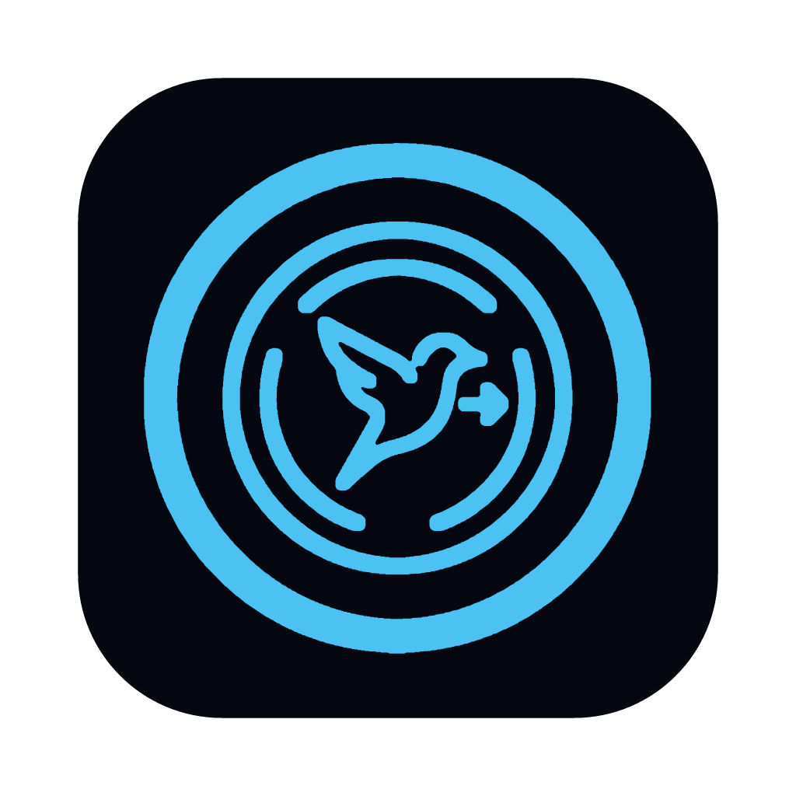
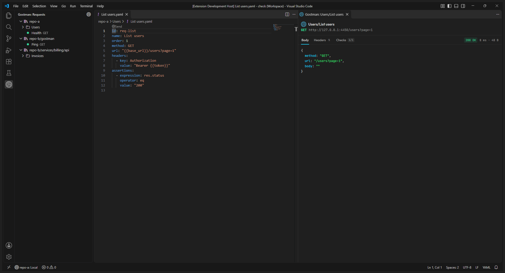
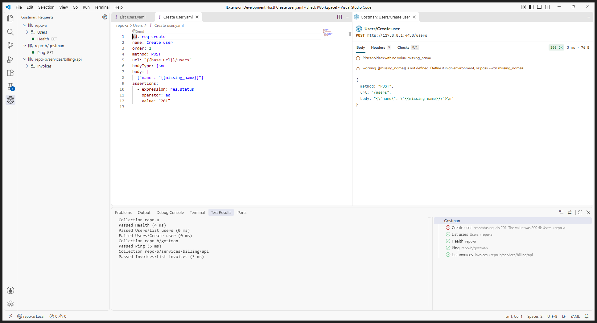

<h1 align="center">Gostman for VS Code</h1>

The free, open source API client, in your editor. Send requests from their files and run your collections, with their checks, in the Test Explorer.

The extension calls the Gostman command line, so a request or a run in VS Code gives the same result as the app, a run in CI and the MCP server. The response panel follows the Gostman app: the same tabs, status colours, fonts and JSON colours, drawn from your VS Code theme, in light, dark and high contrast.

## Requirements

Install the Gostman CLI. The extension starts `gostman` from the PATH, or from `GOBIN`, `GOPATH/bin` or `~/go/bin` where `go install` puts it (and `/opt/homebrew/bin`, `/usr/local/bin` or `~/.local/bin` on macOS and Linux); anywhere else, set `gostman.path` to the full path. Downloads: https://github.com/kunalgoesbyken/gostman/releases

## Collections

A collection is a folder that holds `gostman.yaml`. The extension finds every collection in every workspace folder, at its root or up to four folders below it, such as the `gostman` folder that `gostman init` creates in a repository. Hidden folders, `node_modules`, `bower_components`, `vendor` and `__pycache__` are skipped. With several collections, the Testing view shows one item per collection, the status bar shows the environment of the active editor's collection, and the commands use that collection or ask which one. The extension does not run in virtual workspaces.

## Send from the file

Open a request file of the collection, or pick it in the **Requests** view under the Gostman icon in the activity bar. A **Send** lens above the first line, or the send button next to the request in the view, runs `gostman send --json <id>` and shows the response in a panel beside the editor: the status, time and size, then **Body**, **Headers**, **Checks** and **Console** tabs, with JSON bodies formatted. The panel is plain HTML with no scripts and a strict content security policy. Secret values stay redacted as `{{name}}`; the extension never passes `--reveal`. An unsaved file is saved first. The panel also lists placeholders that had no value, secrets Gostman did not fill in, skipped requests, script logs and the CLI's warnings, so a literal `{{token}}` from a wrong or missing environment is explained. Bodies are shown as received.

## Test Explorer

The folders and requests of each collection appear in the Testing view. Run everything, a collection, a folder or a request: the extension runs `gostman run . --reporter json --redact` in each collection, with `--folder` or `--only`, and marks each request passed or failed. A failed request shows the failed checks, or the error, as its message.

## Environment

The status bar shows the environment passed as `--env`. Select it, or run **Gostman: Select environment**, to choose one of the files in the collection's `environments` folder. Each collection keeps its own choice in VS Code's workspace storage, never in a committed file; a collection with no choice uses the `gostman.environment` setting, which a team can commit as a shared default. The environment is used by Run collection, Run a folder, Send a saved request, Run a flow, the Send lens and the Test Explorer; Scan, Lint, Create a collection and Open the documentation do not take an environment. The status bar item shows a warning when the stored name is not one of the collection's environments.

## Commands

Open the Command Palette and type `Gostman`.

| Command | Runs |
| --- | --- |
| Run collection | `gostman run .` |
| Run a folder of the collection | `gostman run . --folder <name>` |
| Send a saved request | `gostman send --workspace . <request>` |
| Send this request | `gostman send --json <id>`, also the Send lens |
| Select environment | sets `--env` for the commands that take one |
| Run a flow | `gostman flow run <name> --workspace .` |
| Lint an OpenAPI spec | `gostman lint <file>`, also in the Explorer context menu |
| Scan the collection for leaked secrets | `gostman scan .` |
| Create a collection in this folder | `gostman init .` |

The commands that are not the lens or the Testing view show their output in a terminal named after the collection. Create a collection in this folder asks for the workspace folder when there are several. Every command line the extension starts, and what the CLI printed to stderr, is logged in the **Gostman** output channel.

## Settings

- `gostman.path`: command that starts the CLI.
- `gostman.environment`: environment name passed as `--env` for collections where none was selected; empty uses the first environment of the collection.

## Trust

Running a collection sends requests and runs its scripts, so the extension is off in untrusted workspaces.

## Translating

The text uses VS Code's own localisation. English is the source and the only language so far. To add one, create `package.nls.<locale>.json` (a copy of `package.nls.json`) and `l10n/bundle.l10n.<locale>.json` (a copy of `l10n/bundle.l10n.json`) with the values translated and the keys, `{0}` placeholders and command names kept. The locale is VS Code's display language, such as `de`, `fr`, `pt-br` or `zh-cn`. Request a language, or report a translation, on https://github.com/kunalgoesbyken/gostman/issues/15. After adding a message, run `npm run l10n:export` to refresh `l10n/bundle.l10n.json`.

Documentation: https://gostman.com/docs
